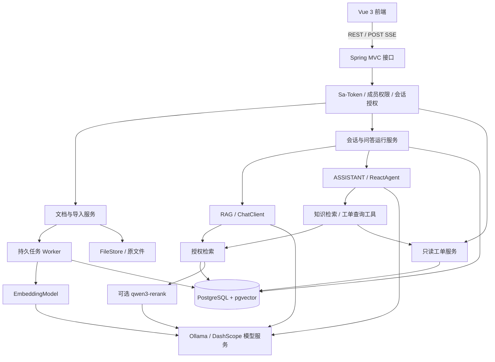

# SupportAI

**基于 Spring AI Alibaba 的企业技术支持 AI 助手**

SupportAI 面向研发与技术支持人员，将业务文档、故障处理经验和工单查询整合到同一个问答入口。通过检索增强生成（RAG）提供带原文依据的回答，通过受控工具查询工单当前状态，让每次回答都能核对来源。

**目标版本：V1.0.0 · 当前阶段：F01 真实模型待验收，F02—F13 已实现待完整验收，F14—F19 尚未实现，F20 独立能力已实现待前置与场景验收，F21 评测资产已实现待真实基线，F22—F24 质量优化能力已实现待同集实测与配置冻结**

当前仓库包含 Maven 多模块 Spring Boot 后端、Vue 登录、运行状态、知识库、文档检查与流式问答页面以及 PostgreSQL 开发配置，已实现 Sa-Token Cookie 登录态与 CSRF 防护、springdoc-openapi + Knife4j 接口文档、MyBatis-Plus 数据访问，以及 Ollama / DashScope 的 Chat 与 Embedding 配置。F03—F13 已形成知识库授权、文档上传与原子发布、授权检索、带来源问答和流式回答链路；聊天取消、run 状态查询与断线恢复仍属于尚未实现的 F14。

F20 已新增导入任务 retry/cancel POST 接口、WRITE 权限与 CSRF 边界、自动重试和终止失败分类、原子 pending 清理与重新取得、租约失效隔离、错误阶段提示，以及前端重新处理和取消交互。定向后端单元测试、安全测试、Testcontainers 数据库测试、前端 55 项测试和生产构建已通过；隔离数据库已执行 Flyway V1—V11，开发数据卷仍只确认到 V10。F20 依赖的 F18、F19 尚未实现，真实模型失败、浏览器场景和完整前置链路未验收，认证后的 OpenAPI JSON 500 基线问题也仍存在，因此 F20 保持未勾选。

F21 已建立 60 道开发题和 40 道固定测试题、7 份可上传版本语料、66 个稳定证据段、JSON Schema、固定测试集 SHA-256 校验及人工结果汇总工具。F12 的 20 道功能题与同事实改写均限制在开发集；问答运行新增无密钥模型/检索/提示词配置快照，并分别记录检索与生成耗时。Node 评测测试 2/2、后端定向测试 25/25 已通过；本机 Ollama 与后端不可连接，且 F18—F20 前置链路未完整验收，因此没有生成或伪造基础分数，F21 保持未勾选。

F22 已在统一授权仓储中加入错误码、HTTP 方法与接口路径、业务标识符和显式术语的精确关键词召回，与向量候选按稳定 chunk ID 去重并使用 RRF 融合；两路共享成员、会话、当前发布版本、删除状态和嵌入空间过滤。问答默认策略仍为 `VECTOR`，WRITE 调试接口可显式选择 `FUSION`；运行快照记录策略及融合参数。定向单元测试 22/22、评测脚本 3/3、Testcontainers 数据库测试 4/4 通过；同一开发集真实双跑尚未执行，因此 F22 保持未勾选。

F23 已增加独立 qwen3-rerank HTTPS 适配器，只对统一授权检索返回的候选按稳定下标重排，不生成新候选或改变来源标识；候选数、单项与总 Token、超时、响应下标和分数均受校验。没有候选时跳过调用，输入超限、模型不可用或异常响应时返回基础排序。开关默认关闭，配置与运行状态可追溯，评测脚本支持同一开发集关闭/开启对比；真实质量、用量和耗时双跑尚未执行，因此 F23 保持未勾选。

F24 已增加证据正文 Token 预算和向量、融合、重排序三类最终分数阈值，筛选发生在二次授权后、来源登记和 Chat 调用前；运行指标记录筛选前后数量、预算用量及未知的 Embedding Token。`f24-v1` 快照明确 Chat/Embedding/Rerank 角色并携带完整索引配置哈希，五条授权检索 SQL 均拒绝混用不同分块或 Embedding 配置的索引。评测工具支持三策略统一报告和严格单因素比较；真实开发集尚未运行，默认继续使用 `VECTOR` 且关闭重排序，F24 保持未勾选。

F09 前置依赖仍未验收，因此 F10—F13 均不能勾选；M1/M2 复核记录中的真实模型、开发数据和场景缺口也仍有效。阶段产出统一存放于 [验收记录](doc/验收记录/)，综合结论见 [M1-M2 阶段验收复核](doc/验收记录/M1-M2阶段复核.md)，F10—F13、F20—F24 的实现和待验收项见对应记录；完成状态以开发计划中的勾选记录为准。

[技术设计大纲](doc/技术设计大纲.md) · [功能开发计划](doc/开发计划.md) · [后端模块结构](doc/后端模块结构.md)

## 业务场景

项目以模拟订单系统为业务背景，围绕技术支持中的具体问题展开：

- **查业务资料**：“支付回调成功，但订单仍待支付，应该检查哪些配置？”
- **查错误码与接口**：“这个错误码代表什么？创建订单接口有哪些必填参数？”
- **连续追问**：“上面提到的配置在哪里修改？还有哪些排查步骤？”
- **查工单状态**：“工单 T10086 目前是什么状态？结合处理规范说明下一步。”

文档类问题通过授权知识库检索回答；工单当前状态通过业务服务查询。资料不足或查询失败时给出明确反馈。

## V1.0.0 功能范围

| 模块 | 计划实现的能力 |
| --- | --- |
| 账号与授权 | 登录、退出、知识库成员管理、READ/WRITE 权限、个人会话隔离 |
| 知识管理 | Markdown/TXT 上传、解析分块、原文预览、版本发布、文档删除 |
| 导入管理 | 持久任务、处理进度、失败提示、重试、取消与中断恢复 |
| 知识问答 | 授权向量检索、关键词融合、可关闭的重排序、资料不足处理 |
| 会话与引用 | 流式输出、原文引用、历史会话、有限多轮上下文、追问改写 |
| 运行控制 | 请求幂等、单会话运行约束、取消生成、断开连接后的状态查询 |
| 业务助手 | Spring AI Alibaba ReactAgent、知识检索工具、只读工单查询工具 |
| 质量与交付 | 固定题集评测、用量与错误记录、单实例部署、备份恢复验证 |

V1.0.0 聚焦文本知识与只读业务查询。PDF/OCR、图片问答、多租户 SaaS、跨会话长期记忆、知识图谱、多智能体、可视化工作流和工单写操作不在本版本范围内。

## 设计重点

**回答有据可查。** 记录所有实际进入模型的文档证据和成功工具结果，引用能够定位到具体文档版本、章节或工单查询。资料不足时明确说明。

**授权覆盖整个处理链路。** 检索、原文预览、历史消息和工具调用均执行权限检查。ADMIN 的管理身份不自动获得资料读取权；共享知识库的成员也不能读取彼此的个人会话。

**知识更新具有确定结果。** 文档的新版本完整处理后才切换为有效版本；更新失败时旧版本继续服务。逻辑删除立即使资料退出检索，失效 Worker 不能将已删除内容重新发布。

**多轮对话保留证据关系。** 历史消息再次进入模型前，重新检查来源权限与有效版本；后续转述继续保留根证据，避免失效知识经由历史摘要再次进入回答。

**生成与工具调用可控制。** 每次问答有独立运行记录；相同请求键复用已有运行。取消、失败和完成具有明确终态。工具采用白名单，仅允许知识检索和工单查询。

## 技术选型

以下为设计基线，精确依赖版本、模型可用性与兼容性在工程初始化和接入验证中确认。

| 层面 | 选型 |
| --- | --- |
| Java | JDK 21 |
| Web 服务 | Spring Boot 3.5.x、Spring MVC；初始验证基线为 3.5.8 |
| AI 框架 | Spring AI Alibaba 1.1.2.2、Spring AI 1.1.2、SAA Extensions 1.1.2.2 |
| 生成模型 | 默认本机 Ollama `qwen2.5:3b`；可切换北京地域 DashScope `qwen-plus` |
| 向量模型 | 默认 Ollama `bge-m3`；可切换 DashScope `text-embedding-v4`，统一校验 1024 维 |
| 重排序 | qwen3-rerank，独立适配、支持关闭与失败回退 |
| 数据存储 | PostgreSQL 16 + pgvector 0.8.x |
| 数据访问与迁移 | MyBatis-Plus 3.5.17（Spring Boot 3 专用 Starter）、Flyway |
| 身份认证 | Sa-Token 1.46.0、Cookie 登录态、Servlet Session CSRF、jBCrypt |
| 接口文档 | springdoc-openapi 2.9.1、Knife4j 4.5.0、OpenAPI 3.0 |
| 前端 | Vue 3、TypeScript、Vite、Element Plus |
| 实时响应 | POST + fetch 消费 SSE，后端使用 SseEmitter |
| 后台任务 | PostgreSQL 持久任务表、有界执行器、租约与幂等 |
| 文件存储 | 受控本地目录与持久卷，通过 FileStore 隔离实现 |
| 部署 | Docker Compose：web、app、postgres |
| 验证与观测 | JUnit、Spring Boot Test、Testcontainers、Vitest、Actuator、结构化日志 |

Spring AI、SAA Extensions 和 SAA 分别使用对应 BOM 管理依赖。模型、文件存储与检索存储通过适配边界接入，便于按需求替换；更换向量模型或维度时需要重建索引并同步切换查询配置。

## 系统架构

采用 **模块化单体后端 + 独立前端 + PostgreSQL**。数据库同时保存业务数据、导入任务和向量，文件保存在受控目录中。



### 两种问答模式

| 模式 | 处理方式 | 适用场景 |
| --- | --- | --- |
| RAG | 由应用明确编排检索、证据筛选与 ChatClient 生成 | 错误码、接口说明、故障排查等文档问题 |
| ASSISTANT | 由 ReactAgent 在受控范围内选择知识检索和工单工具 | 需要查询业务状态或结合文档解释的问题 |

知识工具返回带来源的片段，由主 Agent 统一生成回答。工单工具检查用户权限与当前会话范围；询问当前状态时重新查询业务数据。工具调用默认每轮最多 2 次，并受模型轮次和执行预算约束。

### 核心处理流程

**文档入库**

上传与写权限检查 → 创建版本和持久任务 → 解析分块 → 批量向量化 → 写入分块与向量 → 完整性检查 → 原子激活版本。

**知识问答**

创建运行记录 → 授权与合法历史选择 → 可选追问改写 → 向量/关键词检索 → 融合与可选重排序 → 登记输入证据 → 流式生成 → 校验引用 → 保存运行结果。

**知识维护**

新版构建期间继续使用旧版；新版发布后仅检索当前版本。正常历史版本可用于来源查看，失效来源不再进入模型上下文。撤权后重新校验会话范围与来源，文档删除后拒绝原文预览。

## 项目分层与工程组织

所有 Controller 统一放在 bootstrap 的 `com.haha.supportai.controller.<业务>` 下；其余代码先按业务模块归属，再按职责细分包。简单业务模块直接使用职责包，复杂业务可先增加功能子包，再按职责细分：

| 职责包 | 主要职责 |
| --- | --- |
| bootstrap 下的 controller.<业务> | 参数校验、HTTP 状态、SSE 和文件响应，调用所属业务模块的 service |
| service | 业务用例、授权、状态规则、短事务与调用编排；不为单一实现创建空接口 |
| entity.dto / entity.vo | 本业务的请求或内部传输对象 / 对外响应对象 |
| filter / handler / exception / config | 过滤器、异常处理、业务异常与装配配置 |
| security / access / model / support | 身份安全、资源授权、模型适配及其他有明确职责的支撑代码 |
| data 下的业务域 entity.po / enums / repository / mapper | 数据库实体、持久化枚举、业务查询门面与 MyBatis Mapper |

后端采用 9 个子模块，加父工程共 10 个 Maven 工程。只有 bootstrap 生成可执行 Spring Boot JAR；F03—F05 的知识库、成员授权和文档上传代码已落入 knowledge、identity、data、storage 和 bootstrap，尚未实现的业务继续使用包说明预留职责：

```text
support-ai/
├── backend/
│   ├── pom.xml                 # support-ai-parent：聚合、版本与构建规则
│   ├── support-ai-common/      # 响应、异常、traceId 与公共 Web 支撑
│   ├── support-ai-data/        # MyBatis-Plus、类型映射、按业务分包的实体与数据访问
│   ├── support-ai-storage/     # FileStore 与受控本地原文件存储
│   ├── support-ai-identity/    # 账号认证、Sa-Token、CSRF 与身份 DTO/VO
│   ├── support-ai-ai/          # Ollama / DashScope Chat、Embedding 与重排序模型接入
│   ├── support-ai-knowledge/   # 知识库、文档上传、解析分块、向量发布、授权查看、融合与重排序编排
│   ├── support-ai-conversation/ # 个人 RAG 会话、运行约束、来源登记与流式回答编排
│   ├── support-ai-assistant/   # 工单、ReactAgent 边界，待 F25 起实现
│   └── support-ai-bootstrap/  # 唯一启动入口、全部 Controller、应用装配与集成测试
│       ├── src/main/java/com/haha/supportai/
│       │   ├── SupportAiApplication.java
│       │   ├── controller/identity/ # 认证与管理员账号目录接口
│       │   ├── controller/knowledge/ # 知识库、成员、文档、任务与检索调试接口
│       │   ├── controller/conversation/ # 个人 RAG 会话创建与流式消息接口
│       │   └── config/
│       └── src/main/resources/
│           ├── application*.yml
│           └── db/migration/   # 按全局顺序管理的 Flyway 迁移
├── frontend/                   # Vue 登录、运行状态与知识库页面
├── evaluation/                 # 100 题评测集、契约、校验脚本与结果状态
├── data/demo/knowledge/f21/    # F21 可上传的脱敏模拟知识语料
├── deploy/                     # 开发数据库 Compose，完整部署在 F31
├── doc/
│   ├── 技术设计大纲.md
│   ├── 开发计划.md
│   └── 验收记录/              # 阶段验收记录统一存放，后续直接新增
└── README.md
```

`data` 统一提供 MyBatis-Plus、数据库驱动、连接池与类型映射，并按业务分包承载实体 PO、持久化枚举、Repository 和 Mapper；当前 `AppUser`、`UserRoleEnum`、`AppUserRepository`、`AppUserMapper` 分别位于 `com.haha.supportai.data.identity` 下的 `entity.po`、`enums`、`repository`、`mapper` 包。业务服务通过 Repository 调用 Mapper，不直接使用 JdbcTemplate 或 RowMapper。业务授权、事务编排、认证流程与 DTO/VO 留在所属业务模块，跨业务调用仍通过业务服务，不能绕过服务直接访问其他域的 Repository/Mapper。data 不反向依赖 identity；连接参数、Flyway 生产迁移与应用配置集中在 bootstrap。全局 OpenAPI 元信息与 Knife4j 运行装配归 bootstrap，身份配置与异常处理归 identity。F06 的任务租约 SQL 同样由 data 的 Repository/Mapper 承载，业务层只通过服务编排，不绕过租约条件直接更新任务。详细结构见[后端模块结构](doc/后端模块结构.md)。

data 使用 `com.baomidou:mybatis-plus-spring-boot3-starter:3.5.17`，父工程保留 Spring Boot 3.5.8，不重复引入普通 MyBatis Starter。当前 `data.identity`、`data.knowledge` 与 `data.conversation` 已包含账号、知识库、成员、文档、版本、入库任务、`document_chunk`、`vector_store` 以及会话、运行、消息和来源的 PO、Repository 与 Mapper。F05 的 JSONB 配置快照使用显式 SQL 转换；事务内通过 `SELECT ... FOR UPDATE` 锁定启用知识库和成员关系，使上传登记与撤权/改权具有明确顺序。F07 的分块 Mapper 按 `(version_id, chunk_index)` 幂等写入并保留稳定分块 ID；F08 使用向量 TypeHandler 与显式批量 SQL 写入 1024 维向量，业务层在短事务内复核租约并原子发布完整版本。F10 在同一事务中按固定排序锁定全部可读知识库和成员关系，再写入会话及其范围；内部 run 使用显式条件更新和数据库唯一约束维护幂等与单活跃运行。F11 的 `AuthorizedRetrievalRepository` 使用显式 Mapper SQL，在相似度排序前完成实时成员授权、发布状态、固定范围和向量空间过滤。F12 在模型调用前按候选 chunk 再次执行相同边界校验，并在 `REQUIRES_NEW` 独立短事务中核对 run、会话、成对消息、问题及 `chat_session_kb` 后写入所有 `message_source`；回答完成后只将已登记且实际出现的引用编号标为 `is_cited`。F20 使用数据修改 CTE 原子更新 `ingestion_job`、`document_version` 与 `document.pending_version_id`，并在领取、等待重试和写入前复核租约、版本与 pending 归属。F21 在创建 run 时把 Chat/Embedding 提供方和模型、向量维度、TopK、检索策略及提示词版本写入 `config_snapshot`，并在 `metrics` 中保存检索、生成、首增量与总耗时。F22 在同一 `AuthorizedRetrievalRepository` 中提供向量与精确关键词两路查询，复用授权过滤后按 chunk ID 去重并使用 RRF 融合，运行快照继续记录策略和融合参数。F24 进一步在五条向量、关键词和二次复核 SQL 上校验文档处理 `config_hash`，保证查询配置不会混用旧分块或旧 Embedding 索引。UUID、枚举、JSON、向量和时间类型显式映射，数据库结构由 Flyway 管理。PgVectorStore 仅用于隔离接入验证，不参与正式业务写入；完整业务验收仍待前置任务和真实场景完成。

认证控制器和管理员账号目录控制器位于 bootstrap 的 `controller.identity`；知识库元数据、成员、文档、任务、检索调试与来源预览控制器位于 `controller.knowledge`；会话创建和流式消息控制器位于 `controller.conversation`，当前开放 `POST /api/chat/sessions` 与 `POST /api/chat/sessions/{sessionId}/messages`。任务控制器另开放 `POST /api/ingestion-jobs/{jobId}/retry` 与 `POST /api/ingestion-jobs/{jobId}/cancel`，业务层和原子 SQL 均再次校验 WRITE 权限及任务状态。identity 负责账号目录和管理员身份校验，knowledge 由 `AccessPolicy` 统一处理 ADMIN、KB-R、KB-W，并编排原文件落盘、短数据库事务、授权检索和来源读取。F11 调试请求只接受 `query/topK`，拒绝客户端附带的用户、范围、SQL 或自由过滤字段。F13 由 `ChatRunService` 同步完成身份、会话、幂等与 run 准备，再交给有界执行器异步调用 `RagAnswerService`；可信 userId 随准备结果传递，不依赖异步线程中的 Sa-Token 上下文。模型调用位于事务外，来源登记、每个回答增量、成功终态和失败部分文本分别使用短事务持久化；SSE 发送失败只停止推送，不取消后台运行。`AuthenticatedUser` 是内部认证快照，归 `entity.dto`，不作为数据库 PO。业务模块不反向依赖 bootstrap。纯单元测试跟随被测类的包结构，控制器与跨模块集成测试在 bootstrap 内维护。

F23 由 knowledge 将已授权候选交给 ai 的独立 qwen3-rerank 适配器，只按响应下标更新候选顺序和分数；失败时保留基础排序，配置快照与运行指标记录无密钥参数、状态、用量和耗时。

F24 由 conversation 在二次授权后执行分策略分数阈值和 CL100K 证据正文预算，配置快照固定回答参数与当前索引哈希；evaluation 校验三策略同提交运行及严格单因素变更，并将提供方未报告的 Embedding 用量保持为未知值。

## 数据与接口设计

V1.0.0 规划 **15 张业务/向量表、35 个 HTTP 方法与路径组合**。

| 数据域 | 主要表 |
| --- | --- |
| 身份与知识库 | `app_user`、`knowledge_base`、`kb_member` |
| 文档与索引 | `document`、`document_version`、`ingestion_job`、`document_chunk`、`vector_store` |
| 会话与问答 | `chat_session`、`chat_session_kb`、`chat_run`、`chat_message`、`message_source` |
| 工单与工具 | `ticket`、`tool_call` |

接口统一使用 `/api` 前缀，覆盖登录、成员管理、文档与版本、导入任务、检索调试、会话、运行控制和工单查询。普通接口使用 JSON，上传使用 multipart/form-data，问答使用 SSE。

流式事件包括 `start`、`delta`、`tool`、`sources`、`done` 和 `error`。网络断开后通过运行查询接口确认持久状态；相同请求键不会自动再次生成。

字段、约束、完整接口与请求示例见[技术设计大纲](doc/技术设计大纲.md)。

## 开发路线

V1.0.0 按 **7 个累计阶段、32 个任务**逐步增加功能，不按日期排期：

1. **M1 · 账号与知识空间**：F01&#8288;—&#8288;F04，建立工程、登录、知识库和成员授权。
2. **M2 · 文档变成可用知识**：F05&#8288;—&#8288;F09，完成上传、持久任务、解析、向量索引与原文查看。
3. **M3 · 有来源的流式问答**：F10&#8288;—&#8288;F14，完成会话、授权检索、引用、流式输出与运行控制。
4. **M4 · 持续对话与知识维护**：F15&#8288;—&#8288;F20，增加历史、多轮追问、版本更新、删除与导入恢复。
5. **M5 · 检索与回答质量提升**：F21&#8288;—&#8288;F24，建立评测集，验证关键词融合、重排序和默认策略。
6. **M6 · 业务查询助手**：F25&#8288;—&#8288;F28，接入只读工单服务、工具调用与 ReactAgent 多轮助手。
7. **M7 · 可交付的完整产品**：F29&#8288;—&#8288;F32，完成跨功能回归、失败诊断、部署恢复与整体验收。

每项任务都有前置依赖、实现内容、验收标准和完成复选框。通过验收后更新[开发计划](doc/开发计划.md)中的对应标识。

## 本机启动（F01—F08）

在仓库根目录使用 PowerShell 7，准备 JDK 21、Maven 3.9.11、Node 24.13.1、npm 11.8.0，并启动 Docker Desktop 的 Linux 引擎。默认端口为后端 8080、前端 5173、数据库 5432。

启动本机 PostgreSQL，再构建并启动后端。Flyway 创建表结构，并通过 V4 自动补齐默认管理员 `admin/admin`；已有同名账号的密码、角色和启用状态不会被覆盖：

```powershell
docker compose -f deploy/compose.dev.yml up -d --wait postgres
mvn -f backend/pom.xml -DskipTests clean install
mvn -f backend/support-ai-bootstrap/pom.xml spring-boot:run
```

如需 `support1`、`support2` 两位普通演示用户，等待后端启动完成后，在另一个 PowerShell 终端从仓库根目录执行以下可选命令：

```powershell
Get-Content -Raw -Encoding utf8 'backend/support-ai-data/src/main/resources/db/seed/identity/init_app_user.sql' | docker compose -f deploy/compose.dev.yml exec -T postgres psql -U supportai -d supportai -v ON_ERROR_STOP=1
```

默认账号如下，密码与用户名一致；管理员自动初始化，普通演示用户按需手动导入：

| 用户名 | 默认密码 | 角色 | 初始化方式 |
| --- | --- | --- | --- |
| `admin` | `admin` | ADMIN | Flyway V4 自动补齐 |
| `support1` | `support1` | USER | 可选手动种子 SQL |
| `support2` | `support2` | USER | 可选手动种子 SQL |

管理员初始化脚本为 bootstrap 模块的 `db/migration/V4__initialize_default_admin.sql`，随 Flyway 升级执行；手动脚本保留在 data 模块的 `db/seed/identity/init_app_user.sql`，用于补齐管理员和两位普通演示用户，不会自动执行。两份脚本均使用兼容 jBCrypt 的 cost 12 BCrypt 摘要及 `ON CONFLICT (username) DO NOTHING`，不覆盖已有密码、角色或启用状态，也不在日常启动时重置账号。手动导入前须完成 Flyway 建表；接口响应和日志不包含密码或摘要。

账号表由 V2 创建，V3 补齐表及全部 8 个字段的中文数据库注释，V4 补齐默认管理员；V5 创建 `knowledge_base`、`kb_member` 及其约束、索引和中文注释。2026-09-21 已确认当前开发库 V1—V10 均由 Flyway 成功登记；`knowledge_base`、文档任务、分块、`vector_store` 及 V10 的四张会话表均存在，向量列为 `vector(1024)`。V11 已随 F12 加入代码，负责创建带来源编号、类型、知识库、chunk、定位和快照的 `message_source`，但尚未在当前开发库或 Testcontainers 中执行。此前 V4 幂等补齐的 `admin/admin` 已通过当前后端基础登录验证。F03 使用一次性 pgvector PostgreSQL 容器按顺序执行 V1—V5，已验证两张表、9 个关键约束、4 个非级联外键和 3 个索引；当前开发库核验不替代空库 Testcontainers、MyBatis 和事务验收。完整状态见 [验收记录](doc/验收记录/)。

多模块应用需要先安装同一版本的本地模块，再从 bootstrap 启动。本次 Controller 跨模块迁移后首次构建必须带 `clean`，清除旧包中的类、旧 Controller、旧 Repository 和已删除初始化器的编译产物，避免新旧组件重复扫描或旧初始化器继续自动创建用户；本轮没有执行 Maven 或删除这些产物。后续未移动类的日常构建可使用 `mvn -f backend/pom.xml -DskipTests install`。父工程只负责聚合构建，不直接执行 `spring-boot:run`；修改其他模块后需重新安装。也可以在仓库根目录打包后启动唯一的可执行 JAR：

```powershell
mvn -f backend/pom.xml -DskipTests clean package
java -jar backend/support-ai-bootstrap/target/support-ai-bootstrap-1.0.0-SNAPSHOT.jar
```

数据库地址、名称、用户和密码已直接配置为 `localhost:5432/supportai`、`supportai`、`supportai`。该公开密码只用于绑定到 `127.0.0.1` 的本机开发数据库，生产部署必须替换。PostgreSQL 初始化密码只在空数据卷首次创建时生效；已有卷需通过数据库命令同步修改账号密码。`docker compose -f deploy/compose.dev.yml down` 保留数据卷，不应使用 `down -v` 作为日常重启方式。

另开终端启动前端：

```powershell
npm --prefix frontend ci
npm --prefix frontend run dev
```

访问 <http://127.0.0.1:5173>。Vite 将 `/api` 代理到 `http://127.0.0.1:8080`；修改后端端口时，在前端启动终端设置 `VITE_API_PROXY_TARGET`。页面先取得 CSRF 令牌并恢复当前身份，登录后显示运行概览；`GET /api/health` 保持匿名，其余业务入口要求登录，写请求还必须携带 CSRF 令牌。页面连接成功只表示后端与数据库可用，不代表模型已经验收。

本机 HTTP 开发配置的 Sa-Token 登录 Cookie 与 CSRF Session Cookie 均使用 `HttpOnly`、`SameSite=Lax`，并显式设置 `Secure=false`。部署到 HTTPS 时必须将 `sa-token.cookie.secure` 和 `server.servlet.session.cookie.secure` 都覆盖为 `true`。Sa-Token 当前使用单实例内存存储登录态，应用重启后需要重新登录。

### 接口文档

接口文档本身属于受保护资源。先在 <http://127.0.0.1:5173> 登录，再访问 Knife4j 页面 <http://127.0.0.1:8080/doc.html>；前后端必须使用相同主机名，不能混用 `localhost` 与 `127.0.0.1`。OpenAPI 3.0 JSON 位于 <http://127.0.0.1:8080/v3/api-docs>，Actuator 健康接口位于 `actuator` 文档分组。当前生成内容包含已经实现的认证、知识库元数据、管理员账号目录、成员管理和文档上传接口；后续接口随对应开发任务落地后再进入契约。

文档声明 Sa-Token HttpOnly Cookie 鉴权，并明确标注写请求所需的 `X-CSRF-TOKEN`。在 Knife4j 中调试写接口前，先调用 `GET /api/auth/csrf`，再将返回的令牌填入该请求头。Knife4j 4.5.0 自带的旧 springdoc 依赖已排除，工程显式固定 springdoc-openapi 2.9.1 以适配 Spring Boot 3.5.x。

接口保留操作、参数、数据模型和鉴权注解，成功响应由方法返回类型及 HTTP 状态注解生成，避免逐接口重复声明响应列表。通用错误结构与状态约定见[技术设计大纲](doc/技术设计大纲.md)，运行行为由安全回归测试验证。

普通配置在 YAML 中使用可直接运行的开发默认值；演示账号无需环境变量，DashScope 密钥仍只在启动进程中通过环境变量注入。原生 Maven/Java 不会自动加载 `.env`，不要提交真实凭据，也不要使用 `VITE_` 前缀把密钥传给浏览器。

### 文档上传

WRITE 成员可在知识库页面上传 UTF-8 编码的 `.md`、`.markdown` 或 `.txt`，单文件上限 5 MB。原文件默认写入仓库根目录下被忽略的 `.local/storage`，物理文件名由服务端随机生成；浏览器提供的文件名只保存清理后的 basename，不能参与路径拼接。上传成功返回 202 和文档、版本、任务标识，仅表示进入 `QUEUED/PARSE` 队列，F08 发布前不能用于问答。

文件先完整写入受控目录，再在短事务中登记 `document`、`document_version`、`ingestion_job` 并设置 `pending_version_id`；首次上传的 `active_version_id` 保持空。事务提交失败会删除已写文件。需要修改本地目录或大小时，使用 Spring Boot 外部配置覆盖 `support.ai.storage.root`、`support.ai.document.upload.max-file-size` 和对应的 `spring.servlet.multipart` 限制。

### 导入任务状态

上传回执中的 `jobId` 可通过 `GET /api/ingestion-jobs/{jobId}` 查询。查询按当前登录用户和知识库成员关系授权；越权、停用知识库、无成员关系和不存在的任务不区分返回，避免通过任务编号探测其他知识库。响应只返回 `QUEUED`、`RUNNING`、`RETRY_WAIT`、`FAILED`、`SUCCEEDED` 或 `CANCELLED` 状态、`PARSE`、`CHUNK`、`EMBED` 或 `PUBLISH` 阶段、attempt、进度和可重试/可取消标识，错误信息使用稳定业务提示，不泄露堆栈、SQL、文件路径或模型供应商详情。

F06 已建立 PostgreSQL 持久任务的有界执行器、`FOR UPDATE SKIP LOCKED` 原子领取、按阶段 attempt 递增与推进后归零、owner + token + 有效期租约、心跳/进度和重试基础设施。领取、租约和状态写入只占用短事务；解析、分块和模型调用在事务外执行，提交阶段结果前重新校验租约。F07 读取原文件时校验受控存储键、文件大小、SHA-256 和严格 UTF-8，使用 CommonMark 标题层级和 `CL100K_BASE` 估算预算生成可定位分块，并以稳定 ID 幂等写入 `document_chunk`。F08 按 `support.ai.document.embedding.batch-size` 分批调用 EmbeddingModel，校验 1024 维有限数值，在短事务中幂等确认对应 chunk、写入 vector 并更新进度；中断后从已完成连续前缀继续。所有块完整后，PUBLISH 在同一事务中完成版本 READY、active 切换、pending 清理和任务 SUCCEEDED。前端会区分排队、运行、等待重试、失败和完成状态；当前开发库迁移与基础健康检查已通过，后端编译、db-it、完整任务链路和真实模型验收仍待执行。

`document_chunk` 只保留分块元数据和内容摘要，正文权威副本与向量成对保存在 `vector_store`。正文读取过程不会绕过 `FileStore` 或暴露真实磁盘路径；相同版本和配置重试时使用稳定 chunk UUID 与向量主键幂等续作。空文档、非法 UTF-8、文件完整性不一致、配置或模型空间不匹配、超出分块数量上限以及非法向量均进入脱敏处理失败。只有文档 active 指针指向的 READY 版本才允许后续 F11 检索，构建中的向量不得直接作为有效知识使用。

### 模型选择

默认无需云端密钥，连接本机独立 Ollama。先安装并启动 Ollama，再显式准备模型：

```powershell
ollama pull qwen2.5:3b
ollama pull bge-m3
ollama list
```

应用启动不会拉取模型或发起生成请求。Ollama 地址直接配置为 `http://localhost:11434`，Chat 模型为 `qwen2.5:3b`，Embedding 模型为 `bge-m3`；连接超时为 10 秒，读取超时为 180 秒。需要调整时修改对应 profile，或使用 Spring Boot 标准外部配置覆盖具体属性。

需要北京地域 DashScope 时，在启动终端配置密钥并启用对应 profile：

```powershell
$env:SPRING_AI_DASHSCOPE_API_KEY = Read-Host '北京地域 DashScope API Key' -MaskInput
mvn -f backend/pom.xml -DskipTests clean install
mvn -f backend/support-ai-bootstrap/pom.xml spring-boot:run '-Dspring-boot.run.profiles=dashscope'
```

云端 profile 直接配置 Chat 为 `qwen-plus`，Embedding 为 `text-embedding-v4 / 1024`。混合模式仍启用 `dashscope` profile，再通过 `SPRING_AI_MODEL_CHAT`、`SPRING_AI_MODEL_EMBEDDING` 临时覆盖其中一个角色。两个角色独立选择，均只接受 `ollama` 或 `dashscope`；全本地直接使用 `ollama` profile。

qwen3-rerank 通过独立 HTTPS 适配器接入，可以与本机 Chat/Embedding 组合使用，不需要切换 `dashscope` profile。真实比较前默认关闭；启用时在启动终端注入密钥、工作空间完整地址和开关，地址格式以阿里云百炼控制台实际工作空间为准：

```powershell
$env:SPRING_AI_DASHSCOPE_API_KEY = Read-Host '北京地域 DashScope API Key' -MaskInput
$env:SUPPORT_AI_RERANK_ENDPOINT = 'https://<workspaceId>.cn-beijing.maas.aliyuncs.com/compatible-api/v1/reranks'
$env:SUPPORT_AI_RERANK_ENABLED = 'true'
mvn -f backend/support-ai-bootstrap/pom.xml spring-boot:run
```

开启时应用会校验模型名、HTTPS 地址、密钥和正数超时。候选、Token 与超时参数可通过 `support.ai.rerank` 下的配置覆盖；密钥和地址不会写入运行快照或仓库文件。

同为 1024 维不代表向量兼容。更换 Embedding 提供方或模型后必须重建独立索引，不能用新模型查询旧向量。F01 的向量表仅存在于隔离测试环境；正式业务向量表在 F08 创建。

### 自动化检查

普通测试不调用真实模型，也不要求 Docker。先执行最快的编译和单元测试：

```powershell
mvn -f backend/pom.xml -DskipTests clean compile
mvn -f backend/pom.xml clean test
mvn -f backend/pom.xml dependency:tree
npm --prefix frontend run test -- --run
npm --prefix frontend run build
npm --prefix evaluation test
npm --prefix evaluation run validate
```

数据库与真实模型检查显式执行。Testcontainers 使用隔离数据库，不连接开发数据卷；数据库检查需要 Docker，真实模型检查还需要对应服务、模型或密钥。缺少条件时测试失败，不静默跳过：

```powershell
mvn -f backend/pom.xml -Pdb-it verify
mvn -f backend/pom.xml -Plive-ai '-Dspring.profiles.active=ollama' verify
# 先注入 SPRING_AI_DASHSCOPE_API_KEY
mvn -f backend/pom.xml -Plive-ai '-Dspring.profiles.active=dashscope' verify
```

真实测试发送少量固定样本文本，分别检查 Chat、流式增量、实际向量长度和 PgVectorStore 相似查询。云端调用会产生相应模型费用；没有执行成功的测试不计入验收通过。

以上编译、测试和验收命令从父 POM 执行整个 reactor；AI 与身份纯单元测试跟随各自模块，应用集成和 OpenAPI 测试位于 bootstrap。普通测试报告在各模块的 `target/surefire-reports/`，数据库与真实模型报告在 `backend/support-ai-bootstrap/target/failsafe-reports/`。F20 已通过聚合编译、定向单元测试与 Testcontainers 数据库测试；F21 已通过题集结构校验、Node 汇总测试与配置快照/指标定向测试；F22 已通过关键词/RRF 定向单元测试、同集比较脚本测试与授权关键词 SQL 的 Testcontainers 测试；F23 已通过 45 项核心定向测试、11 项启动配置测试、1 项 OpenAPI 定向测试、4 项评测脚本测试及题集指纹校验；F24 已通过聚合测试编译、145 项相关后端普通单元测试、7 项评测脚本测试、题集指纹校验和 4 项授权检索数据库测试。这些结果不替代真实模型、开发数据卷和完整业务场景验收。

MyBatis-Plus 接入后需重点核对 UUID、字符串枚举、JSON/JSONB、pgvector 和带时区时间映射，以及知识库、成员、文档版本、分块、任务、会话与来源事务的回滚行为。F04 仍需验证成员幂等授权、撤权即时生效及 ADMIN 与成员读取权分离；F05 还需验证复合版本外键、事务失败文件补偿、READ/WRITE 上传边界和路径穿越防护；F06 还需验证任务查询授权、并发领取唯一性、过期租约隔离、attempt 持久化和重启恢复；F07 还需验证严格 UTF-8/完整性失败、标题层级、token 预算和稳定分块 ID；F08 还需验证批量模型调用、断点续作、失效租约拒绝写入以及 READY/active/SUCCEEDED 原子一致性；F10 还需验证会话范围锁、幂等 run 与单活跃 run 的并发行为；F11 还需验证真实 1024 维查询向量、授权后 TopK、向量空间隔离和 WRITE 调试接口边界；F12 还需验证 V11、模型前来源提交、引用标记、历史来源预览、撤权、资料不足及模型失败终态；F13 还需验证真实流式模型、逐增量落库、事件顺序、部分回答、来源二次鉴权、线程池过载和模型用量未知场景。当前开发库已核对 V1—V10、pgvector 0.8.6、`vector(1024)` 及 V10 会话结构；隔离 Testcontainers 已核对 V1—V11，并通过 F20 的任务状态 SQL、F22 的授权关键词查询和 F24 的完整处理配置隔离。F20 仍需等待 F18、F19，修复 OpenAPI 基线问题，并完成真实失败注入、浏览器和删除竞争验收。F21 的结构化题集和追溯字段已就绪，但仍需上传绑定演示语料、启动真实模型，分别运行开发集与冻结后的固定测试集，并由人工核对引用和依据后才能验收。F22 还需在同一 60 题开发集上完成纯向量与融合策略双跑，报告错误码、接口名和中文改写的收益、回退、延迟与用量后，才能决定是否将默认策略从 `VECTOR` 切换为 `FUSION`。F23 还需在基础策略确定后完成同一开发集的重排序关闭/开启双跑，核对质量、回退题、真实 Token、费用与耗时，再决定是否开启默认配置。F24 还需在 development 分割中逐项调整 TopK、证据预算、当前策略阈值、分块、Embedding 与提示词，完成三策略统一报告并列出退化题后才能冻结默认配置；固定测试集不得参与调参。

## 验证与交付标准

- **权限**：覆盖两位普通用户、无成员权管理员、READ/WRITE 变更、撤权与会话隔离。
- **一致性**：验证半成品不可检索、版本原子切换、失效 Worker 隔离、删除与导入竞争。
- **问答运行**：验证请求幂等、取消与完成的唯一终态、断流查询和重启后的中断处理。
- **来源与历史**：验证未显式引用的证据也被记录，多轮转述仍能追溯根来源。
- **工具**：验证正常查询、不存在、越权、会话外工单、工具失败与状态新鲜度。
- **效果**：建立 100 题评测集，其中开发集 60 题、固定测试集 40 题，记录检索、引用、依据充分性和真实调用代价。
- **部署**：验证空环境启动、SSE 经代理逐步输出、数据库与文件备份，以及隔离环境恢复。

真实数据库行为通过集成测试验证，外部模型接入单独验证。功能完成以可复现的验收结果为准。
