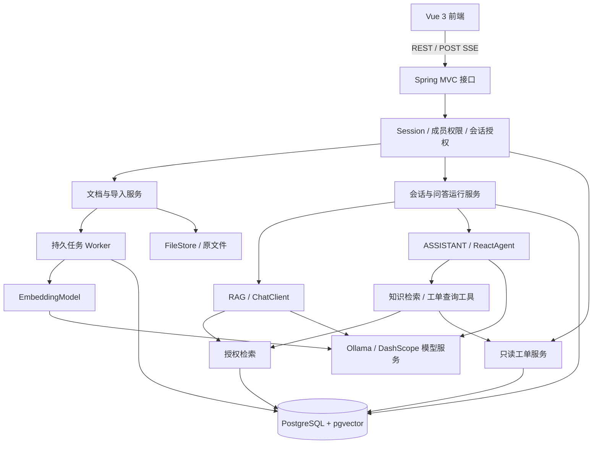

# SupportAI

**基于 Spring AI Alibaba 的企业技术支持 AI 助手**

SupportAI 面向研发与技术支持人员，将业务文档、故障处理经验和工单查询整合到同一个问答入口。通过检索增强生成（RAG）提供带原文依据的回答，通过受控工具查询工单当前状态，让每次回答都能核对来源。

**目标版本：V1.0.0 · 当前阶段：F01 工程基础，真实模型验收待完成**

当前仓库包含 Spring Boot 后端、Vue 启动状态页和 PostgreSQL 开发配置，支持配置 Ollama / DashScope 的 Chat 与 Embedding。登录、知识库及问答等业务能力仍按 F02 起逐步实现；下文业务架构为 V1.0.0 的建设目标。工程验证与真实模型验收分别记录在 [F01 验收记录](doc/F01验收记录.md)，完成状态以开发计划中的勾选记录为准。

[技术设计大纲](doc/技术设计大纲.md) · [功能开发计划](doc/开发计划.md)

## 业务场景

项目以模拟订单系统为业务背景，围绕技术支持中的具体问题展开：

- **查业务资料**：“支付回调成功，但订单仍待支付，应该检查哪些配置？”
- **查错误码与接口**：“这个错误码代表什么？创建订单接口有哪些必填参数？”
- **连续追问**：“上面提到的配置在哪里修改？还有哪些排查步骤？”
- **查工单状态**：“工单 T10086 目前是什么状态？结合处理规范说明下一步。”

文档类问题通过授权知识库检索回答；工单当前状态通过业务服务查询。资料不足或查询失败时给出明确反馈。

## V1.0.0 功能范围

| 模块 | 计划实现的能力 |
| --- | --- |
| 账号与授权 | 登录、退出、知识库成员管理、READ/WRITE 权限、个人会话隔离 |
| 知识管理 | Markdown/TXT 上传、解析分块、原文预览、版本发布、文档删除 |
| 导入管理 | 持久任务、处理进度、失败提示、重试、取消与中断恢复 |
| 知识问答 | 授权向量检索、关键词融合、可关闭的重排序、资料不足处理 |
| 会话与引用 | 流式输出、原文引用、历史会话、有限多轮上下文、追问改写 |
| 运行控制 | 请求幂等、单会话运行约束、取消生成、断开连接后的状态查询 |
| 业务助手 | Spring AI Alibaba ReactAgent、知识检索工具、只读工单查询工具 |
| 质量与交付 | 固定题集评测、用量与错误记录、单实例部署、备份恢复验证 |

V1.0.0 聚焦文本知识与只读业务查询。PDF/OCR、图片问答、多租户 SaaS、跨会话长期记忆、知识图谱、多智能体、可视化工作流和工单写操作不在本版本范围内。

## 设计重点

**回答有据可查。** 记录所有实际进入模型的文档证据和成功工具结果，引用能够定位到具体文档版本、章节或工单查询。资料不足时明确说明。

**授权覆盖整个处理链路。** 检索、原文预览、历史消息和工具调用均执行权限检查。ADMIN 的管理身份不自动获得资料读取权；共享知识库的成员也不能读取彼此的个人会话。

**知识更新具有确定结果。** 文档的新版本完整处理后才切换为有效版本；更新失败时旧版本继续服务。逻辑删除立即使资料退出检索，失效 Worker 不能将已删除内容重新发布。

**多轮对话保留证据关系。** 历史消息再次进入模型前，重新检查来源权限与有效版本；后续转述继续保留根证据，避免失效知识经由历史摘要再次进入回答。

**生成与工具调用可控制。** 每次问答有独立运行记录；相同请求键复用已有运行。取消、失败和完成具有明确终态。工具采用白名单，仅允许知识检索和工单查询。

## 技术选型

以下为设计基线，精确依赖版本、模型可用性与兼容性在工程初始化和接入验证中确认。

| 层面 | 选型 |
| --- | --- |
| Java | JDK 21 |
| Web 服务 | Spring Boot 3.5.x、Spring MVC；初始验证基线为 3.5.8 |
| AI 框架 | Spring AI Alibaba 1.1.2.2、Spring AI 1.1.2、SAA Extensions 1.1.2.2 |
| 生成模型 | 默认本机 Ollama `qwen2.5:3b`；可切换北京地域 DashScope `qwen-plus` |
| 向量模型 | 默认 Ollama `bge-m3`；可切换 DashScope `text-embedding-v4`，统一校验 1024 维 |
| 重排序 | qwen3-rerank，独立适配、支持关闭与失败回退 |
| 数据存储 | PostgreSQL 16 + pgvector 0.8.x |
| 数据访问与迁移 | Spring JDBC / JdbcTemplate、Flyway |
| 身份认证 | Spring Security、服务端 Session、CSRF |
| 前端 | Vue 3、TypeScript、Vite、Element Plus |
| 实时响应 | POST + fetch 消费 SSE，后端使用 SseEmitter |
| 后台任务 | PostgreSQL 持久任务表、有界执行器、租约与幂等 |
| 文件存储 | 受控本地目录与持久卷，通过 FileStore 隔离实现 |
| 部署 | Docker Compose：web、app、postgres |
| 验证与观测 | JUnit、Spring Boot Test、Testcontainers、Vitest、Actuator、结构化日志 |

Spring AI、SAA Extensions 和 SAA 分别使用对应 BOM 管理依赖。模型、文件存储与检索存储通过适配边界接入，便于按需求替换；更换向量模型或维度时需要重建索引并同步切换查询配置。

## 系统架构

采用 **模块化单体后端 + 独立前端 + PostgreSQL**。数据库同时保存业务数据、导入任务和向量，文件保存在受控目录中。



### 两种问答模式

| 模式 | 处理方式 | 适用场景 |
| --- | --- | --- |
| RAG | 由应用明确编排检索、证据筛选与 ChatClient 生成 | 错误码、接口说明、故障排查等文档问题 |
| ASSISTANT | 由 ReactAgent 在受控范围内选择知识检索和工单工具 | 需要查询业务状态或结合文档解释的问题 |

知识工具返回带来源的片段，由主 Agent 统一生成回答。工单工具检查用户权限与当前会话范围；询问当前状态时重新查询业务数据。工具调用默认每轮最多 2 次，并受模型轮次和执行预算约束。

### 核心处理流程

**文档入库**

上传与写权限检查 → 创建版本和持久任务 → 解析分块 → 批量向量化 → 写入分块与向量 → 完整性检查 → 原子激活版本。

**知识问答**

创建运行记录 → 授权与合法历史选择 → 可选追问改写 → 向量/关键词检索 → 融合与可选重排序 → 登记输入证据 → 流式生成 → 校验引用 → 保存运行结果。

**知识维护**

新版构建期间继续使用旧版；新版发布后仅检索当前版本。正常历史版本可用于来源查看，失效来源不再进入模型上下文。撤权后重新校验会话范围与来源，文档删除后拒绝原文预览。

## 项目分层与工程组织

后端按业务域组织，复杂模块内部划分四层：

| 层级 | 主要职责 |
| --- | --- |
| API | 参数与 DTO、HTTP 状态、SSE 和文件响应 |
| Application | 业务用例、鉴权入口、事务与调用编排 |
| Domain | 权限语义、任务状态、版本发布等业务规则 |
| Infrastructure | JDBC、模型适配、文件存取和后台执行 |

下列为工程布局；业务域暂保留包边界，评测和演示资料随后续阶段添加：

```text
support-ai/
├── backend/                    # Spring Boot 后端
│   └── src/main/
│       ├── java/com/haha/supportai/
│       │   ├── identity/       # 账号与授权
│       │   ├── knowledge/      # 知识库、文档与版本
│       │   ├── ingestion/      # 解析、分块与导入任务
│       │   ├── retrieval/      # 向量、关键词、融合与重排序
│       │   ├── conversation/   # 会话、运行、引用与 SSE
│       │   ├── ticket/         # 模拟工单与查询
│       │   ├── ai/             # 模型、提示词与 Agent 工具
│       │   ├── storage/        # 受控文件存储
│       │   ├── common/         # 共享基础类型，规划包
│       │   └── config/         # 组件装配
│       └── resources/
│           ├── db/migration/   # Flyway 迁移
│           └── prompts/        # 提示词，规划目录
├── frontend/                   # Vue 启动状态页
├── evaluation/                 # 评测题集与结果，规划目录
├── data/demo/                  # 模拟资料与工单，规划目录
├── deploy/                     # 开发数据库 Compose，完整部署在 F31
├── doc/
│   ├── 技术设计大纲.md
│   └── 开发计划.md
└── README.md
```

## 数据与接口设计

V1.0.0 规划 **15 张业务/向量表、35 个 HTTP 方法与路径组合**。

| 数据域 | 主要表 |
| --- | --- |
| 身份与知识库 | `app_user`、`knowledge_base`、`kb_member` |
| 文档与索引 | `document`、`document_version`、`ingestion_job`、`document_chunk`、`vector_store` |
| 会话与问答 | `chat_session`、`chat_session_kb`、`chat_run`、`chat_message`、`message_source` |
| 工单与工具 | `ticket`、`tool_call` |

接口统一使用 `/api` 前缀，覆盖登录、成员管理、文档与版本、导入任务、检索调试、会话、运行控制和工单查询。普通接口使用 JSON，上传使用 multipart/form-data，问答使用 SSE。

流式事件包括 `start`、`delta`、`tool`、`sources`、`done` 和 `error`。网络断开后通过运行查询接口确认持久状态；相同请求键不会自动再次生成。

字段、约束、完整接口与请求示例见[技术设计大纲](doc/技术设计大纲.md)。

## 开发路线

V1.0.0 按 **7 个累计阶段、32 个任务**逐步增加功能，不按日期排期：

1. **M1 · 账号与知识空间**：F01&#8288;—&#8288;F04，建立工程、登录、知识库和成员授权。
2. **M2 · 文档变成可用知识**：F05&#8288;—&#8288;F09，完成上传、持久任务、解析、向量索引与原文查看。
3. **M3 · 有来源的流式问答**：F10&#8288;—&#8288;F14，完成会话、授权检索、引用、流式输出与运行控制。
4. **M4 · 持续对话与知识维护**：F15&#8288;—&#8288;F20，增加历史、多轮追问、版本更新、删除与导入恢复。
5. **M5 · 检索与回答质量提升**：F21&#8288;—&#8288;F24，建立评测集，验证关键词融合、重排序和默认策略。
6. **M6 · 业务查询助手**：F25&#8288;—&#8288;F28，接入只读工单服务、工具调用与 ReactAgent 多轮助手。
7. **M7 · 可交付的完整产品**：F29&#8288;—&#8288;F32，完成跨功能回归、失败诊断、部署恢复与整体验收。

每项任务都有前置依赖、实现内容、验收标准和完成复选框。通过验收后更新[开发计划](doc/开发计划.md)中的对应标识。

## 本机启动（F01）

在仓库根目录使用 PowerShell 7，准备 JDK 21、Maven 3.9.11、Node 24.13.1、npm 11.8.0，并启动 Docker Desktop 的 Linux 引擎。默认端口为后端 8080、前端 5173、数据库 5432。

启动本机 PostgreSQL，再启动后端：

```powershell
docker compose -f deploy/compose.dev.yml up -d --wait postgres
mvn -f backend/pom.xml spring-boot:run
```

数据库地址、名称、用户和密码已直接配置为 `localhost:5432/supportai`、`supportai`、`supportai`。该公开密码只用于绑定到 `127.0.0.1` 的本机开发数据库，生产部署必须替换。PostgreSQL 初始化密码只在空数据卷首次创建时生效；已有卷需通过数据库命令同步修改账号密码。`docker compose -f deploy/compose.dev.yml down` 保留数据卷，不应使用 `down -v` 作为日常重启方式。

另开终端启动前端：

```powershell
npm --prefix frontend ci
npm --prefix frontend run dev
```

访问 <http://localhost:5173>。Vite 将 `/api` 代理到 `http://127.0.0.1:8080`；修改后端端口时，在前端启动终端设置 `VITE_API_PROXY_TARGET`。`GET /api/health` 只返回健康状态，其余路径默认拒绝访问。页面连接成功只表示后端与数据库可用，不代表模型已经验收。

[.env.example](.env.example) 仅列出 DashScope 等必须外部注入的云端凭据。原生 Maven/Java 不会自动加载 `.env`；需要云端模型时应在启动进程中设置对应配置。不要提交填入真实值的文件，也不要使用 `VITE_` 前缀传递密钥。

### 模型选择

默认无需云端密钥，连接本机独立 Ollama。先安装并启动 Ollama，再显式准备模型：

```powershell
ollama pull qwen2.5:3b
ollama pull bge-m3
ollama list
```

应用启动不会拉取模型或发起生成请求。Ollama 地址直接配置为 `http://localhost:11434`，Chat 模型为 `qwen2.5:3b`，Embedding 模型为 `bge-m3`；连接超时为 10 秒，读取超时为 180 秒。需要调整时修改对应 profile，或使用 Spring Boot 标准外部配置覆盖具体属性。

需要北京地域 DashScope 时，在启动终端配置密钥并启用对应 profile：

```powershell
$env:SPRING_AI_DASHSCOPE_API_KEY = Read-Host '北京地域 DashScope API Key' -MaskInput
mvn -f backend/pom.xml spring-boot:run '-Dspring-boot.run.profiles=dashscope'
```

云端 profile 直接配置 Chat 为 `qwen-plus`，Embedding 为 `text-embedding-v4 / 1024`。混合模式仍启用 `dashscope` profile，再通过 `SPRING_AI_MODEL_CHAT`、`SPRING_AI_MODEL_EMBEDDING` 临时覆盖其中一个角色。两个角色独立选择，均只接受 `ollama` 或 `dashscope`；全本地直接使用 `ollama` profile。

同为 1024 维不代表向量兼容。更换 Embedding 提供方或模型后必须重建独立索引，不能用新模型查询旧向量。F01 的向量表仅存在于隔离测试环境；正式业务向量表在 F08 创建。

### 自动化检查

普通测试不调用真实模型，也不要求 Docker。先执行最快的编译和单元测试：

```powershell
mvn -f backend/pom.xml -DskipTests compile
mvn -f backend/pom.xml test
mvn -f backend/pom.xml dependency:tree
npm --prefix frontend run test -- --run
npm --prefix frontend run build
```

数据库与真实模型检查显式执行。Testcontainers 使用隔离数据库，不连接开发数据卷；数据库检查需要 Docker，真实模型检查还需要对应服务、模型或密钥。缺少条件时测试失败，不静默跳过：

```powershell
mvn -f backend/pom.xml -Pdb-it verify
mvn -f backend/pom.xml -Plive-ai '-Dspring.profiles.active=ollama' verify
# 先注入 SPRING_AI_DASHSCOPE_API_KEY
mvn -f backend/pom.xml -Plive-ai '-Dspring.profiles.active=dashscope' verify
```

真实测试发送少量固定样本文本，分别检查 Chat、流式增量、实际向量长度和 PgVectorStore 相似查询。云端调用会产生相应模型费用；没有执行成功的测试不计入验收通过。

## 验证与交付标准

- **权限**：覆盖两位普通用户、无成员权管理员、READ/WRITE 变更、撤权与会话隔离。
- **一致性**：验证半成品不可检索、版本原子切换、失效 Worker 隔离、删除与导入竞争。
- **问答运行**：验证请求幂等、取消与完成的唯一终态、断流查询和重启后的中断处理。
- **来源与历史**：验证未显式引用的证据也被记录，多轮转述仍能追溯根来源。
- **工具**：验证正常查询、不存在、越权、会话外工单、工具失败与状态新鲜度。
- **效果**：建立 100 题评测集，其中开发集 60 题、固定测试集 40 题，记录检索、引用、依据充分性和真实调用代价。
- **部署**：验证空环境启动、SSE 经代理逐步输出、数据库与文件备份，以及隔离环境恢复。

真实数据库行为通过集成测试验证，外部模型接入单独验证。功能完成以可复现的验收结果为准。
