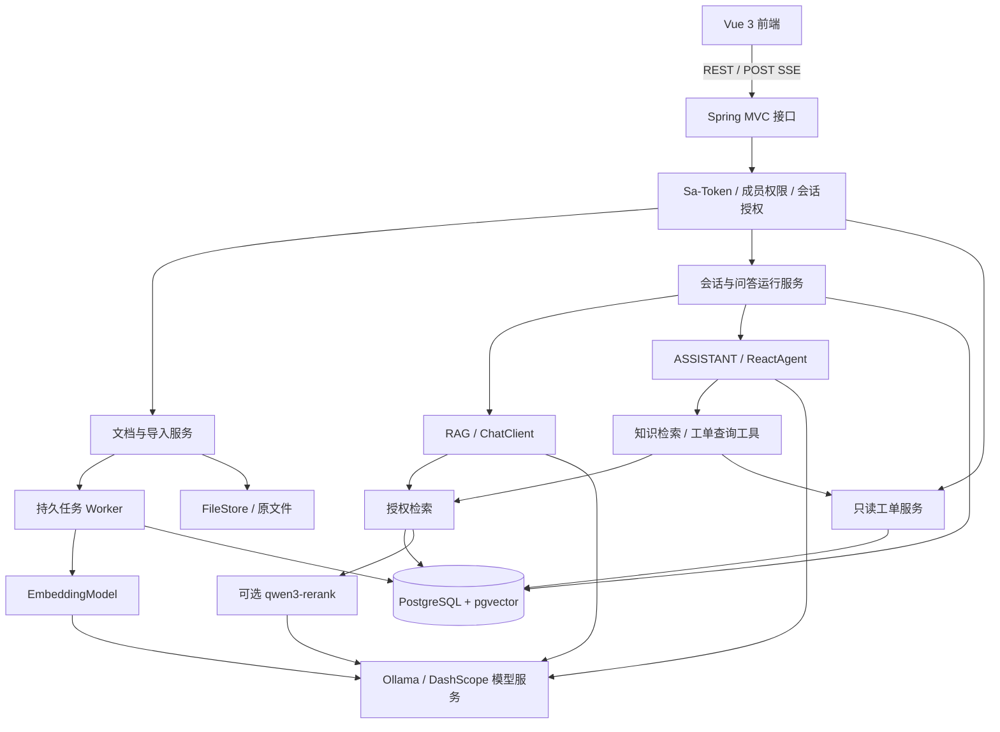

# SupportAI

**基于 Spring AI Alibaba 的企业技术支持 AI 助手**

SupportAI 面向研发与技术支持人员，将业务文档、故障处理经验和工单查询整合到同一个问答入口。通过检索增强生成（RAG）提供带原文依据的回答，通过受控工具查询工单当前状态，让每次回答都能核对来源。

**目标版本：V1.0.0 · 当前阶段：F32 本地真实评测与恢复证据已归档，正式质量验收待复核**

当前仓库包含 Maven 多模块 Spring Boot 后端、Vue 业务页面、PostgreSQL 开发配置和 Docker Compose 交付配置。F03—F20 已形成知识授权、文档入库、可追溯 RAG、多轮会话、版本更新、删除和任务恢复链路；F21—F24 已加入固定评测题集、关键词融合、可关闭重排序与配置冻结；F25—F28 已加入实时只读工单、工具调用审计、受预算约束的 ReactAgent 助手及有限多轮历史。ASSISTANT 会话只能调用服务端注册的知识检索与工单查询工具，复用既有 run、SSE、取消、状态查询和来源协议；当前工单问题要求本轮重新查询，不接受模型编造的来源编号。F29 已完成跨功能授权一致性回归，F30 已补齐持久 traceId、单用户并发配额、异常脱敏、健康状态和用户诊断反馈；F31 已完成 web、app、postgres 同源部署以及数据库与原文件的一致性备份、隔离恢复演练。数据库迁移当前为 V15。2026-09-29 已将默认模型切换为 `qwen3.5:9b` 与 `bge-m3:567m`，Ollama 真实接入四项测试通过；F32 已完成本地真实业务、开发集策略比较、冻结后固定 40 题及真实模型恢复演练。人工质量复核、云端/重排序和部分特殊场景仍待完成，完整验收状态以[开发计划](doc/开发计划.md)和[阶段验收记录](doc/验收记录/)为准。

[技术设计大纲](doc/技术设计大纲.md) · [功能开发计划](doc/开发计划.md) · [后端模块结构](doc/后端模块结构.md)

2026-09-29 F32 阶段归档：真实部署业务 49/49、独立权限 24/24 断言通过，覆盖 35 个业务操作、16 张业务/向量表及关键关系。后端普通回归 382/382、前端 97/97、评测脚本最终 29/29 通过；助手 v4 提示调整后另通过相关 11 项测试。开发集 VECTOR/FUSION 比较后保留 VECTOR，冻结后固定 40 题全部完成，按原题口径完整预期证据命中 38/39；其中 TEST-039 存在题目预期与 active-only 检索范围冲突，原题与原结果均保留。真实模型隔离恢复 14 项检查通过。人工评分仍为空，正式 F32/M7 未勾选；详见 [F32 验收记录](doc/验收记录/F32验收记录.md)及其阶段产物目录。

F15 已补齐本人会话的游标分页列表、标题修改、空闲逻辑删除和消息历史分页。F16 默认从最近历史中分页选择最多 3 个完整成功问答轮次，并受 6000 字符预算限制；任一来源失效会排除整轮历史。当前检索来源和历史继承来源在本轮统一编号，每个不同根来源都会传播，继承记录的 `origin_source_id` 始终指向根来源；来源登记提交后还会紧邻模型调用再次复核。F17 仅在问题含上下文指代或属于短追问，且未携带明确错误码、HTTP 状态、通用 API 路径或异常类时，使用 F16 已验证历史生成严格单字段 JSON 检索问题；模型异常、空白、非法或超长输出回退原问题。F18 在文档行锁内校验 `expectedRevision` 和单一 pending，按 `next_version_no` 分配新版；同内容配置命中当前 READY/SUCCEEDED 版本时返回 200 且不重复 Embedding，否则返回 202 并保留旧 active 到完整发布。F19 的 `DELETE /api/documents/{documentId}` 返回 202；删除事务清空 active/pending、递增 revision、取消非终态导入并撤销租约，V14 清理任务随后幂等删除全部版本原文件和目标向量正文。版本、分块和来源定位继续保留，已有回答把被删除来源标为 `available=false`，且不再提供预览路径或注入多轮上下文。详情见 [F16 验收记录](doc/验收记录/F16验收记录.md)、[F17 验收记录](doc/验收记录/F17验收记录.md)、[F18 验收记录](doc/验收记录/F18验收记录.md)和 [F19 验收记录](doc/验收记录/F19验收记录.md)。

F20 已新增导入任务 retry/cancel POST 接口、WRITE 权限与 CSRF 边界、自动重试和终止失败分类、原子 pending 清理与重新取得、租约失效隔离、错误阶段提示，以及前端重新处理和取消交互。真实模型失败、浏览器场景和完整前置链路仍待验收，因此 F20 保持未勾选。

F21 已建立 60 道开发题和 40 道固定测试题、7 份可上传版本语料、66 个稳定证据段、JSON Schema、固定测试集 SHA-256 校验及人工结果汇总工具。问答运行新增无密钥模型、检索和提示词配置快照，并分别记录检索与生成耗时；尚未取得真实基础结果，因此 F21 保持未勾选。

F22 已在统一授权仓储中加入错误码、HTTP 方法与接口路径、业务标识符和显式术语的精确关键词召回，与向量候选按稳定 chunk ID 去重并使用 RRF 融合；两路共享成员、会话、当前发布版本、删除状态和嵌入空间过滤。问答默认策略仍为 `VECTOR`，真实开发集双跑尚未完成，因此 F22 保持未勾选。

F23 已增加独立 qwen3-rerank HTTPS 适配器，只对统一授权检索返回的候选按稳定下标重排，不生成新候选或改变来源标识；没有候选时跳过调用，输入超限、模型不可用或异常响应时回退基础排序。开关默认关闭，真实质量、用量和耗时双跑尚未完成，因此 F23 保持未勾选。

F24 已增加证据正文 Token 预算和向量、融合、重排序三类最终分数阈值，筛选发生在二次授权后、来源登记和 Chat 调用前；运行指标记录筛选前后数量、预算用量及未知的 Embedding Token。`f24-v1` 快照携带完整索引配置哈希，授权检索 SQL 拒绝混用不同分块或 Embedding 配置的索引。F32 已完成真实开发集 VECTOR/FUSION 比较并冻结本次配置；默认保留 `VECTOR` 且关闭重排序，重排序实测与人工质量门槛尚未闭合，F24 保持未勾选。

F25 已新增带完整中文注释与约束的 V12 `ticket` 表、30 条幂等模拟工单种子、`data.assistant` 数据访问、复用知识库成员授权的 `TicketQueryService`、`GET /api/tickets/{ticketNo}` 和工单查询页面。查询直接读取业务表，不调用模型；不存在、停用范围和越权统一返回 404，无成员权管理员不能读取工单。F24 前置尚未验收，因此 F25 保持未勾选。

F26 已新增 V13 `tool_call`、DOCUMENT/TICKET 来源约束、可信运行上下文以及 `searchKnowledge(query)`、`getTicketStatus(ticketNo)` 两个只读适配器。工具只能使用服务端固定的用户、会话和白名单名称；成功结果及来源在进入后续模型编排前落库，失败调用保存稳定错误码。

F27 使用 Spring AI Alibaba ReactAgent 固定注册上述两个工具，默认限制 2 次工具调用、3 次模型调用、8000 Token 单次上下文和 60 秒总执行时间，并把工具过程映射为 `tool` SSE。阶段实现与待验收边界见 [F27 验收记录](doc/验收记录/F27验收记录.md)。

F28 已把有限历史与完整来源校验用于 ASSISTANT：默认最多 3 个成功轮次、6000 字符的问答与来源快照预算；继承来源直接指向同一用户、同一会话内的根来源和原工具调用，入模前及答复前重新鉴权。“现在呢”“它解决了吗”等工单追问要求本轮查询并引用对应结果；工单卡片显示先前/本轮查询和实际查询时间。63 项后端定向测试、7 项隔离数据库测试、前端 93 项测试及生产构建通过；结果基于当前工作区，真实模型和浏览器场景仍待验收，详见[阶段验收记录](doc/验收记录/)。

2026-09-24 已整理 M05—M06 阶段复核并修复发现的代码问题：RAG 批量来源 UUID 类型、测试上下文装配、OpenAPI 500、上传表单文档和 UUID 排序断言均已处理；13:28—13:29 后端普通测试 361/361、选定数据库测试 21/21 全部通过。初次复核的评测工具 7/7、100 题结构校验、前端 93/93 及构建通过，本次修复未重复运行前端和评测工具。上述修复已整理为独立提交；真实质量比较和助手真实模型/HTTP/浏览器验收仍待完成，阶段保持未勾选；修复明细、历史失败记录和证据边界见[阶段验收记录](doc/验收记录/)。

F29 已完成跨功能授权与数据一致性自动化回归：新增两个普通用户、无成员权管理员、READ/WRITE 变更、撤权和知识库停用的贯穿数据库场景，并确保前端权限刷新失败后立即清除缓存原文与分块。后端普通测试 361/361、13 组真实 PostgreSQL 场景 58/58、前端 95/95 及生产构建均通过；M7 仍需继续完成 F30—F32，详见 [F29 验收记录](doc/验收记录/F29验收记录.md)。

F30 已将入口 traceId 持久化到 `chat_run` 和 `ingestion_job`，异步问答、入库阶段与心跳会恢复同一日志上下文；运行/任务状态接口及失败页面可显示对应追踪号。问题长度、流式执行器容量和单用户跨会话并发数由配置控制，用户并发配额通过账号行锁串行判断，超限返回结构化 429。模型 Token 未返回时页面明确显示“未知”，通用异常和 DOWN 健康响应不返回 SQL、密码或内部组件详情。自动化验收结果与边界见 [F30 验收记录](doc/验收记录/F30验收记录.md)。

F31 新增固定镜像摘要的 app/web 构建、Nginx 同源 `/api` 和文档代理、关闭 SSE 缓冲的超时配置，以及 PostgreSQL 与原文件持久卷。维护脚本在停止 app 写入后生成数据库归档、原文件归档、Flyway 版本清单和 SHA-256 校验，再在临时数据库与临时目录完整校验后恢复目标环境。空卷启动、容器重建、浏览器逐步输出、Session 重启失效、隔离恢复、遗留问答 `RUN_INTERRUPTED` 且不重放模型均已验证，详见 [F31 验收记录](doc/验收记录/F31验收记录.md)。

## 业务场景

项目以模拟订单系统为业务背景，围绕技术支持中的具体问题展开：

- **查业务资料**：“支付回调成功，但订单仍待支付，应该检查哪些配置？”
- **查错误码与接口**：“这个错误码代表什么？创建订单接口有哪些必填参数？”
- **连续追问**：“上面提到的配置在哪里修改？还有哪些排查步骤？”
- **查工单状态**：“工单 T10086 目前是什么状态？结合处理规范说明下一步。”

文档类问题通过授权知识库检索回答；工单当前状态通过业务服务查询。资料不足或查询失败时给出明确反馈。

## V1.0.0 功能范围

| 模块 | 计划实现的能力 |
| --- | --- |
| 账号与授权 | 登录、退出、知识库成员管理、READ/WRITE 权限、个人会话隔离 |
| 知识管理 | Markdown/TXT 上传、解析分块、原文预览、版本发布、文档删除 |
| 导入管理 | 持久任务、处理进度、失败提示、重试、取消与中断恢复 |
| 知识问答 | 授权向量检索、关键词融合、可关闭的重排序、资料不足处理 |
| 会话与引用 | 流式输出、原文引用、历史会话、有限多轮上下文、追问改写 |
| 运行控制 | 请求幂等、单会话运行约束、取消生成、断开连接后的状态查询 |
| 业务助手 | Spring AI Alibaba ReactAgent、知识检索工具、只读工单查询工具 |
| 质量与交付 | 固定题集评测、用量与错误记录、单实例部署、备份恢复验证 |

V1.0.0 聚焦文本知识与只读业务查询。PDF/OCR、图片问答、多租户 SaaS、跨会话长期记忆、知识图谱、多智能体、可视化工作流和工单写操作不在本版本范围内。

## 设计重点

**回答有据可查。** 记录所有实际进入模型的文档证据和成功工具结果，引用能够定位到具体文档版本、章节或工单查询。资料不足时明确说明。

**授权覆盖整个处理链路。** 检索、原文预览、历史消息和工具调用均执行权限检查。ADMIN 的管理身份不自动获得资料读取权；共享知识库的成员也不能读取彼此的个人会话。

**知识更新具有确定结果。** 文档的新版本完整处理后才切换为有效版本；更新失败时旧版本继续服务。逻辑删除立即使资料退出检索，失效 Worker 不能将已删除内容重新发布。

**多轮对话保留证据关系。** 历史消息再次进入模型前，重新检查来源权限与有效版本；后续转述继续保留根证据，避免失效知识经由历史摘要再次进入回答。

**生成与工具调用可控制。** 每次问答有独立运行记录；相同请求键复用已有运行。取消、失败和完成具有明确终态。工具采用白名单，仅允许知识检索和工单查询。

## 技术选型

以下为设计基线，精确依赖版本、模型可用性与兼容性在工程初始化和接入验证中确认。

| 层面 | 选型 |
| --- | --- |
| Java | JDK 21 |
| Web 服务 | Spring Boot 3.5.x、Spring MVC；初始验证基线为 3.5.8 |
| AI 框架 | Spring AI Alibaba 1.1.2.2、Spring AI 1.1.2、SAA Extensions 1.1.2.2 |
| 生成模型 | 默认本机 Ollama `qwen3.5:9b`；可切换北京地域 DashScope `qwen-plus` |
| 向量模型 | 默认 Ollama `bge-m3:567m`；可切换 DashScope `text-embedding-v4`，统一校验 1024 维 |
| 重排序 | qwen3-rerank，独立适配、支持关闭与失败回退 |
| 数据存储 | PostgreSQL 16 + pgvector 0.8.x |
| 数据访问与迁移 | MyBatis-Plus 3.5.17（Spring Boot 3 专用 Starter）、Flyway |
| 身份认证 | Sa-Token 1.46.0、Cookie 登录态、Servlet Session CSRF、jBCrypt |
| 接口文档 | springdoc-openapi 2.9.1、Knife4j 4.5.0、OpenAPI 3.0 |
| 前端 | Vue 3、TypeScript、Vite、Element Plus |
| 实时响应 | POST + fetch 消费 SSE，后端使用 SseEmitter |
| 后台任务 | PostgreSQL 持久任务表、有界执行器、租约与幂等 |
| 文件存储 | 受控本地目录与持久卷，通过 FileStore 隔离实现 |
| 部署 | Docker Compose：web、app、postgres |
| 验证与观测 | JUnit、Spring Boot Test、Testcontainers、Vitest、Actuator、结构化日志 |

Spring AI、SAA Extensions 和 SAA 分别使用对应 BOM 管理依赖。模型、文件存储与检索存储通过适配边界接入，便于按需求替换；更换向量模型或维度时需要重建索引并同步切换查询配置。

## 系统架构

采用 **模块化单体后端 + 独立前端 + PostgreSQL**。数据库同时保存业务数据、导入任务和向量，文件保存在受控目录中。



### 两种问答模式

| 模式 | 处理方式 | 适用场景 |
| --- | --- | --- |
| RAG | 由应用明确编排检索、证据筛选与 ChatClient 生成 | 错误码、接口说明、故障排查等文档问题 |
| ASSISTANT | 由 ReactAgent 在受控范围内选择知识检索和工单工具 | 需要查询业务状态或结合文档解释的问题 |

知识工具返回带来源的片段，由主 Agent 统一生成回答。工单工具检查用户权限与当前会话范围；询问当前状态时重新查询业务数据。工具调用默认每轮最多 2 次，并受模型轮次和执行预算约束。

### 核心处理流程

**文档入库**

上传与写权限检查 → 创建版本和持久任务 → 解析分块 → 批量向量化 → 写入分块与向量 → 完整性检查 → 原子激活版本。

**知识问答**

创建运行记录 → 授权与合法历史选择 → 可选追问改写 → 向量/关键词检索 → 融合与可选重排序 → 登记输入证据 → 流式生成 → 校验引用 → 保存运行结果。

**知识维护**

新版构建期间继续使用旧版；新版发布后仅检索当前版本。正常历史版本可用于来源查看，失效来源不再进入模型上下文。撤权后重新校验会话范围与来源，文档删除后拒绝原文预览。

## 项目分层与工程组织

所有 Controller 统一放在 bootstrap 的 `com.haha.supportai.controller.<业务>` 下；其余代码先按业务模块归属，再按职责细分包。简单业务模块直接使用职责包，复杂业务可先增加功能子包，再按职责细分：

| 职责包 | 主要职责 |
| --- | --- |
| bootstrap 下的 controller.<业务> | 参数校验、HTTP 状态、SSE 和文件响应，调用所属业务模块的 service |
| service | 业务用例、授权、状态规则、短事务与调用编排；不为单一实现创建空接口 |
| entity.dto / entity.vo | 本业务的请求或内部传输对象 / 对外响应对象 |
| filter / handler / exception / config | 过滤器、异常处理、业务异常与装配配置 |
| security / access / model / support | 身份安全、资源授权、模型适配及其他有明确职责的支撑代码 |
| data 下的业务域 entity.po / enums / repository / mapper | 数据库实体、持久化枚举、业务查询门面与 MyBatis Mapper |

后端采用 9 个子模块，加父工程共 10 个 Maven 工程。只有 bootstrap 生成可执行 Spring Boot JAR；F03—F05 的知识库、成员授权和文档上传代码已落入 knowledge、identity、data、storage 和 bootstrap，尚未实现的业务继续使用包说明预留职责：

```text
support-ai/
├── backend/
│   ├── pom.xml                 # support-ai-parent：聚合、版本与构建规则
│   ├── support-ai-common/      # 响应、异常、traceId 与公共 Web 支撑
│   ├── support-ai-data/        # MyBatis-Plus、类型映射、按业务分包的实体与数据访问
│   ├── support-ai-storage/     # FileStore 与受控本地原文件存储
│   ├── support-ai-identity/    # 账号认证、Sa-Token、CSRF 与身份 DTO/VO
│   ├── support-ai-ai/          # Ollama / DashScope Chat、Embedding 与重排序模型接入
│   ├── support-ai-knowledge/   # 知识库、文档上传、向量发布、授权检索、融合与重排序编排
│   ├── support-ai-conversation/ # RAG/ASSISTANT 会话、运行约束、来源与 SSE 编排
│   ├── support-ai-assistant/   # 工单、受控工具与 ReactAgent 助手
│   └── support-ai-bootstrap/  # 唯一启动入口、全部 Controller、应用装配与集成测试
│       ├── src/main/java/com/haha/supportai/
│       │   ├── SupportAiApplication.java
│       │   ├── controller/identity/ # 认证与管理员账号目录接口
│       │   ├── controller/knowledge/ # 知识库、成员、文档、任务与检索调试接口
│       │   ├── controller/conversation/ # 个人 RAG 会话创建与流式消息接口
│       │   ├── controller/assistant/ # 只读工单查询接口
│       │   └── config/
│       └── src/main/resources/
│           ├── application*.yml
│           └── db/migration/   # 按全局顺序管理的 Flyway 迁移
├── frontend/                   # Vue 登录、运行状态、知识库、问答与工单查询页面
├── evaluation/                 # 100 题评测集、契约、校验脚本与结果状态
├── data/demo/knowledge/f21/    # F21 可上传的脱敏模拟知识语料
├── deploy/                     # 开发数据库与 F31 完整部署、维护及验收脚本
├── doc/
│   ├── 技术设计大纲.md
│   ├── 开发计划.md
│   └── 验收记录/              # 阶段验收记录统一存放，后续直接新增
└── README.md
```

`data` 统一提供 MyBatis-Plus、数据库驱动、连接池与类型映射，并按业务分包承载实体 PO、持久化枚举、Repository 和 Mapper；当前 `AppUser`、`UserRoleEnum`、`AppUserRepository`、`AppUserMapper` 分别位于 `com.haha.supportai.data.identity` 下的 `entity.po`、`enums`、`repository`、`mapper` 包。业务服务通过 Repository 调用 Mapper，不直接使用 JdbcTemplate 或 RowMapper。业务授权、事务编排、认证流程与 DTO/VO 留在所属业务模块，跨业务调用仍通过业务服务，不能绕过服务直接访问其他域的 Repository/Mapper。data 不反向依赖 identity；连接参数、Flyway 生产迁移与应用配置集中在 bootstrap。全局 OpenAPI 元信息与 Knife4j 运行装配归 bootstrap，身份配置与异常处理归 identity。F06 的任务租约 SQL 同样由 data 的 Repository/Mapper 承载，业务层只通过服务编排，不绕过租约条件直接更新任务。详细结构见[后端模块结构](doc/后端模块结构.md)。

data 使用 `com.baomidou:mybatis-plus-spring-boot3-starter:3.5.17`，父工程保留 Spring Boot 3.5.8，不重复引入普通 MyBatis Starter。当前 `data.identity`、`data.knowledge`、`data.conversation` 与 `data.assistant` 已包含账号、知识库、成员、文档、版本、入库任务、`document_chunk`、`vector_store`、`document_cleanup_job`、会话、运行、消息、来源、工单及工具调用的 PO、Repository 与 Mapper。F05 的 JSONB 配置快照使用显式 SQL 转换；事务内通过 `SELECT ... FOR UPDATE` 锁定启用知识库和成员关系，使上传登记与撤权/改权具有明确顺序。F07 的分块 Mapper 按 `(version_id, chunk_index)` 幂等写入并保留稳定分块 ID；F08 使用向量 TypeHandler 与显式批量 SQL 写入 1024 维向量，业务层在短事务内复核租约并原子发布完整版本。F10 在同一事务中按固定排序锁定全部可读知识库和成员关系，再写入会话及其范围；内部 run 使用显式条件更新和数据库唯一约束维护幂等与单活跃运行，并保存 Chat、Embedding、Prompt、检索与索引的非敏感配置快照。F11 的 `AuthorizedRetrievalRepository` 使用显式 Mapper SQL，在排序前完成实时成员授权、发布状态、固定范围和向量空间过滤。F12 在模型调用前再次复核候选并以独立短事务登记来源；F19 的删除事务立即阻断检索与 Worker，独立清理租约只回收目标文件和向量正文。F20 使用数据修改 CTE 原子更新任务、版本与 pending 指针；F22 在统一授权仓储提供向量与精确关键词查询并按 chunk ID 融合；F24 在授权检索 SQL 上校验完整处理配置哈希。F25 的 `TicketRepository` 读取只读业务表，F26 的 `ToolCallRepository` 在 ASSISTANT run 内登记调用，并与全部来源同事务复核真实 chunk/ticket、会话范围和实时成员权。UUID、枚举、JSON、向量和时间类型显式映射，数据库结构由 Flyway 管理。PgVectorStore 仅用于隔离接入验证，不参与正式业务写入；完整业务验收仍待前置任务和真实场景完成。

认证控制器和管理员账号目录控制器位于 bootstrap 的 `controller.identity`；知识库、成员、文档、任务、检索调试与来源预览控制器位于 `controller.knowledge`；会话、流式消息与 run 控制器位于 `controller.conversation`；只读工单入口位于 `controller.assistant`。当前开放文档删除与版本上传、任务 retry/cancel、会话与消息、run 查询/取消以及 `GET /api/tickets/{ticketNo}`。identity 负责账号目录和管理员身份校验，knowledge 由 `AccessPolicy` 统一处理 ADMIN、KB-R、KB-W，并编排原文件落盘、短数据库事务、授权检索和来源读取；`TicketQueryService` 复用相同读取权限，将不存在、停用范围和越权统一收敛为 404。F13 由 `ChatRunService` 同步完成身份、会话、幂等与 run 准备，再按会话模式交给 RAG 或 ASSISTANT 回答引擎；可信 userId 随准备结果传递，不依赖异步线程中的 Sa-Token 上下文。模型调用位于事务外，来源登记、每个回答增量、工具事件、成功终态和失败部分文本分别使用短事务持久化；SSE 发送失败只停止推送，不取消后台运行。F14 以数据库 run 为最终事实来源，超时、取消、完成和失败通过条件更新争夺唯一终态；查询回答时复核完整会话知识范围及每条引用的当前权限。`AuthenticatedUser` 是内部认证快照，归 `entity.dto`，不作为数据库 PO。业务模块不反向依赖 bootstrap。纯单元测试跟随被测类的包结构，控制器与跨模块集成测试在 bootstrap 内维护。

F23 由 knowledge 将已授权候选交给 ai 的独立 qwen3-rerank 适配器，只按响应下标更新候选顺序和分数；失败时保留基础排序，配置快照与运行指标记录无密钥参数、状态、用量和耗时。F24 由 conversation 在二次授权后执行分策略分数阈值和 CL100K 证据正文预算，并把当前索引哈希写入运行快照。F25 的工单服务每次读取当前业务状态；F26 的两个内部工具只接受模型可提供的 query 或 ticketNo，服务端固定 run/session/user/message 上下文。F27 在这些边界之上注册 ReactAgent，不扩大数据库、文件或网络访问权限。

## 数据与接口设计

V1.0.0 规划 **16 张业务/向量表、35 个 HTTP 方法与路径组合**。

| 数据域 | 主要表 |
| --- | --- |
| 身份与知识库 | `app_user`、`knowledge_base`、`kb_member` |
| 文档与索引 | `document`、`document_version`、`ingestion_job`、`document_chunk`、`vector_store`、`document_cleanup_job` |
| 会话与问答 | `chat_session`、`chat_session_kb`、`chat_run`、`chat_message`、`message_source` |
| 工单与工具 | `ticket`、`tool_call` |

接口统一使用 `/api` 前缀，覆盖登录、成员管理、文档与版本、导入任务、检索调试、会话、运行控制和工单查询。普通接口使用 JSON，上传使用 multipart/form-data，问答使用 SSE。

当前流式事件包括 `start`、`tool`、`delta`、`sources`、`done` 和 `error`。`tool` 仅公开白名单工具名称和 `STARTED/SUCCEEDED/FAILED` 状态，不返回参数、结果正文或隐藏推理；RAG 会话不发送该事件。网络断开后通过运行查询接口确认持久状态；相同请求键不会自动再次生成。

字段、约束、完整接口与请求示例见[技术设计大纲](doc/技术设计大纲.md)。

## 开发路线

V1.0.0 按 **7 个累计阶段、32 个任务**逐步增加功能，不按日期排期：

1. **M1 · 账号与知识空间**：F01&#8288;—&#8288;F04，建立工程、登录、知识库和成员授权。
2. **M2 · 文档变成可用知识**：F05&#8288;—&#8288;F09，完成上传、持久任务、解析、向量索引与原文查看。
3. **M3 · 有来源的流式问答**：F10&#8288;—&#8288;F14，完成会话、授权检索、引用、流式输出与运行控制。
4. **M4 · 持续对话与知识维护**：F15&#8288;—&#8288;F20，增加历史、多轮追问、版本更新、删除与导入恢复。
5. **M5 · 检索与回答质量提升**：F21&#8288;—&#8288;F24，建立评测集，验证关键词融合、重排序和默认策略。
6. **M6 · 业务查询助手**：F25&#8288;—&#8288;F28，接入只读工单服务、工具调用与 ReactAgent 多轮助手。
7. **M7 · 可交付的完整产品**：F29&#8288;—&#8288;F32，完成跨功能回归、失败诊断、部署恢复与整体验收。

每项任务都有前置依赖、实现内容、验收标准和完成复选框。通过验收后更新[开发计划](doc/开发计划.md)中的对应标识。

## 本机启动（F01—F30）

在仓库根目录使用 PowerShell 7，准备 JDK 21、Maven 3.9.11、Node 24.13.1、npm 11.8.0，并启动 Docker Desktop 的 Linux 引擎。默认端口为后端 8080、前端 5173、数据库 5432。

启动本机 PostgreSQL，再构建并启动后端。Flyway 创建表结构，并通过 V4 自动补齐默认管理员 `admin/admin`；已有同名账号的密码、角色和启用状态不会被覆盖：

```powershell
docker compose -f deploy/compose.dev.yml up -d --wait postgres
mvn -f backend/pom.xml -DskipTests clean install
mvn -f backend/support-ai-bootstrap/pom.xml spring-boot:run
```

如需 `support1`、`support2` 两位普通演示用户和 F25 的 30 条模拟工单，等待后端启动完成后，在另一个 PowerShell 终端从仓库根目录按顺序执行以下可选命令：

```powershell
Get-Content -Raw -Encoding utf8 'backend/support-ai-data/src/main/resources/db/seed/identity/init_app_user.sql' | docker compose -f deploy/compose.dev.yml exec -T postgres psql -U supportai -d supportai -v ON_ERROR_STOP=1
Get-Content -Raw -Encoding utf8 'backend/support-ai-data/src/main/resources/db/seed/assistant/init_ticket.sql' | docker compose -f deploy/compose.dev.yml exec -T postgres psql -U supportai -d supportai -v ON_ERROR_STOP=1
```

默认账号如下，密码与用户名一致；管理员自动初始化，普通演示用户按需手动导入：

| 用户名 | 默认密码 | 角色 | 初始化方式 |
| --- | --- | --- | --- |
| `admin` | `admin` | ADMIN | Flyway V4 自动补齐 |
| `support1` | `support1` | USER | 可选手动种子 SQL |
| `support2` | `support2` | USER | 可选手动种子 SQL |

管理员初始化脚本为 bootstrap 模块的 `db/migration/V4__initialize_default_admin.sql`，随 Flyway 升级执行；账号和工单手动脚本分别位于 data 模块的 `db/seed/identity/init_app_user.sql`、`db/seed/assistant/init_ticket.sql`，不会自动执行。账号脚本使用兼容 jBCrypt 的 cost 12 BCrypt 摘要；两个手动脚本均通过 `ON CONFLICT ... DO NOTHING` 幂等补齐数据，不覆盖已有账号、成员权限或工单状态。工单脚本依赖演示账号，必须在账号脚本之后执行；它创建独立演示知识库，授权 `support1` WRITE、`support2` READ，但不授予 `admin` 成员权。手动导入前须完成 Flyway 建表；接口响应和日志不包含密码或摘要。

账号表由 V2 创建，V3 补齐表及全部 8 个字段的中文数据库注释，V4 补齐默认管理员；V5 创建 `knowledge_base`、`kb_member` 及其约束、索引和中文注释。当前迁移定义中，V11 创建 `message_source`；V12 创建只读 `ticket`；V13 创建 `tool_call` 并扩展工单/工具来源字段；V14 创建每文档唯一、带租约和自动重试状态的 `document_cleanup_job`；V15 为 `chat_run` 和 `ingestion_job` 增加可空追踪字段、非空白约束、索引和中文列注释。已执行过的 V12—V14 脚本及校验值保持不变，不需要 `repair`、删表或重建数据卷。2026-09-24 已在现有开发库完成 V14 校验与启动；2026-09-29 通过 Testcontainers 验证 V14→V15 前向升级和 V1→V15 空库迁移。完整证据见 [验收记录](doc/验收记录/)。

多模块应用需要先安装同一版本的本地模块，再从 bootstrap 启动。Controller 跨模块迁移后的首次构建必须带 `clean`，清除旧包中的类、旧 Controller、旧 Repository 和已删除初始化器的编译产物，避免新旧组件重复扫描或旧初始化器继续自动创建用户。后续未移动类的日常构建可使用 `mvn -f backend/pom.xml -DskipTests install`。父工程只负责聚合构建，不直接执行 `spring-boot:run`；修改其他模块后需重新安装。也可以在仓库根目录打包后启动唯一的可执行 JAR：

```powershell
mvn -f backend/pom.xml -DskipTests clean package
java -jar backend/support-ai-bootstrap/target/support-ai-bootstrap-1.0.0-SNAPSHOT.jar
```

数据库地址、名称、用户和密码已直接配置为 `localhost:5432/supportai`、`supportai`、`supportai`。该公开密码只用于绑定到 `127.0.0.1` 的本机开发数据库，生产部署必须替换。PostgreSQL 初始化密码只在空数据卷首次创建时生效；已有卷需通过数据库命令同步修改账号密码。`docker compose -f deploy/compose.dev.yml down` 保留数据卷，不应使用 `down -v` 作为日常重启方式。

另开终端启动前端：

```powershell
npm --prefix frontend ci
npm --prefix frontend run dev
```

访问 <http://127.0.0.1:5173>。Vite 将 `/api` 代理到 `http://127.0.0.1:8080`；修改后端端口时，在前端启动终端设置 `VITE_API_PROXY_TARGET`。页面先取得 CSRF 令牌并恢复当前身份，登录后显示运行概览；`GET /api/health` 保持匿名，其余业务入口要求登录，写请求还必须携带 CSRF 令牌。页面连接成功只表示后端与数据库可用，不代表模型已经验收。

本机 HTTP 开发配置的 Sa-Token 登录 Cookie 与 CSRF Session Cookie 均使用 `HttpOnly`、`SameSite=Lax`，并显式设置 `Secure=false`。部署到 HTTPS 时必须将 `sa-token.cookie.secure` 和 `server.servlet.session.cookie.secure` 都覆盖为 `true`。Sa-Token 当前使用单实例内存存储登录态，应用重启后需要重新登录。

## Docker Compose 部署（F31）

完整部署包含 `web`、`app`、`postgres` 三个常驻服务。Nginx 在同一入口提供 Vue 页面、`/api`、`/v3/api-docs` 和 `/doc.html`，对 SSE 关闭响应缓冲与缓存；数据库和原文件分别保存在命名卷。先复制环境变量模板并填写独立强密码，`deploy/.env` 已被 Git 忽略：

```powershell
Copy-Item deploy/.env.example deploy/.env
# 编辑 deploy/.env，至少设置 SUPPORT_AI_DB_PASSWORD。
docker compose -p support-ai -f deploy/compose.yml --env-file deploy/.env up -d --build --wait
```

默认仅监听 <http://127.0.0.1:8088>。Flyway 首次启动自动迁移到 V15 并补齐默认管理员；演示用户和工单仍按上一节的顺序手动导入，不会自动污染部署数据。部署在 HTTPS 入口后必须把 `SUPPORT_AI_COOKIE_SECURE` 设为 `true`；本机 HTTP 验证保持 `false`。

备份脚本先停止 app，避免数据库与原文件继续写入，再通过一次性维护容器生成 `database.dump`、`storage.tar`、`MANIFEST` 和 `SHA256SUMS`。仅在维护命令成功且 app/web 重新达到健康状态后脚本才返回成功：

```powershell
pwsh -File deploy/scripts/backup.ps1 -ProjectName support-ai -EnvFile deploy/.env
pwsh -File deploy/scripts/restore.ps1 -ProjectName support-ai -EnvFile deploy/.env -BackupName <备份目录名>
```

恢复会先核对固定文件集、SHA-256、归档路径和 Flyway 版本，在临时数据库中验证所有未删除文档的 `storage_key`、大小、摘要及 active/pending 指针，再以单事务恢复目标数据库并切换文件目录。任一步失败都会保留 app 停止状态，维护者应先查看实际容器状态和错误原因，不能绕过校验强行启动。

恢复演练必须使用不同项目名、端口和空数据卷，例如将 `deploy/.env.example` 复制为被忽略的 `deploy/.env.restore`，设置不同的 `SUPPORT_AI_HTTP_PORT` 后执行：

```powershell
docker compose -p support-ai-restore -f deploy/compose.yml --env-file deploy/.env.restore up -d --wait postgres
pwsh -File deploy/scripts/restore.ps1 -ProjectName support-ai-restore -EnvFile deploy/.env.restore -BackupName <备份目录名>
```

`deploy/acceptance/mock-ollama.mjs` 只用于确定性部署验收，可复现 1024 维 Embedding、JSON 查询改写和分三次输出的 Chat 流；它不代表真实模型质量。完整 F31 演练可先运行该协议桩，再执行 `deploy/scripts/verify-f31.ps1`。生产或真实验收必须改用明确配置并已准备模型的 Ollama/DashScope，不能使用协议桩。

### 接口文档

接口文档本身属于受保护资源。先在 <http://127.0.0.1:5173> 登录，再访问 Knife4j 页面 <http://127.0.0.1:8080/doc.html>；前后端必须使用相同主机名，不能混用 `localhost` 与 `127.0.0.1`。OpenAPI 3.0 JSON 位于 <http://127.0.0.1:8080/v3/api-docs>，Actuator 健康接口位于 `actuator` 文档分组。当前生成内容覆盖已实现的认证、知识库、文档、导入任务、检索、会话、运行控制和工单接口；运行与任务状态模型包含可空 traceId，问答并发超限使用 429 `REQUEST_LIMITED`。

文档声明 Sa-Token HttpOnly Cookie 鉴权，并明确标注写请求所需的 `X-CSRF-TOKEN`。在 Knife4j 中调试写接口前，先调用 `GET /api/auth/csrf`，再将返回的令牌填入该请求头。Knife4j 4.5.0 自带的旧 springdoc 依赖已排除，工程显式固定 springdoc-openapi 2.9.1 以适配 Spring Boot 3.5.x。

接口保留操作、参数、数据模型和鉴权注解，成功响应由方法返回类型及 HTTP 状态注解生成，避免逐接口重复声明响应列表。通用错误结构与状态约定见[技术设计大纲](doc/技术设计大纲.md)，运行行为由安全回归测试验证。

普通配置在 YAML 中使用可直接运行的开发默认值；演示账号无需环境变量，DashScope 密钥仍只在启动进程中通过环境变量注入。原生 Maven/Java 不会自动加载 `.env`，不要提交真实凭据，也不要使用 `VITE_` 前缀把密钥传给浏览器。

### 资源限制与失败诊断

开发默认值限制单文件 5 MB、数据库连接池最多 10 个连接、导入执行器 2 个线程加 16 个排队任务、流式问答执行器 4 个线程加 32 个排队任务。问题去除首尾空白后最多 2000 个字符，同一用户跨会话最多保留 2 个 `QUEUED/RUNNING` 运行，单次问答执行上限 180 秒；助手最多调用 2 次工具、3 次模型，单次上下文最多 8000 Token，总执行上限 60 秒。对应值可通过 `spring.servlet.multipart`、`spring.datasource.hikari`、`support.ai.document`、`support.ai.ingestion.worker`、`support.ai.chat.stream` 和 `support.ai.assistant.agent` 外部配置覆盖。

所有 HTTP 响应携带 `X-Trace-Id`。问答运行和入库任务保存创建请求的 traceId，并在异步执行日志中恢复该上下文；状态接口和失败页面可用同一追踪号定位问题。结构化错误只返回稳定代码、用户提示和 traceId，不返回 SQL、堆栈、凭据或原始供应商报文；Actuator 健康接口只公开总体 `UP/DOWN`，不公开内部组件详情。V15 之前创建的运行和任务没有持久 traceId，查询时该字段为空。

### 文档上传

WRITE 成员可在知识库页面上传 UTF-8 编码的 `.md`、`.markdown` 或 `.txt`，单文件上限 5 MB。原文件默认写入仓库根目录下被忽略的 `.local/storage`，物理文件名由服务端随机生成；浏览器提供的文件名只保存清理后的 basename，不能参与路径拼接。上传成功返回 202 和文档、版本、任务标识，仅表示进入 `QUEUED/PARSE` 队列，F08 发布前不能用于问答。

文件先完整写入受控目录，再在短事务中登记 `document`、`document_version`、`ingestion_job` 并设置 `pending_version_id`；首次上传的 `active_version_id` 保持空。事务提交失败会删除已写文件。需要修改本地目录或大小时，使用 Spring Boot 外部配置覆盖 `support.ai.storage.root`、`support.ai.document.upload.max-file-size` 和对应的 `spring.servlet.multipart` 限制。

### 导入任务状态

上传回执中的 `jobId` 可通过 `GET /api/ingestion-jobs/{jobId}` 查询。查询按当前登录用户和知识库成员关系授权；越权、停用知识库、无成员关系和不存在的任务不区分返回，避免通过任务编号探测其他知识库。响应只返回 `QUEUED`、`RUNNING`、`RETRY_WAIT`、`FAILED`、`SUCCEEDED` 或 `CANCELLED` 状态、`PARSE`、`CHUNK`、`EMBED` 或 `PUBLISH` 阶段、attempt、进度、可重试/可取消标识和创建任务的 traceId；错误信息使用稳定业务提示，不泄露堆栈、SQL、文件路径或模型供应商详情。V15 之前创建的历史任务 traceId 允许为空。

F06 已建立 PostgreSQL 持久任务的有界执行器、`FOR UPDATE SKIP LOCKED` 原子领取、按阶段 attempt 递增与推进后归零、owner + token + 有效期租约、心跳/进度和重试基础设施。领取、租约和状态写入只占用短事务；解析、分块和模型调用在事务外执行，提交阶段结果前重新校验租约。F07 读取原文件时校验受控存储键、文件大小、SHA-256 和严格 UTF-8，使用 CommonMark 标题层级和 `CL100K_BASE` 估算预算生成可定位分块，并以稳定 ID 幂等写入 `document_chunk`。F08 按 `support.ai.document.embedding.batch-size` 分批调用 EmbeddingModel，校验 1024 维有限数值，在短事务中幂等确认对应 chunk、写入 vector 并更新进度；中断后从已完成连续前缀继续。所有块完整后，PUBLISH 在同一事务中完成版本 READY、active 切换、pending 清理和任务 SUCCEEDED。前端会区分排队、运行、等待重试、失败和完成状态；2026-09-24 已解决开发库迁移兼容和向量测试夹具问题，2026-09-29 完整数据库回归 84/84 通过，同日 F32 已完成真实模型导入、发布和问答链路；完整场景与部署页面检查边界见 F32 验收记录。

`document_chunk` 只保留分块元数据和内容摘要，正文权威副本与向量成对保存在 `vector_store`。正文读取过程不会绕过 `FileStore` 或暴露真实磁盘路径；相同版本和配置重试时使用稳定 chunk UUID 与向量主键幂等续作。空文档、非法 UTF-8、文件完整性不一致、配置或模型空间不匹配、超出分块数量上限以及非法向量均进入脱敏处理失败。只有文档 active 指针指向的 READY 版本才允许后续 F11 检索，构建中的向量不得直接作为有效知识使用。

### 模型选择

默认无需云端密钥，连接本机独立 Ollama。先安装并启动 Ollama，再显式准备模型：

```powershell
ollama pull qwen3.5:9b
ollama pull bge-m3:567m
ollama list
```

应用启动不会拉取模型或发起生成请求。Ollama 地址直接配置为 `http://localhost:11434`，Chat 模型为 `qwen3.5:9b`，Embedding 模型为 `bge-m3:567m`；连接超时为 10 秒，读取超时为 180 秒。模型名称应与 `ollama list` 中的完整标签一致；仅安装 `bge-m3:567m` 时，未带标签的 `bge-m3` 会请求尚未安装的 `latest`。需要调整时修改对应 profile，或使用 Spring Boot 标准外部配置覆盖具体属性。Compose 容器通过 `http://host.docker.internal:11434` 访问宿主机模型服务，已有 `deploy/.env` 需要同步修改模型变量并重建 app 才能生效。

本地 Chat 默认显式使用 16384 上下文并关闭思考输出。F32 开发集曾在 Ollama 默认 4096 窗口下出现有检索依据但无回答正文的 `MODEL_EMPTY_RESPONSE`，相关原始结果保留在评测产物中。Spring AI 1.1.2 对应属性为 `spring.ai.ollama.chat.options.num-ctx` 和 `think-option`，项目提供严格布尔转换器；不能使用会被忽略的 `think: false`。Compose 可通过 `SUPPORT_AI_CHAT_CONTEXT_LENGTH` 和 `SUPPORT_AI_CHAT_THINKING` 覆盖，RAG/助手运行快照记录实际值。上下文增大会增加本地资源占用，变更后需重新验证开发集。

需要北京地域 DashScope 时，在启动终端配置密钥并启用对应 profile：

```powershell
$env:SPRING_AI_DASHSCOPE_API_KEY = Read-Host '北京地域 DashScope API Key' -MaskInput
mvn -f backend/pom.xml -DskipTests clean install
mvn -f backend/support-ai-bootstrap/pom.xml spring-boot:run '-Dspring-boot.run.profiles=dashscope'
```

云端 profile 直接配置 Chat 为 `qwen-plus`，Embedding 为 `text-embedding-v4 / 1024`。混合模式仍启用 `dashscope` profile，再通过 `SPRING_AI_MODEL_CHAT`、`SPRING_AI_MODEL_EMBEDDING` 临时覆盖其中一个角色。两个角色独立选择，均只接受 `ollama` 或 `dashscope`；全本地直接使用 `ollama` profile。

同为 1024 维不代表向量兼容。更换 Embedding 提供方或模型后必须重建独立索引，不能用新模型查询旧向量。配置哈希包含完整 Embedding 模型名，因此从 `bge-m3` 改为 `bge-m3:567m` 后，旧配置的文档需要重新导入才能参与检索；只更换 Chat 模型不影响索引哈希。F31 协议桩生成的向量只用于历史部署验收，不可复用为真实模型质量评测数据。F01 的向量表仅存在于隔离测试环境；正式业务向量表在 F08 创建。

### 自动化检查

普通测试不调用真实模型，也不要求 Docker。先执行最快的编译和单元测试：

```powershell
mvn -f backend/pom.xml -DskipTests clean compile
mvn -f backend/pom.xml clean test
mvn -f backend/pom.xml dependency:tree
npm --prefix frontend run test -- --run
npm --prefix frontend run build
```

数据库与真实模型检查显式执行。Testcontainers 使用隔离数据库，不连接开发数据卷；数据库检查需要 Docker，真实模型检查还需要对应服务、模型或密钥。缺少条件时测试失败，不静默跳过：

```powershell
mvn -f backend/pom.xml -Pdb-it verify
mvn -f backend/pom.xml -Plive-ai '-Dspring.profiles.active=ollama' verify
# 先注入 SPRING_AI_DASHSCOPE_API_KEY
mvn -f backend/pom.xml -Plive-ai '-Dspring.profiles.active=dashscope' verify
```

真实测试发送少量固定样本文本，分别检查 Chat、流式增量、实际向量长度和 PgVectorStore 相似查询。云端调用会产生相应模型费用；没有执行成功的测试不计入验收通过。

2026-09-29 模型切换复核：使用项目默认 `qwen3.5:9b` / `bge-m3:567m`，配置定向测试 16/16、真实 `ProviderLiveAiIT` 4/4 通过；覆盖普通 Chat、流式 Chat、1024 维有限向量和隔离 PostgreSQL 中的真实相似检索。模型接入与部署核验记录见 [F32 阶段验收记录](doc/验收记录/F32验收记录.md)，不将四项接入检查等同于固定题集质量验收。

以上编译、测试和验收命令从父 POM 执行整个 reactor；AI 与身份纯单元测试跟随各自模块，应用集成和 OpenAPI 测试位于 bootstrap。普通测试报告在各模块的 `target/surefire-reports/`，数据库与真实模型报告在 `backend/support-ai-bootstrap/target/failsafe-reports/`。此前合并复核的局部结果为普通测试 275/275、6 类数据库测试 31/31 通过。2026-09-23 23:34—23:42 的 M3/M4 扩大复核基于 `443deb5` 加本地合并修复：包含 bootstrap 的普通测试 339 项中 338 项通过，1 项 OpenAPI 测试失败；8 类数据库测试 47 项中 38 项通过，2 项断言失败、7 项错误，涉及来源 SQL、范围排序及向量测试夹具；空库 V1—V14 迁移通过。前端 89 项测试和生产构建通过。不同批次数字不累加，已知失败与真实模型、HTTP、浏览器验收仍待收口，逐项证据见 [验收记录](doc/验收记录/)。

2026-09-24 修复复验：普通测试已恢复 361/361，六类定向数据库测试 21/21 通过，包含共享 RAG Mapper 6/6、助手工单/工具/历史 10/10、授权检索 4/4、迁移兼容 1/1。OpenAPI 与文档页面已通过登录访问和匿名拒绝检查；Knife4j 可选增强关闭以兼容当前 springdoc。该批次不等同于重跑全部历史数据库测试，详细边界见阶段验收记录。

2026-09-29 F30 验收：后端普通测试 78 个报告、368/368 通过；19 类完整 Testcontainers 数据库回归 84/84 通过，覆盖 V1→V15、V14→V15、账号行锁、run/job traceId 和既有业务链路；前端 11 个文件 95/95 通过，生产构建通过。模型、数据库、队列和并发故障使用确定性自动化场景模拟，未执行真实外部模型或浏览器人工操作，详细证据与边界见 [F30 验收记录](doc/验收记录/F30验收记录.md)。

2026-09-29 F31 验收：从空命名卷构建并启动 `web/app/postgres`，经 Nginx 完成登录、上传、入库、RAG、历史来源和工单查询；app/web 强制重建后数据库与原文件仍可用，旧 Session 返回 401，过期 `RUNNING` 入库任务由新实例接管并完成。备份 `20260929T062331Z-02da9ca6` 经 SHA-256 和临时数据库校验后在独立项目恢复，恢复后的文档、来源与工单一致；遗留问答收口为 `RUN_INTERRUPTED` 且恢复过程模型调用为 0。源环境与隔离恢复环境的 SSE 均收到 3 次增量，浏览器也观察到回答分批增长。F31 后端定向测试 38/38、摄取数据库集成测试 7/7、前端 95/95 及容器生产构建通过；模型调用使用本地确定性 Ollama 协议桩，不等同于真实模型质量验收。详细证据见 [F31 验收记录](doc/验收记录/F31验收记录.md)。

历史阶段验收清单（以下“还需验证”保留原阶段要求，已覆盖范围以 F32 的矩阵与结果为准）：MyBatis-Plus 接入后需重点核对 UUID、字符串枚举、JSON/JSONB、pgvector 和带时区时间映射，以及知识库、成员、文档版本、分块、任务、会话与来源事务的回滚行为。F04 仍需验证成员幂等授权、撤权即时生效及 ADMIN 与成员读取权分离；F05 还需验证复合版本外键、事务失败文件补偿、READ/WRITE 上传边界和路径穿越防护；F06 还需验证任务查询授权、并发领取唯一性、过期租约隔离、attempt 持久化和重启恢复；F07 还需验证严格 UTF-8/完整性失败、标题层级、token 预算和稳定分块 ID；F08 还需验证批量模型调用、断点续作、失效租约拒绝写入以及 READY/active/SUCCEEDED 原子一致性；F10 还需验证会话范围锁、完整配置快照、幂等 run 与单活跃 run 的并发行为；F11 还需验证真实 1024 维查询向量、授权后 TopK、向量空间隔离和 WRITE 调试接口边界；F12 还需验证模型前来源提交、引用标记、历史来源预览、撤权、资料不足及模型失败终态；F13 还需验证真实流式模型、逐增量落库、事件顺序、部分回答、来源发送前即时复核、线程池过载和模型用量未知场景；F14 还需验证任务总超时、断线回查、撤权隐藏、完成/取消/超时竞争、任务中断和重启收口；F19 还需验证删除与发布并发、过期清理租约、目标隔离及历史来源失效。上述及下方条目为阶段收口要求，部分已有自动化证据；开发库迁移兼容通过保持 V12—V14 不变并新增 V15 诊断迁移继续前向演进，Testcontainers 空库与 V14→V15 增量测试均已通过。本轮已补充真实模型及完整业务 HTTP/SSE 证据，不能据此代签全部历史要求；部署页面检查尚未完成，各项覆盖与待办见 [F32 验收记录](doc/验收记录/F32验收记录.md)。
F15 还需验证列表与消息游标边界、标题仅更新、活跃运行删除 409、同库不同用户隔离、固定范围撤权隐藏历史正文，以及来源逐条实时复核。F15 复用 V10/V11，不新增迁移；在后端、数据库、接口和浏览器场景完成前，F15 继续待完整验收。
F16 还需验证默认最近 3 轮和 6000 字符预算、完整成功轮次筛选、任一来源失效整轮排除、当前/继承来源统一编号、根来源直指、单次 Prompt 注入，以及失败、取消和超预算轮次不进入模型。F16 同样复用 V10/V11 且不改变前端接口；在 Maven、数据库、真实模型、API 和浏览器三轮场景完成前继续待完整验收。
F17 还需验证同一追问在不同会话生成各自独立检索问题、无历史和明确标识直查、完整问题不被误改写、非法模型输出回退、提示注入隔离、改写诊断持久化，以及撤权后状态查询与 SSE `done` 脱敏。F17 不新增迁移、接口或前端改动；在普通测试、真实模型、API 和浏览器连续追问场景完成前继续待完整验收。
F18 还需验证同修订号并发更新只有一个成功、pending 互斥、旧 active 在构建或失败期间继续可检索、发布后只检索新版、相同内容配置不产生文件/版本/任务/Embedding，以及旧来源 `isCurrent=false` 和三轮继承排除。F18 复用 V6/V11；在 Maven、Testcontainers、真实 API、模型调用计数和浏览器版本切换场景完成前继续待完整验收。

## 验证与交付标准

- **权限**：覆盖两位普通用户、无成员权管理员、READ/WRITE 变更、撤权与会话隔离。
- **一致性**：验证半成品不可检索、版本原子切换、失效 Worker 隔离、删除与导入竞争。
- **问答运行**：验证请求幂等、取消与完成的唯一终态、断流查询和重启后的中断处理。
- **来源与历史**：验证历史分页、撤权隐藏和来源逐条复核；未显式引用的证据也被记录，多轮转述仍能追溯根来源。
- **工具**：验证正常查询、不存在、越权、会话外工单、工具失败与状态新鲜度。
- **效果**：建立 100 题评测集，其中开发集 60 题、固定测试集 40 题，记录检索、引用、依据充分性和真实调用代价。
- **部署**：验证空环境启动、SSE 经代理逐步输出、数据库与文件备份，以及隔离环境恢复。

真实数据库行为通过集成测试验证，外部模型接入单独验证。功能完成以可复现的验收结果为准。
