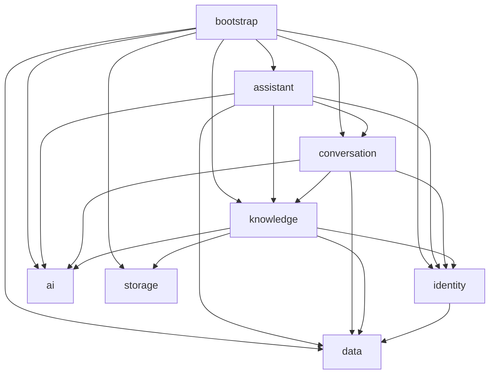

# 后端模块结构

日期：2026-09-21。依据 F01—F32 功能规划和已确认的九子模块方案整理。F03—F09 的知识库、成员授权、文档上传、持久任务、解析分块、向量生成、原子发布和授权查看代码已经落位，构建与运行回归待执行；预留模块仅说明后续职责，不代表对应业务已实现。F01—F09 继续保持待验收。

## 一、工程结构

采用 Maven 多模块的模块化单体：九个子模块，加父工程共十个 Maven 工程，一个可执行 Spring Boot 应用，共用 PostgreSQL。基础包名保持 `com.haha.supportai`。

```text
backend/
├── pom.xml                         # support-ai-parent：聚合、依赖与插件版本
├── support-ai-common/              # 公共响应、异常、traceId、Web 支撑
├── support-ai-data/                # MyBatis-Plus、类型映射、按业务分包的数据访问
├── support-ai-storage/             # 文件存储边界
├── support-ai-identity/            # 账号、认证、CSRF、安全配置
├── support-ai-ai/                  # Chat、Embedding、模型接入配置
├── support-ai-knowledge/           # 知识、导入、检索
├── support-ai-conversation/        # 会话、运行、RAG、来源、SSE
├── support-ai-assistant/           # 工单与 ReactAgent 助手
└── support-ai-bootstrap/          # 唯一启动入口、全部 Controller 与应用装配
    ├── src/main/java/com/haha/supportai/
    │   ├── SupportAiApplication.java
    │   ├── controller/
    │   │   └── identity/AuthController.java
    │   └── config/                # 全局 OpenAPI 等应用装配
    ├── src/main/resources/
    │   ├── application.yml
    │   ├── application-ollama.yml
    │   ├── application-dashscope.yml
    │   └── db/migration/          # 全局有序的 Flyway 生产迁移
    └── src/test/                  # 跨模块集成、数据库与真实模型验收
```

## 二、职责与实现边界

| 模块 | 责任 | 本次迁移状态 |
| --- | --- | --- |
| common | 公共成功/错误响应、追踪标识、Web 通用错误处理 | 迁入现有公共代码，不依赖业务模块或 Sa-Token |
| data | MyBatis-Plus、PostgreSQL 驱动、Hikari、事务与 TypeHandler，以及按业务分包的 PO、持久化枚举、Repository、Mapper | 账号、知识库、成员、文档/版本/任务、分块和向量已实现；后续业务持久化按对应业务包增加 |
| storage | FileStore、本地受控目录、路径校验与文件读写 | F05 已实现随机内部键、临时文件、原子移动、幂等删除和路径边界校验；F07 增加受控打开读取，解析服务不接触真实磁盘路径 |
| identity | 账号认证、Sa-Token、CSRF、AuthenticatedUser、身份 DTO/VO、安全与异常处理 | 使用 data.identity 读取账号，已提供管理员守卫和不含密码字段的账号目录服务，待后端验收 |
| ai | Ollama/DashScope 选择、ChatClient、Embedding、向量校验与调用超时 | 迁入已有配置和纯单元测试，真实模型待验收 |
| knowledge | 知识库、成员授权、文档/版本、导入任务、分块、向量、检索策略 | F03—F05 已实现知识库、授权和上传受理；F06 已实现任务查询、租约协调及有界 Worker 基础；F07 已接入受控读取、解析和分块；F08 已接入批量向量化、断点续作和原子发布，授权检索待 F11 实现 |
| conversation | 会话、消息、run、来源、工具审计、SSE、历史、幂等、取消、RAG、回答引擎契约 | 包边界预留，待 F10 起实现 |
| assistant | 只读工单业务、ReactAgent、工具白名单与执行预算 | ticket/agent 包边界预留，待 F25 起实现 |
| bootstrap | 主类、全部 Controller、应用配置、全局 OpenAPI、Flyway、应用集成和真实模型验收 | 认证、账号目录、知识库、成员、文档上传和任务查询 Controller 已集中，唯一可执行 Boot JAR |

全部 Controller 由 bootstrap 按业务域集中管理；identity 保留认证、安全配置与账号目录，knowledge 已具备知识库、成员、`AccessPolicy`、文档上传、任务租约、解析分块、向量生成和发布编排。data.knowledge 的 `entity.po`、`enums`、`repository`、`mapper` 已包含 `KnowledgeDocument`、`DocumentVersion`、`IngestionJob`、`DocumentChunk` 和 `DocumentVector` 及其状态；JSON/JSONB、pgvector 与任务租约使用显式 Mapper SQL，业务服务不直接使用 JdbcTemplate。storage 提供 `FileStore` 和本地实现，knowledge 只持久化内部 `storage_key`，不接触或返回真实磁盘路径。

已有实际代码的 identity 主包、data 根包及 data.identity 包不再保留占位 `package-info.java`；尚未实现业务的现有包说明继续标识职责边界。本次职责包整理不新增占位文件或空 service 接口。默认管理员由 bootstrap 的 Flyway V4 初始化，其余演示账号使用 data 中的独立种子 SQL 按需补齐，不由 Java 初始化组件创建。

## 三、依赖方向

下图箭头表示“依赖”。bootstrap 的 Controller 调用业务模块服务，同时装配业务与基础模块；common 为叶子模块，图中省略各模块对它的公共依赖。



当前尚未实现的业务调用以模块边界预留。任何模块均不反向依赖 bootstrap；data、storage、ai 不反向依赖业务模块，尤其 data 不依赖 identity。后续跨模块业务调用使用所属业务模块的 `contract` 接口和数据契约。data 虽集中存放不同业务域的持久化代码，业务模块仍只能通过所属业务服务访问其他域，不能直接调用其他域 Repository 绕过授权和流程规则。

conversation 负责定义 `AnswerEngine` 等回答能力契约，assistant 在后续任务中实现 ASSISTANT 模式，使依赖保持 `assistant → conversation`。RAG 编排归 conversation，知识召回、授权过滤、融合与重排序归 knowledge，模型提供方适配归 ai。

## 四、公共数据层与事务

| 内容 | 归属 |
| --- | --- |
| MyBatis-Plus、驱动、连接池、事务与 TypeHandler | data |
| 用户 PO、持久化角色枚举、Repository、Mapper | data.identity，本轮已迁移 |
| 知识库、成员的持久化 | data.knowledge，F03 已实现 |
| 文档、版本、任务、分块、向量的持久化 | data.knowledge；文档、版本、任务已在 F05 实现，分块与向量随 F07—F08 增加 |
| 会话、消息、run、来源、工具审计的持久化 | data.conversation，随对应任务实现 |
| 工单的持久化 | data.assistant，随对应任务实现 |
| 认证、知识授权、业务状态与事务编排 | identity、knowledge、conversation、assistant 对应业务服务 |
| 实际连接参数、生产迁移和全局迁移顺序 | bootstrap |
| 自动补齐默认管理员 | bootstrap 的 `db/migration/V4__initialize_default_admin.sql` |
| 手动演示账号种子 SQL | data 的 `src/main/resources/db/seed/identity/init_app_user.sql` |

data 通过公共依赖提供基础设施和各业务域的持久化实现，Spring Boot 在唯一应用上下文中完成自动装配。不同业务域分别组织实体、枚举、Repository 和 Mapper；业务服务决定查询授权条件与事务边界，Repository 保留业务查询语义并调用 Mapper，Mapper 负责 SQL 执行与结果映射。业务代码不直接使用 JdbcTemplate 或 RowMapper，不跨业务域直接调用 Repository/Mapper。上层 API DTO、认证会话对象和业务流程留在业务模块，不随实体一起迁移到 data。

当前 AppUserRepository 保留 `findByUsername`、`findById`、`isEnabled` 三个方法，内部调用继承 BaseMapper 的 AppUserMapper。AppUser 显式映射表和列，UUID 主键使用 INPUT、由调用方提供，UserRoleEnum 按字符串保存，时间使用 OffsetDateTime。`data.config.MybatisPlusConfiguration` 注册 `UuidTypeHandler` 和 `VectorTypeHandler`；向量 Mapper 使用显式 CAST 与批量 upsert。当前注解 SQL 足以表达已实现查询，不提前创建空 XML。

knowledge 统一负责文档上传和后续发布短事务。F05 在文件落盘前做初次 WRITE 校验，落盘后于事务内锁定启用知识库与成员行并再次确认 WRITE，再登记文档、版本、任务和 pending 指针；事务失败由外层补偿删除文件。F06 的领取、续租、进度、阶段推进和失败回写分别使用短事务，所有执行结果同时校验 owner、token 和未过期租约；解析和外部模型调用在事务外执行。F08 每批在独立事务中幂等确认 chunk、写入 vector 并更新进度；发布事务再次锁定 job/version/document，在一次提交中完成 READY、active/pending 和 SUCCEEDED。

授权关联查询、任务租约与条件更新、chunk/向量批量写入保留显式 Mapper SQL；通用 CRUD、逻辑删除或乐观锁插件不能代替成员授权、active/pending 指针和 lease token 校验。F08 已实现 `VectorTypeHandler`，JSON 继续在显式 SQL 中转换。PgVectorStore 验收和独立 SQL 测试夹具仍可使用 JDBC，它们不等同于业务 Repository；正式向量写入只经过 knowledge 服务和 data Mapper。

## 五、内部包约定

Controller 统一归 support-ai-bootstrap 的 `com.haha.supportai.controller.<业务>`，先集中 HTTP 入口，再按业务划分子包。业务模块的其余代码遵循“业务域 → 职责包”，Service、DTO/VO、安全配置、过滤器与异常处理器继续归原模块；简单模块直接划分职责包，复杂业务先划分功能子包再按职责细分。当前已实现代码的包结构如下，图中各目录都以 `com.haha.supportai` 为根：

```text
com.haha.supportai/
├── controller/                    # support-ai-bootstrap：全部业务 Controller
│   ├── identity/
│   │   └── AuthController.java
│   └── knowledge/
│       ├── AdminKnowledgeBaseController.java
│       ├── DocumentController.java
│       ├── IngestionJobController.java
│       ├── KnowledgeBaseController.java
│       └── KnowledgeBaseMemberController.java
├── identity/                       # support-ai-identity
│   ├── service/
│   │   ├── AuthenticationService.java
│   │   ├── CsrfTokenService.java
│   │   └── UserDirectoryService.java
│   ├── entity/
│   │   ├── dto/
│   │   │   ├── LoginRequest.java
│   │   │   └── AuthenticatedUser.java # 内部认证快照，不是数据库 PO
│   │   └── vo/
│   │       ├── CsrfTokenResponse.java
│   │       ├── CurrentUserResponse.java
│   │       └── UserSummaryResponse.java
│   ├── security/
│   │   ├── ActiveAccountGuard.java
│   │   ├── AdministratorGuard.java
│   │   └── PasswordHasher.java
│   ├── filter/
│   │   └── CsrfProtectionFilter.java
│   ├── exception/
│   │   ├── AccountUnavailableException.java
│   │   ├── IdentityAccessDeniedException.java
│   │   └── InvalidCredentialsException.java
│   ├── handler/
│   │   └── IdentityExceptionHandler.java
│   └── config/
│       ├── SecurityConfiguration.java
│       └── IdentityOpenApiConfiguration.java
├── common/                         # support-ai-common
│   ├── entity/vo/
│   │   ├── ApiError.java
│   │   └── ApiResult.java
│   ├── filter/TraceIdFilter.java
│   ├── handler/ApiExceptionHandler.java
│   └── support/SecurityResponseWriter.java
├── data/                           # support-ai-data
│   ├── config/MybatisPlusConfiguration.java
│   ├── typehandler/UuidTypeHandler.java
│   └── identity/
│       ├── entity/po/AppUser.java
│       ├── enums/UserRoleEnum.java
│       ├── repository/AppUserRepository.java
│       └── mapper/AppUserMapper.java
└── ai/                             # support-ai-ai
    ├── config/AiConfiguration.java
    └── model/ValidatedEmbeddingModel.java
```

data 按业务域统一组织持久化代码，PO 一律置于所属业务域的 `entity.po`，枚举、Repository 与 Mapper 分开；SQL 与结果映射由 Mapper 及 TypeHandler 维护，本次不变更数据库结构。其余持久化包仍为后续规划：

```text
com.haha.supportai.data/
├── config/
│   └── MybatisPlusConfiguration.java
├── typehandler/
│   └── UuidTypeHandler.java
├── identity/
│   ├── entity/po/
│   │   └── AppUser.java
│   ├── enums/
│   │   └── UserRoleEnum.java
│   ├── repository/
│   │   └── AppUserRepository.java  # 保留业务查询语义
│   └── mapper/
│       └── AppUserMapper.java      # BaseMapper；复杂 SQL 按需扩展
├── knowledge/                     # F03—F08 知识、文档、任务租约、分块与向量持久化
│   ├── entity/po/
│   │   ├── KnowledgeBase.java
│   │   ├── KbMember.java
│   │   ├── KnowledgeDocument.java
│   │   ├── DocumentVersion.java
│   │   ├── IngestionJob.java
│   │   ├── DocumentChunk.java
│   │   └── DocumentVector.java
│   ├── enums/
│   │   ├── KnowledgeBaseStatusEnum.java
│   │   ├── KbPermissionEnum.java
│   │   ├── DocumentVersionStatusEnum.java
│   │   ├── IngestionJobStatusEnum.java
│   │   └── IngestionStageEnum.java
│   ├── repository/
│   │   ├── KnowledgeBaseRepository.java
│   │   ├── KbMemberRepository.java
│   │   ├── KnowledgeDocumentRepository.java
│   │   ├── DocumentVersionRepository.java
│   │   ├── IngestionJobRepository.java
│   │   ├── DocumentChunkRepository.java
│   │   └── DocumentVectorRepository.java
│   └── mapper/
│       ├── KnowledgeBaseMapper.java
│       ├── KbMemberMapper.java
│       ├── KnowledgeDocumentMapper.java
│       ├── DocumentVersionMapper.java
│       ├── IngestionJobMapper.java
│       ├── DocumentChunkMapper.java
│       └── DocumentVectorMapper.java
├── conversation/                  # 会话持久化，后续实现
└── assistant/                     # 工单持久化，后续实现
```

Controller 继续集中到 bootstrap 的 controller 下，按 identity、knowledge、conversation、assistant 等业务域划分。当前 identity 包含认证和管理员账号目录 Controller，knowledge 包含知识库元数据和成员管理 Controller；其余包随实际功能新增，不提前创建空目录。以下为控制器包的归属与实现状态：

```text
support-ai-bootstrap/src/main/java/com/haha/supportai/controller/
├── identity/              # AuthController、AdminUserController
├── knowledge/             # 知识库、成员、文档上传与 IngestionJobController；检索调试待后续实现
├── conversation/          # 规划：会话、问答、运行与来源
└── assistant/             # 规划：工单查询与助手相关入口
```

后续复杂业务的服务和数据契约按功能划分包，再按实际需要增加职责包。F05 已创建 document 下的配置、DTO/VO、异常、处理器、服务和支撑类；F06 已创建 ingestion 的任务查询、协调、Worker 和租约异常边界；F07 在 document.parsing 下增加受控读取、CommonMark 解析、token 预算分块、处理配置校验和分块持久化；F08 在 document.embedding 下增加批量配置、异常、模型空间校验、向量短事务和发布事务，并在 ingestion.worker 下接入 EMBED/PUBLISH 阶段处理器。retrieval 仍由 F11 实现：

```text
com.haha.supportai.knowledge/
├── contract/              # 提供给其他模块的能力契约
├── access/                # 已实现 AccessPolicy，后续资源授权继续复用
├── space/                 # 知识库管理
├── document/              # 文档、版本、原文与发布
│   ├── config/
│   ├── parsing/            # F07 原文读取、规范化、标题解析与分块
│   │   ├── config/
│   │   ├── entity/dto/
│   │   ├── exception/
│   │   └── service/
│   ├── embedding/          # F08 批量向量生成、幂等续作与原子发布
│   │   ├── config/
│   │   ├── exception/
│   │   └── service/
│   ├── service/
│   ├── handler/
│   ├── exception/
│   ├── support/
│   └── entity/
│       ├── dto/
│       └── vo/
├── ingestion/             # 持久任务查询、租约协调和有界 Worker
│   ├── config/            # Worker、轮询与心跳的有界配置
│   ├── service/           # 授权查询与短事务任务协调
│   ├── worker/            # PARSE/CHUNK/EMBED/PUBLISH 处理器与轮询调度
│   ├── handler/
│   ├── exception/
│   └── entity/
│       ├── dto/
│       └── vo/
└── retrieval/             # 授权召回、融合与排序

com.haha.supportai.assistant/
├── ticket/                # 工单业务用例与授权
└── agent/                 # ReactAgent、工具适配、预算
```

bootstrap 中的 controller 负责请求校验、HTTP 状态和调用所属业务模块的 service，不直接访问 Repository 或编排模型；业务模块不反向依赖 bootstrap。service 承载用例、授权、业务规则与短事务，不为单一实现机械创建接口和 impl。仅确有跨模块契约、多种实现或替换边界时定义接口，跨模块能力继续放 `contract`。filter、handler、exception、config、security、model、support 等包根据实际职责创建，不随 Controller 集中迁移。

DTO 是请求或内部传输对象，VO 是对外响应对象，均保留在所属业务模块；PO 是持久化实体，集中在 data 对应业务域。DTO、VO、PO 使用 Lombok 和中文字段注释；业务与注解类型统一通过 import 引入。API 保留 OpenAPI 3.0 的操作、参数、数据模型和鉴权说明，成功响应依据方法返回类型及 HTTP 状态注解生成，不逐接口重复声明响应列表；通用错误约定由统一错误响应和安全回归维护。提示词随使用它的模块管理。

枚举类型统一以 `Enum` 结尾（如 `UserRoleEnum`），独立常量类统一以 `Constant` 结尾，异常类型统一以 `Exception` 结尾。配置类、服务类、过滤器中的常量字段不影响所属类的职责命名；异常处理器仍以 `ExceptionHandler` 结尾。

纯单元测试跟随被测类的包结构，例如 identity.security.PasswordHasherTest、ai.model.ValidatedEmbeddingModelTest 和 ai.model.DashScopeEmbeddingContractTest。控制器测试及应用、数据库和真实模型集成测试放在 bootstrap，不为测试引入业务模块对 bootstrap 的反向依赖。

## 六、版本、配置与迁移

父 POM 统一管理 JDK 21、Boot 3.5.8、Spring AI 1.1.2、Spring AI Alibaba / Extensions 1.1.2.2、MyBatis-Plus 3.5.17、Sa-Token、springdoc、Knife4j 和构建插件版本。三个 AI BOM 分别导入，子模块声明所需依赖，不重复指定版本。普通子模块输出常规 JAR，只有 bootstrap 执行 Spring Boot 重打包。

data 引入 `com.baomidou:mybatis-plus-spring-boot3-starter:3.5.17`，不重复添加普通 MyBatis Starter，也不直接声明 starter-jdbc；数据源与 JDBC 设施由专用 Starter 的传递依赖提供。Spring Boot 继续固定 3.5.8。[3.5.17 官方发布 POM](https://repo.maven.apache.org/maven2/com/baomidou/mybatis-plus-spring-boot3-starter/3.5.17/mybatis-plus-spring-boot3-starter-3.5.17.pom) 已存在，但项目最终依赖解析与运行兼容性仍待 Maven 验证。

springdoc-openapi 固定 2.9.1，Swagger annotations 与之统一到 2.2.55；版本依据为 [springdoc 2.9.1 官方 POM](https://raw.githubusercontent.com/springdoc/springdoc-openapi/v2.9.1/pom.xml)。Knife4j 4.5.0 的旧 springdoc 依赖继续排除。公共模块仅使用注解依赖，文档运行组件由 bootstrap 装配；Cookie 鉴权方案归 identity 的 `IdentityOpenApiConfiguration`，全局元信息归 bootstrap 的 `OpenApiConfiguration`。

应用 YAML 与生产 Flyway 脚本集中在 bootstrap。已执行迁移的名称、内容和顺序保持不变；隔离验收向量表的迁移只放 bootstrap 测试资源。业务 PO、持久化枚举、Repository 和 Mapper 集中到 data 的对应业务包，MyBatis-Plus 不接管 Flyway 的建表和迁移职责。

F02 的 `V3__comment_app_user.sql` 为账号表及全部 8 个字段补充中文数据库注释，`V4__initialize_default_admin.sql` 自动补齐默认管理员 `admin/admin`。已有 V1—V3 内容保持不变。2026-09-21 先在当前开发库直接执行 V4 文件补齐管理员，幂等重放返回 `INSERT 0 0`，当前后端基础登录成功；后续应用启动已由 Flyway 正式登记 V4—V9，当前历史为 V1—V9 全部成功。Maven 与完整认证回归仍待运行。

F03 的 `V5__create_knowledge_base.sql` 创建 `knowledge_base`、`kb_member`、状态与权限约束、无级联外键、查询索引及完整中文表列注释。V1—V5 已在一次性 PostgreSQL 16 + pgvector 0.8.6 容器中按顺序执行成功；该结果只验证 SQL，不替代 Flyway、MyBatis Mapper、事务和 HTTP 链路的应用验收。

F05 的 `V6__create_document_ingestion.sql` 创建 `document`、`document_version`、`ingestion_job`，包含状态、哈希、计数、1024 维、唯一性及无级联外键约束，并以两条复合外键保证 active/pending 版本属于当前文档。V6 及对应 MyBatis Mapper、JSONB 写入、真实上传事务尚待 Testcontainers/Maven 运行验收。

F06 的 `V7__clarify_ingestion_attempt_comments.sql` 不修改表结构，只把 `attempt/max_attempts` 的数据库注释明确为“单个处理阶段”的尝试计数；任务成功推进阶段时由租约条件 SQL 将 attempt 重置为 0。V7 和任务并发领取仍待 Testcontainers/Maven 运行验收。

F07 的 `V8__create_document_chunk.sql` 创建可定位分块元数据表；F08 的 `V9__create_vector_store.sql` 创建 `id/content/metadata/embedding` 标准四字段表，使用 `id` 一对一引用 chunk 并固定 `vector(1024)`。初期保持精确检索，不提前创建 HNSW。2026-09-21 已确认当前开发库由 Flyway 执行至 V9，pgvector 0.8.6、四字段和 `vector(1024)` 均符合设计；空库 Testcontainers、向量 TypeHandler、批次回滚、原子发布及真实模型仍待运行验收。

V4 只补齐管理员；独立演示脚本 `backend/support-ai-data/src/main/resources/db/seed/identity/init_app_user.sql` 保留 `admin/admin`、`support1/support1`、`support2/support2`，用于手动补齐普通演示用户或缺失管理员。两份脚本均使用兼容 jBCrypt 的 cost 12 BCrypt 摘要和 `ON CONFLICT (username) DO NOTHING`，重复执行不覆盖密码、角色或启用状态。独立演示脚本不在 Flyway 扫描目录、不自动执行；Java 演示初始化及相关配置保持移除。数据库配置与 DashScope 环境密钥规则保持 README 约定。

## 七、任务归属

下表列出业务实现的主要承载模块；各任务新增的 HTTP Controller 均统一归 bootstrap 的 controller 对应业务子包，DTO/VO 与业务服务留在表中所属模块。

| 任务 | 承载模块 |
| --- | --- |
| F01 工程、数据库、模型连接 | bootstrap、common、data、ai |
| F02 身份认证 | identity、data.identity、common、bootstrap |
| F03—F04 知识库与成员权限 | knowledge、data.knowledge，调用 identity 身份契约 |
| F05—F09 上传、导入、发布、查看 | knowledge、data.knowledge、storage、ai |
| F10—F17 会话、RAG、引用、SSE、历史 | conversation、knowledge、data 对应业务包、ai |
| F18—F20 版本、删除、导入恢复 | knowledge、data.knowledge、storage |
| F21—F24 评测、融合、重排序 | knowledge、conversation、data 对应业务包、ai；题集保留 evaluation 目录 |
| F25 工单查询 | assistant 的 ticket 包、data.assistant |
| F26—F28 工具与 ReactAgent 助手 | assistant、knowledge、conversation、data 对应业务包、ai |
| F29—F32 综合验收、诊断、部署恢复 | 各模块自身能力与 bootstrap 跨模块集成验收 |

## 八、启动与验收

在仓库根目录运行 PowerShell。启动前按 README 准备数据库和模型环境。类迁移及移除 Java 初始化后首次构建先执行 `clean`，清除旧类的编译产物；随后安装本地模块并启动 bootstrap。Flyway 完成 V1—V6 表结构迁移，并通过 V4 自动补齐默认管理员：

```powershell
mvn -f backend/pom.xml -DskipTests clean install
mvn -f backend/support-ai-bootstrap/pom.xml spring-boot:run
# 已注入云端密钥时，可改用以下启动方式
mvn -f backend/support-ai-bootstrap/pom.xml spring-boot:run '-Dspring-boot.run.profiles=dashscope'
```

后端首次启动完成后，如需普通演示用户，在另一个 PowerShell 终端执行以下可选命令：

```powershell
Get-Content -Raw -Encoding utf8 'backend/support-ai-data/src/main/resources/db/seed/identity/init_app_user.sql' | docker compose -f deploy/compose.dev.yml exec -T postgres psql -U supportai -d supportai -v ON_ERROR_STOP=1
```

F02 隔离数据库测试需同时验证 V4 自动创建管理员，以及手动脚本补齐普通用户、重复执行不覆盖已有账号。当前开发库的默认管理员和基础登录已验证，实际处理结果见 F02 记录；隔离数据库回归和完整认证流程仍待运行验收。

首次清理完成后，未移动类的日常开发可使用 `mvn -f backend/pom.xml -DskipTests install`。打包运行：

```powershell
mvn -f backend/pom.xml -DskipTests clean package
java -jar backend/support-ai-bootstrap/target/support-ai-bootstrap-1.0.0-SNAPSHOT.jar
```

聚合验证继续使用父 POM，先执行最快的编译，再运行测试和环境验收：

```powershell
mvn -f backend/pom.xml -DskipTests clean compile
mvn -f backend/pom.xml clean test
mvn -f backend/pom.xml dependency:tree
mvn -f backend/pom.xml -Pdb-it verify
mvn -f backend/pom.xml -Plive-ai '-Dspring.profiles.active=ollama' verify
mvn -f backend/pom.xml -Plive-ai '-Dspring.profiles.active=dashscope' verify
```

identity、ai 的纯单元测试留在本模块；应用装配、认证/OpenAPI、数据库和真实模型验收放 bootstrap，避免业务模块测试反向依赖启动模块。普通测试报告位于各模块 `target/surefire-reports/`，数据库及模型报告位于 `backend/support-ai-bootstrap/target/failsafe-reports/`。

从父工程指定单个测试时，补充 `'-Dsurefire.failIfNoSpecifiedTests=false'`，让没有匹配测试的上游模块正常参与构建；全量 `test` 命令无需此参数。

此前数据层迁移的静态检查确认九个子模块依赖无环，账号、知识库、成员和文档持久化代码已集中 data。F05—F08 已形成上传、持久任务、解析分块、向量写入和原子发布链路；F09 在 data 增加授权文档/版本查询与 `vector_store` 正文投影，在 knowledge 增加查询服务、受控原文读取和响应模型，在 bootstrap 集中提供五个文档查看 Controller 入口及数据库验收测试。前端 7 个测试文件共 40 项测试与生产构建已通过，但后端 MyBatis SQL、Sa-Token 权限、OpenAPI 契约和真实 API 尚未运行 Maven。Controller 仍集中 bootstrap。先前构建目录中的旧包类、旧 Controller、旧 Repository 和已删除 Java 初始化器需由首次 `clean` 构建清理，避免旧组件继续参与扫描。

本次调整依照仓库规则未运行 Maven。需要重新确认：聚合构建、MyBatis-Plus/MyBatis/MyBatis-Spring 与 Boot 的实际依赖版本、唯一可执行 JAR、Mapper 扫描、UUID/枚举/JSONB/时间映射和回滚、全局组件扫描、Flyway V1—V9、成员授权/改权/撤权、文档上传权限行锁、文件补偿、任务租约、解析分块、向量发布、F09 授权查看、Sa-Token/CSRF/OpenAPI 边界、模型四种组合及真实模型调用。阶段验收结果统一见 [验收记录](验收记录/)，未通过前保持开发计划未勾选。
