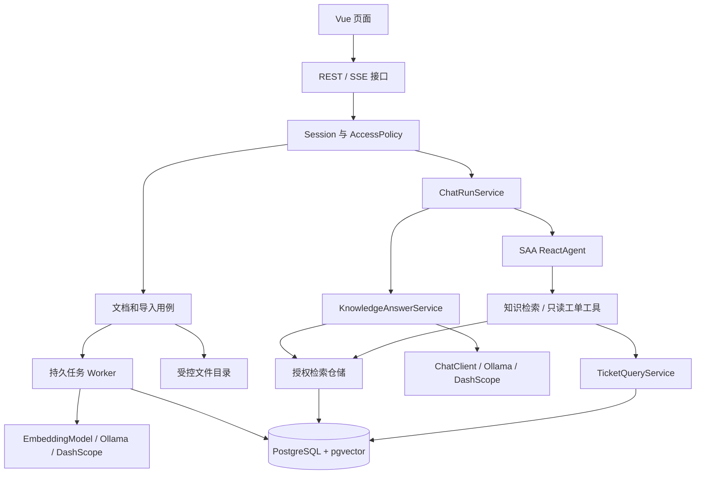
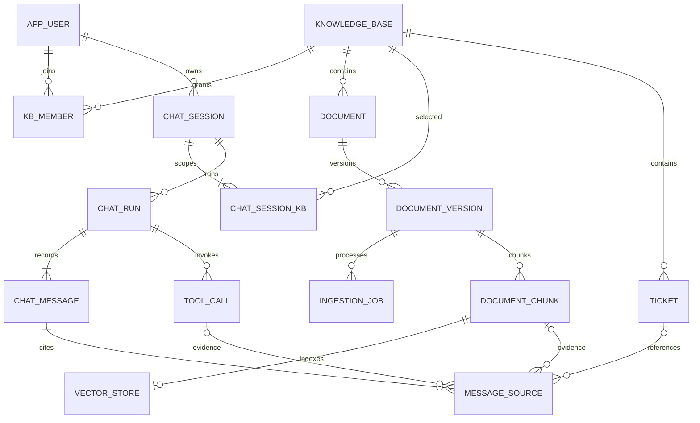

# SupportAI 技术设计大纲

项目名称：SupportAI 企业技术支持 AI 助手  
项目版本：**V1.0.0**  
文档状态：V1.0.0 设计基线；F01—F08 已分阶段实现但仍有构建、数据库、真实模型和运行验收项，完成状态以开发计划和阶段验收记录为准。

SupportAI 是从零构建的企业技术支持 AI 助手，采用 **Spring AI Alibaba** 实现模型接入、知识问答和受控工具调用。本大纲定义 V1.0.0 的业务范围、技术选型、项目分层、数据库、接口、关键流程与验收要求。表名、接口路径和业务类名均为本项目拟建契约，框架接入与运行效果在实施时验证。

## 1. 项目目标与范围

### 1.1 产品定位

面向研发和技术支持人员的知识助手。以模拟订单系统为业务背景，解决“查错误码、理解接口、排查故障、查工单当前状态”四类问题。

用户上传 Markdown/TXT 文档后，系统完成解析、分块和向量化；问答时只检索当前用户有权访问的有效资料，输出流式答案和可查看的原文引用。工单状态从业务表实时查询，不能根据模型记忆或旧文档猜测。

### 1.2 业务模块

| 模块 | V1.0.0 功能范围 | 用户获得的能力 |
| --- | --- | --- |
| 账号与授权 | 登录、退出、当前用户、READ/WRITE 成员、撤权校验 | 按授权访问资料与自己的会话 |
| 知识管理 | 知识库、MD/TXT 上传、导入状态、分块预览、新版本、删除、重试/取消 | 将业务资料转成可维护、可查询的知识 |
| RAG 问答 | 授权向量检索、关键词融合、可开关 Rerank、证据不足处理、引用 | 查询错误码、接口说明和故障处理方法，并核对出处 |
| 会话 | 固定知识范围、流式回答、历史、幂等、取消、有限历史与追问改写 | 连续提问并控制每次回答过程 |
| 业务工具 | 工单查询服务、知识检索工具、只读工单工具、受限 ReactAgent | 在助手中查询工单当前状态并结合资料解释 |
| 评测与运行 | 固定评测集、质量对比、用量记录、部署及恢复验证 | 判断回答是否可靠，并持续维护服务 |

以上功能均属于 **V1.0.0**，通过可验收的小功能逐步叠加。文本 PDF、OCR、图片问答、知识图谱、跨会话长期记忆、多智能体、写操作工具、多租户 SaaS 和可视化工作流不纳入本版本。

### 1.3 权限规则

- 全局角色只有 `ADMIN`、`USER`。ADMIN 可创建/停用知识库和管理成员；不因管理员身份自动获得资料读取权。
- 知识库成员权限只有 `READ`、`WRITE`，WRITE 包含 READ。WRITE 可上传、更新、删除该库文档；READ 可问答、查看文档与原文。
- 创建知识库时，在同一事务为创建者插入 WRITE 成员。`knowledge_base.owner_id` 表示负责人，不作为绕过成员校验的隐藏通道。
- 会话和运行记录还要检查创建者身份。拥有某知识库访问权，不代表可以读取其他人的聊天。
- 这是单应用的成员授权，不是组织/租户隔离。V1.0.0 不引入 tenant_id 或完整权限管理平台。

## 2. 技术选型与版本管理

### 2.1 主技术栈

| 层面 | 本项目方案 | 选择理由与边界 |
| --- | --- | --- |
| Java | JDK 21 | 统一 Java 运行环境；工程初始化时验证框架兼容性 |
| Web | Spring Boot 3.5.x、Spring MVC | 单实例 REST + SSE 服务，与选定框架版本线配套 |
| AI 框架 | Spring AI Alibaba 1.1.2.2 稳定线 | DashScope 模型接入、ReactAgent 与受控工具调用 |
| AI 基础抽象 | 与 SAA 配套的 Spring AI 1.1.2 | ChatClient、ChatModel、EmbeddingModel、Document、工具调用等 |
| 关系与向量库 | PostgreSQL 16 + pgvector 0.8.x | 一套数据库管理业务、任务、向量、版本切换；镜像补丁版/digest 在工程初始化时固定 |
| 数据访问 | MyBatis-Plus 3.5.17，Spring Boot 3 专用 Starter | 简单查询使用 BaseMapper；授权、租约与向量检索保留显式 Mapper SQL |
| 数据迁移 | Flyway，含 PostgreSQL 支持模块 | 统一管理扩展、表、约束和索引；不用向量组件自动创建生产表 |
| 身份 | Sa-Token 1.46.0 + Cookie 登录态 + Servlet Session CSRF | 同源网页适用；单实例内存登录态，重启需要重新登录 |
| 接口文档 | springdoc-openapi 2.9.1 + Knife4j 4.5.0 | 生成 OpenAPI 3.0 契约；文档入口受 Sa-Token 保护 |
| 文档 | UTF-8 TXT、Markdown 结构解析 | 支持两种明确格式，保留章节与原文定位 |
| 生成模型 | 默认 Ollama qwen2.5:3b；可切换北京地域 DashScope qwen-plus | ChatModel 独立选择提供方；真实模型分别验收 |
| 向量模型 | 默认 Ollama bge-m3；可切换 DashScope text-embedding-v4，均为 1024 维 | 同一索引的文档/问题使用同一模型配置，不跨模型混检 |
| 重排序 | qwen3-rerank，独立适配，可关闭 | 通过固定评测集比较收益；超时回退，基础问答可独立运行 |
| 入库后台 | PostgreSQL 任务表 + 有界执行器 | 任务持久化、租约、重试和幂等；V1.0.0 无独立 MQ |
| 文件 | 受控本地目录 + Docker volume | 仅后端鉴权读取，接口留出将来替换 S3/OSS 的边界 |
| 前端 | Vue 3、TypeScript、Vite、Element Plus | 工程初始化时固定版本与 Node 组合并提交 lockfile |
| 流式协议 | POST + fetch 消费 SSE | 支持 JSON 请求体、CSRF、取消；后端 SseEmitter 适配模型/Agent 流 |
| 部署 | Docker Compose：web、app、postgres | 单机可复现；数据库、原文件使用持久卷 |
| 验证与观测 | JUnit、Spring Boot Test、Testcontainers、Vitest、Actuator、结构化日志 | 真实数据库行为做集成测试；外部模型测试显式执行，无外部遥测默认依赖 |

V1.0.0 采用模块化单体和单机部署；服务发现、独立缓存、消息队列与集群编排按实际扩展需求引入。

### 2.2 依赖版本基线

**项目版本 V1.0.0 与框架、数据库的依赖版本独立管理。** 工程采用下列初始验证组合：

| 组件 | 初始验证版本 | 固定方式 |
| --- | --- | --- |
| Java | 21 | 构建与运行环境一致 |
| Spring Boot | 3.5.8 | 在 3.5.x 版本线内验证补丁更新后锁定 |
| Spring AI | 1.1.2 | Spring AI BOM |
| Spring AI Alibaba | 1.1.2.2 | SAA BOM |
| Spring AI Alibaba Extensions | 1.1.2.2 | Extensions BOM |
| PostgreSQL / pgvector | 16 / 0.8.x | 接入验证后固定镜像补丁版本及 digest |
| 前端依赖 | Vue 3 / TypeScript / Vite / Element Plus | 验证 Node 兼容组合，提交 lockfile |

Java 与 Spring 依赖组合参考 SAA 固定标签的根 POM 与依赖示例。实施时检查实际依赖树、应用启动、Chat、Embedding、流式响应和工具调用；验证通过后锁定精确版本，避免单独覆盖 SDK 传递依赖。上述组合是待验证的设计基线，不代表已完成兼容性测试。[SAA 根 POM][saa-pom]、[依赖示例][chatbot-pom]、[Extensions 根 POM][extensions-pom]

### 2.3 需要哪些 Maven 组件

以下坐标来自对应官方源码，选择需要的组件；这里只给依赖清单，不把它当作已构建的完整 POM。

| 坐标 | 引入时机 | 用途 |
| --- | --- | --- |
| `org.springframework.ai:spring-ai-bom:1.1.2` | 工程初始化 | 管理 Spring AI 组件 |
| `com.alibaba.cloud.ai:spring-ai-alibaba-extensions-bom:1.1.2.2` | 工程初始化 | 管理 DashScope 等扩展 |
| `com.alibaba.cloud.ai:spring-ai-alibaba-bom:1.1.2.2` | 工程初始化 | 管理 SAA Agent/Graph 组件 |
| `com.alibaba.cloud.ai:spring-ai-alibaba-starter-dashscope` | 模型接入 | Chat、Embedding 等模型适配 |
| `org.springframework.ai:spring-ai-starter-model-ollama` | 模型接入 | 本机 Ollama Chat / Embedding，与 DashScope 按角色切换 |
| `org.springframework.ai:spring-ai-pgvector-store` | F01 测试依赖 | 手动装配 PgVectorStore 验证；不在普通启动时创建业务向量表 |
| `com.alibaba.cloud.ai:spring-ai-alibaba-agent-framework` | 只读工具助手 | 受限 ReactAgent、工具调用与框架执行能力 |
| `com.alibaba.cloud.ai:spring-ai-alibaba-graph-core` | 显式 Graph 扩展时 | StateGraph 工作流；Agent Framework 已依赖它，无需重复写不同版本 |

三个 BOM 的职责不同，不能只引入 SAA BOM 就假设所有 DashScope/Spring AI 组件均被管理。V1.0.0 通过本地注册的业务工具完成助手功能，无需远程 MCP 或多智能体模块。[依赖示例][chatbot-pom]、[Agent 模块][agent-pom]

### 2.4 模型配置的边界

Chat、Embedding、Rerank 各有独立角色、超时和用量统计。API Key、端点、业务空间与地域通过环境变量传入；模型调用只发生在后端。

F01 已确认支持本机独立 Ollama。默认本地配置选择 qwen2.5:3b 和 bge-m3，关闭 DashScope 自动配置且无需云端密钥；启用 dashscope profile 后，可按 Chat / Embedding 角色分别选择 ollama 或 dashscope。应用只装配当前选定的一个 ChatModel 和一个 EmbeddingModel；普通启动不调用模型，不自动下载或回退。bge-m3 使用原生 1024 维密集向量，实际返回值仍须校验长度、条数和有限数值。云端与本地真实验收分别执行，结果见 [F01 验收记录](F01验收记录.md)。

对于本文选定的 text-embedding-v4，同步接口当前支持 1024 维，每批最多 10 条、每条最多 8192 token。应用仍需自己按 token/批次预算分批，不能只按中文字符数检查；模型接入验收时验证所选 starter 是否能正确传递模型、维度和 document/query 相关参数。[官方 Embedding API][embedding-api]

V1.0.0 应用运行期间固定一份 Embedding 配置。更换模型或维度属于索引迁移：建立独立向量空间、完整重建并验证，再一起切换查询模型与数据索引；不能只修改环境变量后继续查询旧向量。

### 2.5 可替换技术边界

| 能力 | V1.0.0 实现 | 可替换方向 | 替换需要验证的事项 |
| --- | --- | --- | --- |
| 生成模型 | Ollama / DashScope + ChatModel/ChatClient | 兼容的其他模型服务 | 流事件、工具调用、错误映射、用量字段 |
| 向量模型 | EmbeddingModel，1024 维 | 其他模型或维度 | 全量重建独立索引，查询与文档同步切换 |
| 文件存储 | FileStore + 本地卷 | S3/OSS 等对象存储 | 受控读取、删除补偿、历史引用与备份 |
| 检索存储 | PostgreSQL + 自定义授权检索仓储 | 独立向量库或搜索服务 | 权限过滤、版本原子发布和跨系统一致性 |
| 后台执行 | 持久任务表 + 有界执行器 | 消息队列与独立 Worker | 保留租约、重复消费幂等、取消和重试语义 |

替换通过业务能力接口隔离。涉及外部索引时，必须重新设计数据库与索引的同步及授权一致性，不能仅替换连接配置。

## 3. Spring AI Alibaba 在项目中的具体位置

| 框架能力 | 本项目使用方式 | 业务仍需自行负责 |
| --- | --- | --- |
| ChatModel / ChatClient | 通过 Ollama 或 DashScope 调用生成模型，承载 RAG 提示词和流式输出 | 授权、证据选择、引用校验、错误与状态落库 |
| EmbeddingModel | 分块和问题向量化；批次与返回维度显式校验 | 分块策略、版本、幂等和预算 |
| Document / PgVectorStore | 使用标准文档/向量结构，完成接入验证 | 成员授权和当前版本的数据库关联约束 |
| ReactAgent | 实现受限制的工单/知识工具调用 | 可信用户上下文、工具白名单、结果来源、次数/时间预算 |
| StateGraph | 后续需要显式分支、并行或恢复时再采用 | 节点业务、授权、数据一致性和运行状态映射 |
| ChatMemory / Checkpoint | 视阶段选择；不能与业务会话重复注入历史 | 历史授权、保留规则、运行终态、恢复语义 |

V1.0.0 提供两种固定会话模式：`RAG` 由 `KnowledgeAnswerService` 使用 ChatClient 编排知识检索与生成；`ASSISTANT` 由 SAA ReactAgent 选择并调用知识检索、工单查询工具。[SAA 概览][saa-overview]、[Agents][saa-agents]

**业务历史与框架状态分开**：数据库 chat_session/chat_message 是用户可见历史的唯一业务来源。每次从中选取少量仍有权访问的消息，注入本轮模型一次；不要再叠加一个自动回放全部消息的 Memory Advisor。

Graph checkpoint 保存节点执行快照。V1.0.0 以业务运行表记录问答状态，不启用持久 checkpoint；如需可恢复的复杂工作流，再单独设计快照存储、连接管理与恢复语义。

## 4. 项目分层与目录

### 4.1 部署与代码组织

一个 Spring Boot 可执行应用、一个 Vue 前端、一套 PostgreSQL。后端采用九个子模块，加父工程共十个 Maven 工程；`support-ai-parent` 聚合并管理版本，`support-ai-bootstrap` 是唯一启动与可执行 JAR 模块。账号、公共 Web、模型接入、知识库与成员授权、F05 文档上传受理以及 F07 解析分块能力已迁入对应模块；后续业务仍以包说明预留边界，多模块实现尚待构建与回归验收。

```text
support-ai/
  backend/
    pom.xml                        # support-ai-parent
    support-ai-common/             # 响应、异常、traceId 与公共 Web 支撑
    support-ai-data/               # MyBatis-Plus、类型映射、业务实体与数据访问
    support-ai-storage/            # F05 FileStore 与 F07 受控原文件读取
    support-ai-identity/           # 账号认证、Sa-Token、CSRF 与身份 DTO/VO
    support-ai-ai/                 # Ollama / DashScope 与模型配置
    support-ai-knowledge/          # 知识库、成员授权、上传、F07 解析分块
    support-ai-conversation/       # 会话、运行、来源、SSE、RAG，待实现
    support-ai-assistant/          # 工单查询、ReactAgent 与工具适配，待实现
    support-ai-bootstrap/
      src/main/java/com/haha/supportai/
        SupportAiApplication.java
        controller/                # 全部 Controller 按业务归集
          identity/AuthController.java
          knowledge/               # 知识库元数据与成员管理 Controller
        config/                   # 全局 OpenAPI 与应用装配
      src/main/resources/
        application*.yml
        db/migration/              # 全局有序的生产迁移
      src/test/                    # 应用集成、数据库与真实模型验收
  frontend/src/
    api/  pages/  components/  stores/  types/
  evaluation/                      # JSONL 问题、配置、结果
  data/demo/                       # 模拟业务资料和工单种子
  deploy/                          # Dockerfile、Compose、反向代理
  doc/
```

所有 Controller 统一放在 support-ai-bootstrap 的 `com.haha.supportai.controller.<业务>`：当前 `controller.identity` 包含认证和管理员账号目录，`controller.knowledge` 包含知识库元数据和成员管理；后续按功能实际增加 `controller.conversation`、`controller.assistant`，不创建空目录。业务模块内部继续遵循“业务域 → 职责包”，使用 `service / entity.dto / entity.vo / filter / handler / exception / config`，按实际需要增加 `security / model / support / contract / access`。复杂业务可以先按功能划分子包，再细分上述职责；不为单一实现机械创建 service 接口。`AppUser`、`UserRoleEnum`、`AppUserRepository` 分别归 `com.haha.supportai.data.identity.entity.po`、`com.haha.supportai.data.identity.enums`、`com.haha.supportai.data.identity.repository`。枚举、独立常量类、异常类型分别统一使用 `Enum`、`Constant`、`Exception` 后缀。DTO/VO 留在所属业务模块，`AuthenticatedUser` 作为内部认证快照归 identity.entity.dto。AI、身份纯单元测试与被测类包结构对应；控制器、跨模块集成与真实验收测试集中在 bootstrap。提示词随使用它的业务模块维护。

`data` 统一提供 MyBatis-Plus、数据库驱动、连接池、TypeHandler 与事务设施，并按 identity、knowledge、conversation、assistant 等业务包承载实体 PO、持久化枚举、Repository 和 Mapper；data 不依赖 identity 或其他业务服务模块。业务服务通过 Repository 调用 Mapper，不直接使用 JdbcTemplate 或 RowMapper。连接参数和 Flyway 表结构迁移集中在 bootstrap；手动演示数据脚本放 data 的 `src/main/resources/db/seed/identity/init_app_user.sql`，不进入自动迁移。knowledge 服务统一决定知识成员授权、文档发布事务和授权检索条件；conversation 服务定义回答引擎契约并管理运行与来源业务，assistant 通过实现该契约提供助手模式。业务授权和事务编排留在业务服务，跨域调用必须经过相应业务服务，不能因共享 data 而直接使用其他域的 Repository/Mapper。common 不依赖业务模块或 Sa-Token，身份异常与 Cookie OpenAPI 安全方案归 identity。具体依赖图、任务映射和开发约定见[后端模块结构](后端模块结构.md)，MyBatis-Plus 数据层迁移尚待构建和回归验收。

| 职责包 | 允许承担的工作 | 依赖规则 |
| --- | --- | --- |
| bootstrap 下的 controller.<业务> | HTTP 参数、状态码、SSE/文件响应 | 调所属业务模块的 service，不拼 SQL、不直接调模型 |
| service | 用例、鉴权入口、业务状态、短事务、调用顺序 | 通过所属业务服务或 contract 协调业务域，不跨域直调 Repository |
| entity.dto / entity.vo | 请求及内部传输 / 对外响应 | 留在所属业务模块，不兼作数据库实体 |
| data 下的业务域 entity.po / enums / repository / mapper | PO、持久化枚举、业务查询门面、SQL 与映射 | Repository 调 Mapper 执行所属业务服务确定的查询条件，不反向依赖业务模块 |
| filter / handler / exception / config | 请求过滤、统一异常处理、业务异常与装配 | 通用处理归 common，身份专有处理归 identity |
| security / access / model / support / contract | 安全、资源授权、模型适配、支撑能力与跨模块契约 | 按实际能力设置，不越过 service 决定业务授权 |

认证和管理员账号目录 Controller 已归 bootstrap 的 `controller.identity`，知识库元数据和成员 Controller 已归 `controller.knowledge`。认证、CSRF 与安全用户目录归 identity.service，账号有效性、密码和管理员角色校验归 identity.security；知识库事务和成员变更归 knowledge.service，ADMIN、成员 READ/WRITE 与 ACTIVE 边界由 knowledge.access.AccessPolicy 统一判定。common 的公共响应归 `entity.vo`，追踪过滤器归 `filter`，错误处理归 `handler`，安全响应写出归 `support`。ai 的模型装配与向量校验分别归 `config`、`model`。bootstrap 汇聚 HTTP 入口并依赖业务模块，业务模块不反向依赖 bootstrap。编译和运行回归仍待执行。

data 引入 `com.baomidou:mybatis-plus-spring-boot3-starter:3.5.17`，不重复引入普通 MyBatis Starter；Spring Boot 继续固定 3.5.8。AppUserMapper、KnowledgeBaseMapper、KbMemberMapper 使用 BaseMapper 和显式结果映射；知识库可访问查询、`id + revision` 条件更新及成员复合键列表、授权、撤权使用注解 SQL。成员授权通过 PostgreSQL `ON CONFLICT` 幂等覆盖权限与授权人，并保留首次授权时间。UUID 主键由应用提供，枚举按名称保存，时间使用 OffsetDateTime；data.config.MybatisPlusConfiguration 注册 data.typehandler.UuidTypeHandler。当前无自定义 XML，后续复杂 SQL 按需放入 `resources/mapper/<业务>/`。PgVectorStore 验收及独立 SQL 测试夹具保留 JDBC 使用；该版本组合的运行兼容性、事务回滚和 Mapper 行为尚待 Maven 验证。

### 4.2 关键业务组件（项目自定义）

| 组件 | 职责 |
| --- | --- |
| AccessPolicy | 给定可信用户与资源，判定 READ/WRITE/管理能力 |
| DocumentApplicationService | 上传、版本创建、删除和激活事务 |
| IngestionWorker | 领取任务，调用解析/分块/Embedding，校验租约后提交结果 |
| AuthorizedRetrievalRepository | 对向量和关键词查询统一追加权限、当前版本和有效状态 |
| KnowledgeAnswerService | RAG 问答编排；证据不足处理；生成与引用 |
| ChatRunService | 请求幂等、并发约束、运行终态、取消和消息落库 |
| CitationService | 本轮证据编号、来源授权和历史引用定位 |
| TicketQueryService | 网页与工具共用的工单查询及授权 |
| SupportAgentService | SAA ReactAgent 装配与运行；接入已授权的业务工具 |
| FileStore | 上传、受控读取、删除；不向调用者泄漏真实磁盘路径 |



Spring MVC 使用 SseEmitter 将模型/Agent 输出转换为项目事件。阻塞的数据库访问、解析与文件 IO 放在有界工作执行器，不阻塞模型响应线程；所有流事件按运行串行发送。用户身份作为服务端不可变执行上下文传递，不能依赖模型参数或假设 ThreadLocal 自动跨所有异步边界传播。

## 5. 数据库设计

### 5.1 总体规则和表清单

V1.0.0 设计 **15 张业务/向量表**，随业务功能逐步建立迁移。评测数据存放在 JSONL 文件；Session 使用单实例内存存储，Graph checkpoint 不在本版本持久化范围内。

- 业务主键使用应用生成的 UUID；外部展示工单编号单独用字符串。API 的 UUID 一律作为字符串传输。
- 时间使用 `timestamptz`，按 UTC 保存；前端按用户时区展示。计数/序号用整数，模型用量缺失为 NULL，不填虚假的 0。
- 表中状态用 `varchar` + CHECK 约束，便于 Flyway 演进。下文未注明可空的核心字段均为 NOT NULL；默认值在迁移中明确。
- 普通实体有 `created_at/updated_at`；成员关系、范围关系有 created_at；向量表维持其四字段结构。
- 外键不全局使用级联删除。文档先逻辑删除；历史引用所需的 ID 和版本元数据保留，原文与向量按清理任务回收。
- 业务源数据是关系表。向量 metadata 只镜像定位信息，不能单独承担权限与有效版本判断。

| 序号 | 表 | 职责 | 所属功能 |
| --- | --- | --- | --- |
| 1 | app_user | 账号与全局角色 | 账号与知识库授权 |
| 2 | knowledge_base | 知识库 | 账号与知识库授权 |
| 3 | kb_member | 知识库成员与权限 | 账号与知识库授权 |
| 4 | document | 逻辑文档及有效/待激活版本指针 | 文档上传 |
| 5 | document_version | 原文件、处理配置与版本状态 | 文档上传 |
| 6 | ingestion_job | 持久任务及执行权 | 文档导入与失败恢复 |
| 7 | document_chunk | 分块归属与原文位置 | 文档解析与分块 |
| 8 | vector_store | 分块正文与向量 | 向量索引 |
| 9 | chat_session | 用户会话 | 会话与问答 |
| 10 | chat_session_kb | 会话固定知识库范围 | 会话与问答 |
| 11 | chat_run | 一次问答执行、幂等和终态 | 会话与问答 |
| 12 | chat_message | 用户消息和最终/部分回答 | 会话与问答 |
| 13 | message_source | 文档与工具来源 | 回答来源与工具证据 |
| 14 | ticket | 模拟工单 | 工单查询 |
| 15 | tool_call | 工具执行及其结果来源 | 只读工具助手 |



### 5.2 账号与知识库

**1. app_user**

| 字段 | 类型 | 说明 |
| --- | --- | --- |
| id | uuid PK | 用户 ID |
| username | varchar(64) | 登录名；应用统一规范化后入库 |
| password_hash | varchar(255) | jBCrypt 生成的 BCrypt 密码摘要 |
| display_name | varchar(100) | 展示名 |
| role | varchar(16) | ADMIN / USER |
| enabled | boolean | 默认 true；停用后受保护请求校验失效 |

约束：`UNIQUE(username)`；不返回 password_hash。V1.0.0 不开放注册接口，Flyway V4 自动补齐默认管理员 `admin/admin`；`support1/support1`、`support2/support2` 两位普通演示用户通过独立 SQL 按需手动导入。手动脚本同时保留管理员补齐能力。两份脚本保存兼容 jBCrypt 的 cost 12 BCrypt 摘要，使用 `ON CONFLICT (username) DO NOTHING` 只补齐缺失账号，不覆盖已有密码、角色或启用状态。默认管理员由版本迁移初始化，不由 Java 启动组件反复创建。

**2. knowledge_base**

| 字段 | 类型 | 说明 |
| --- | --- | --- |
| id | uuid PK | 知识库 ID |
| name | varchar(120) | 名称 |
| description | text，可空 | 业务范围 |
| owner_id | uuid FK → app_user | 负责人，仅记录身份；数据访问仍按成员表 |
| status | varchar(16) | ACTIVE / DISABLED |
| revision | bigint | 乐观并发控制，默认 0 |

索引：`(status, updated_at)`；同名知识库允许存在，以 ID 区分。完整删除知识库作为后续扩展，V1.0.0 提供停用。

**3. kb_member**

| 字段 | 类型 | 说明 |
| --- | --- | --- |
| kb_id | uuid FK → knowledge_base | 知识库 |
| user_id | uuid FK → app_user | 被授权用户 |
| permission | varchar(16) | READ / WRITE |
| granted_by | uuid FK → app_user | 授权管理员 |

主键：`(kb_id, user_id)`；反查索引：`(user_id, kb_id)`。创建库与创建者 WRITE 成员在同一事务完成。

### 5.3 文档、版本、任务与向量

**4. document**

| 字段 | 类型 | 说明 |
| --- | --- | --- |
| id | uuid PK | 逻辑文档 ID，跨上传版本保持不变 |
| kb_id | uuid FK → knowledge_base | 所属库 |
| name | varchar(255) | 展示名，不用于拼磁盘路径 |
| active_version_id | uuid，可空 | 当前唯一生效版本；尚未完成首次导入时为空 |
| pending_version_id | uuid，可空 | 当前允许被 Worker 激活的新版本 |
| next_version_no | integer | 在行锁内分配版本号，默认 1 |
| created_by | uuid FK → app_user | 创建者 |
| deleted_at | timestamptz，可空 | 非空即不可用于检索或原文读取 |
| revision | bigint | 乐观并发控制 |

索引：`(kb_id, updated_at DESC)`，可对 `deleted_at IS NULL` 建部分索引。`active_version_id/pending_version_id` 通过 `(id, version_id)` 的复合外键指向 document_version 的 `(document_id, id)`，保证不能串到另一份文档；循环关系在建表后用 ALTER 添加，两个指针允许 NULL。

**5. document_version**

| 字段 | 类型 | 说明 |
| --- | --- | --- |
| id | uuid PK | 版本 ID |
| document_id | uuid FK → document | 逻辑文档 |
| version_no | integer | 文档内递增版本 |
| storage_key | varchar(512) | 内部文件标识，接口不直接返回磁盘路径 |
| file_hash / file_size | char(64) / bigint | SHA-256 与字节数 |
| media_type / original_filename | varchar(100) / varchar(255) | 校验后的类型与原名 |
| status | varchar(16) | QUEUED / BUILDING / READY / FAILED / CANCELLED |
| parser_version / chunker_version | varchar(64) / varchar(64) | 算法版本 |
| embedding_model / dimensions | varchar(128) / integer | V1.0.0 固定模型与 1024 维 |
| config_hash / config_snapshot | char(64) / jsonb | 分块、模型等处理参数快照，无密钥 |
| chunk_count | integer | 完成后分块数，默认 0 |

约束：`UNIQUE(document_id, version_no)`、`UNIQUE(document_id, id)`、`version_no > 0`、`dimensions=1024`（V1.0.0）。旧版 READY 不代表仍生效，必须以 document.active_version_id 判断。相同哈希按同一逻辑文档判断重复，不对其他用户泄露文件是否存在。

**6. ingestion_job**

| 字段 | 类型 | 说明 |
| --- | --- | --- |
| id | uuid PK | 任务 ID |
| version_id | uuid FK → document_version | 目标版本，V1.0.0 每版本一条任务 |
| status / stage | varchar(16) / varchar(24) | 状态与 PARSE/CHUNK/EMBED/PUBLISH 阶段 |
| attempt / max_attempts | integer / integer | 实际领取次数与上限，初始 0 / 3 |
| lease_owner / lease_token | varchar(100)、uuid，均可空 | 执行实例和每次领取的新凭据 |
| lease_until / heartbeat_at | timestamptz，均可空 | 执行权有效期与心跳 |
| next_run_at | timestamptz | 可领取时间 |
| completed_chunks / total_chunks | integer / integer，可空 | 进度；分块完成前总量可空 |
| error_code / error_detail | varchar(64)、text，均可空 | 归类错误与脱敏摘要 |
| cancel_requested_at | timestamptz，可空 | 取消请求时间 |
| started_at / finished_at | timestamptz，均可空 | 本次执行时间 |

约束：`UNIQUE(version_id)`；状态为 QUEUED / RUNNING / RETRY_WAIT / SUCCEEDED / FAILED / CANCELLED。领取索引：`(status,next_run_at)`；失联检查索引：`(status,lease_until)`。人工重试在达到上限时返回 409，需显式重新建版本/重建任务，不能隐式无限重试。详细尝试记录先用带 attempt 的结构化日志，后续需要审计每次完整轨迹再加尝试表。

**7. document_chunk**

| 字段 | 类型 | 说明 |
| --- | --- | --- |
| id | uuid PK | 稳定分块 ID，同时作为 vector_store.id |
| version_id | uuid FK → document_version | 所属版本；经版本可追溯文档和库 |
| chunk_index | integer | 版本内序号，从 0 开始 |
| section | text，可空 | 章节层级 |
| page_no | integer，可空 | PDF 扩展时使用，1 起算 |
| start_offset / end_offset | integer / integer | 规范化文本的字符范围，左闭右开 |
| content_hash | char(64) | 当前分块内容 SHA-256 |
| char_count / token_count | integer、integer 可空 | 字符数与可获得的 token 估计 |

约束：`UNIQUE(version_id,chunk_index)`，`chunk_index >= 0`，`end_offset > start_offset >= 0`，`char_count = end_offset - start_offset`，摘要必须是小写 SHA-256。先按该唯一键取得/插入分块，再生成或复用 UUID，任务重试不能为同一分块随意换 ID。正文只以 vector_store.content 为权威副本，避免关键词和向量查到不同文本。

**F07 解析与分块实现边界**：解析处理器只能通过 `FileStore.open(storage_key)` 读取受控原文件，并在进入解析器前检查文件大小、原始字节数、SHA-256 和严格 UTF-8 解码；不允许把用户原始文件名拼成路径，也不允许向接口返回真实磁盘路径。正文先执行 BOM、CRLF/CR 换行和行尾空白规范化，控制字符清理后再判断空内容。Markdown 使用 CommonMark 解析器识别标题及完整标题层级，TXT 使用空标题层级；起止位置统一记录为规范化文本的 UTF-16 左闭右开偏移。

分块器使用 `CL100K_BASE` 作为可复现的近似 token 计数器，以配置的最大 token 数为硬上限，并优先在段落、换行和句末边界切分；超大段落仍按代码点边界切开，不能拆分 UTF-16 代理对。每个分块保留内容 SHA-256、字符数和 token 估计，ID 由 `versionId + ":" + chunkIndex` 生成名称 UUID。`DocumentChunkPersistenceService` 在 CHUNK 短事务中重新验证 job 的 owner、token、阶段和租约，按 `(version_id, chunk_index)` 批量幂等写入并清理多余旧块。F07 完成后任务进入 EMBED；F08 会重新受控读取并按固化配置生成相同分块，逐项核对元数据后才将正文与 1024 维向量成对写入 `vector_store`。

**8. vector_store**

| 字段 | 类型 | 说明 |
| --- | --- | --- |
| id | uuid PK、FK → document_chunk.id | 一对一；分块可先存在、向量稍后就绪 |
| content | text | 分块正文 |
| metadata | json | 与固定版 PgVectorStore 示例保持四字段布局；镜像 kb/document/version/chunk/定位信息 |
| embedding | vector(1024) | 当前固定 Embedding 模型的文档向量，禁止跨模型混用 |

最初 20–40 篇文档采用精确余弦检索形成基线。需要加速时添加 `HNSW (embedding vector_cosine_ops)`，对有权限/版本过滤的查询重新评测 Recall@K 和执行计划；SQL 有 LIMIT 不代表有过滤时一定返回足够好的候选。

**向量存取方案**：保留 PgVectorStore 的四字段结构，正式业务链路使用 MyBatis Mapper 与 `VectorTypeHandler` 读写，显式维护批量 SQL，与对应 document_chunk 幂等确认使用同一短事务，并通过关系表联合过滤授权和生效版本。Spring AI EmbeddingModel 在事务外生成向量；PgVectorStore 继续只用于接入小验证/适配兼容检查，其底层 JDBC 使用不受业务 Mapper 迁移影响，不把其通用 metadata 过滤当成全部业务授权。F08 已实现 TypeHandler 和批量写入，F11 再实现授权检索。这属于项目适配设计，starter 不会自动认识新增关系表。[固定版 PgVectorStore 文档][pgvector-doc]

一次批处理只生成一次 Embedding。若未来改用 `VectorStore.add()`，它会调用 EmbeddingModel，必须删除外层重复向量化；不能“手动生成向量后再 add”并假设 add 会复用它。

**F08 向量与发布实现边界**：EMBED 开始前必须要求文档版本中的模型名、1024 维和完整配置快照与当前选定提供方一致；切换 Ollama/DashScope 或模型名后，旧 pending 版本不得继续生成或发布，必须按新配置重建。每次重试重新解析原文件并核对 `document_chunk`；数据库中已存在的 vector 必须与当前 chunk ID、正文和 metadata 构成从 0 开始的连续前缀，只有该前缀可跳过模型调用。后续批次在事务外调用 `EmbeddingModel.embed(List<String>)`，按输入顺序校验数量、维度和有限数值，再在短事务中锁定 job/version/document，复核 owner、token、有效期、pending 和删除状态，幂等写入 chunk/vector 并单调更新进度。

PUBLISH 阶段再次校验模型快照，并在同一事务中锁定任务、版本和文档，要求 `document_version.chunk_count`、`document_chunk` 数量、`vector_store` 数量及 `vector_dims=1024` 数量完全一致；随后依次将版本置为 READY、切换 active、清空 pending，并只在完整进度和有效发布租约仍成立时将任务置为 SUCCEEDED。任何一步冲突都整体回滚，已生成但未发布的向量不能作为后续检索候选。初期仍使用精确余弦检索，不在 F08 提前创建 HNSW；F11 建立授权检索基线并评测后再决定索引。

### 5.4 会话、运行与引用

**9. chat_session**

| 字段 | 类型 | 说明 |
| --- | --- | --- |
| id | uuid PK | 会话 ID |
| user_id | uuid FK → app_user | 唯一拥有者 |
| title | varchar(200) | 展示标题 |
| mode | varchar(16) | RAG / ASSISTANT；工具功能未启用时只开放 RAG |
| next_message_seq | bigint | 行锁内分配消息顺序，默认 1 |
| deleted_at | timestamptz，可空 | 逻辑删除 |

索引：`(user_id, updated_at DESC)`。会话的知识库集合和模式创建后固定，切换范围创建新会话，避免把旧上下文带入不相容权限范围。

**10. chat_session_kb**

字段：`session_id uuid FK → chat_session`、`kb_id uuid FK → knowledge_base`、`created_at timestamptz`；主键 `(session_id,kb_id)`，反查索引 `(kb_id,session_id)`。每个会话至少关联一个库，由创建用例在事务中检查；数据库外键不能自动保证“至少一条”。

**11. chat_run**

| 字段 | 类型 | 说明 |
| --- | --- | --- |
| id | uuid PK | 一次问答运行，可用于取消和状态查询 |
| session_id | uuid FK → chat_session | 所属会话 |
| client_request_id | uuid | 前端每次用户提交生成，网络重发保持不变 |
| request_hash | char(64) | 规范化问题与语义参数哈希 |
| status | varchar(16) | QUEUED / RUNNING / COMPLETED / FAILED / CANCELLED |
| config_snapshot | jsonb | 模型、Prompt、检索、索引配置快照，无凭证 |
| usage | jsonb，可空 | 各能力用量、缺失标记，不仅统计最后一次模型调用 |
| metrics | jsonb | 检索、首个答案增量、总耗时等 |
| error_code / error_detail | varchar(64)、text，均可空 | 失败或中断原因 |
| cancel_requested_at | timestamptz，可空 | 持久化取消信号 |
| started_at / finished_at | timestamptz，均可空 | 执行时间 |

约束：`UNIQUE(session_id,client_request_id)`；部分唯一索引 `UNIQUE(session_id) WHERE status IN ('QUEUED','RUNNING')`，同一会话同时只有一个运行。消息通过 run_id 反查，不再让 run 指回消息制造循环外键。

**12. chat_message**

| 字段 | 类型 | 说明 |
| --- | --- | --- |
| id | uuid PK | 消息 ID |
| run_id | uuid FK → chat_run | 本次运行 |
| session_id | uuid FK → chat_session | 便于分页；须与 run 所属会话一致 |
| seq | bigint | 会话内顺序 |
| role | varchar(16) | USER / ASSISTANT |
| content | text | 用户输入或已生成的正文，可保存中断前部分内容 |
| status | varchar(16) | USER 固定 COMPLETED；ASSISTANT 为 STREAMING/COMPLETED/FAILED/CANCELLED |

约束：`UNIQUE(session_id,seq)`、`UNIQUE(run_id,role)`；建立 chat_run 的 `UNIQUE(session_id,id)`，消息用 `(session_id,run_id)` 复合外键避免串会话。模型内部工具消息不作为额外用户可见消息，执行细节存 tool_call。

**13. message_source**

| 字段 | 类型 | 说明 |
| --- | --- | --- |
| id | uuid PK | 来源 ID |
| message_id | uuid FK → chat_message | 助手消息 |
| origin_source_id | uuid，可空，FK → message_source.id | 从已授权历史继承的来源；直接检索/工具来源为空，继承时指向原始来源 |
| citation_no | integer | 本轮 [1]、[2] 编号 |
| is_cited | boolean | 是否被最终答案显式引用，默认 false；未引用但进入模型的来源也必须保留 |
| source_type | varchar(16) | DOCUMENT / TICKET |
| kb_id | uuid FK → knowledge_base | 供当前授权复核；与真实来源所属库校验一致 |
| chunk_id | uuid，可空，FK → document_chunk | 文档来源；通过 chunk → version → document 追溯 |
| ticket_id / tool_call_id | uuid，均可空 | 启用工单工具时建立，分别 FK → ticket / tool_call |
| locator / snapshot | jsonb / jsonb | 章节、页码、文档版本，或工具查询时间/状态摘要 |

约束：`UNIQUE(message_id,citation_no)`，编号正数；CHECK 规定 DOCUMENT 必须有 chunk_id、不得有工单字段，TICKET 必须有 ticket_id/tool_call_id、不得有 chunk_id。当前直接来源挂到本 run 的助手消息，直接工具来源对应本 run 的 tool_call；历史继承来源允许指向以前的 tool_call，但必须通过 origin_source_id 追溯同一用户、同一会话内已授权的原来源。kb_id、工单、工具结果及历史来源对应关系在写入事务校验，测试覆盖伪造关联。

保存所有实际进入模型的文档证据、成功工具结果及所用历史消息的完整来源，不仅保存模型最后引用的几条；在送入模型前落库，失败/取消的部分回答也能追溯。历史来源继承时复制原来源定位，origin_source_id 指向原始记录，避免只记录上一步而漏掉更早来源；不允许任意形成引用环。否则文档先影响第一轮、再被第二轮总结后，删除文档仍可能从第二轮把旧知识带回。

### 5.5 工单与工具调用

**14. ticket**

| 字段 | 类型 | 说明 |
| --- | --- | --- |
| id | uuid PK | 内部 ID |
| ticket_no | varchar(32) UNIQUE | 外部业务编号，例如 T10086 |
| kb_id | uuid FK → knowledge_base | 授权范围 |
| title / description | varchar(200)、text 可空 | 工单内容 |
| status | varchar(24) | OPEN / IN_PROGRESS / RESOLVED / CLOSED |
| owner_name | varchar(100)，可空 | 模拟处理人 |

索引：`(kb_id,status,updated_at DESC)`。只读展示，不实现工单创建/流转业务；30 条演示数据通过种子数据导入。

**15. tool_call**

| 字段 | 类型 | 说明 |
| --- | --- | --- |
| id | uuid PK | 工具调用记录 |
| run_id | uuid FK → chat_run | 运行 ID |
| call_no | integer | 本次运行内次序 |
| provider_call_id | varchar(200)，可空 | 框架/模型返回的调用标识 |
| tool_name | varchar(100) | 白名单工具名 |
| arguments / result_snapshot | jsonb / jsonb，可空结果 | 经校验参数与受限结果快照 |
| status | varchar(16) | RUNNING / SUCCEEDED / FAILED / CANCELLED |
| error_code | varchar(64)，可空 | 工具错误类别 |
| started_at / finished_at | timestamptz，结束可空 | 耗时依据 |

约束：`UNIQUE(run_id,call_no)`。只读工具也记录失败，不能只存成功调用。真实用户身份从 run → session → user 及可信执行上下文取得，不从 arguments 中接收。

### 5.6 关键事务与一致性

| 场景 | 同一短事务内的动作 | 事务外动作 |
| --- | --- | --- |
| 创建知识库 | 插入 knowledge_base 与创建者 WRITE 成员 | 无 |
| 上传/新版本 | 首次上传锁启用知识库与成员关系并确认 WRITE；新版本另锁 document、检查无 pending、分配序号；插入 version/job 并设 pending | 先用随机内部键完成受控落盘；DB 失败补偿删除，定期回收未引用的孤立文件 |
| 领取任务 | 条件锁定可执行 job；attempt+1；新 lease_token；置 RUNNING/lease_until | 解析与远程 Embedding |
| 写分块批次 | 验证当前 attempt/token/租约/未删除；写 chunk 与 vector；更新进度 | Embedding 先计算完成，不持数据库长事务等模型 |
| 发布版本 | 锁 document/job；验证 pending 指针、执行权及完整片段；version 置 READY；旧 active 换成新版本；清 pending；job SUCCEEDED | 发布失败不得声称已完成 |
| 删除文档 | deleted_at；清 active/pending；使相关 job 取消/执行权失效 | 清理原文件和向量，失败可重试；保留历史引用需要的定位元数据 |
| 导入终态/重试 | RETRY_WAIT 保留 pending；最终 FAILED/CANCELLED 时仅清理仍指向自己的 pending；人工重试须重新取得空 pending 且目标未被新版本超越 | 达重试上限、文档已删除或已有更新待发布时拒绝重试，不无限重置 attempt |
| 开始问答 | 插入幂等 run；分配 seq；插入用户消息与 STREAMING 助手占位消息 | 检索、模型、工具和 SSE |
| 结束问答 | 条件更新运行唯一终态；保存正文、来源、用量与助手消息状态 | 成功提交后才发送 done |

领取可采用 `FOR UPDATE SKIP LOCKED`，但必须还有租约和旧执行者隔离。检查后到写入之间也要受同一事务/行锁保护，不能仅在方法开头检查一次。文档首次导入即具备持久任务、租约校验和原子激活，半成品不可进入查询；恢复功能在此基础上增加异常处理与操作入口。最终失败清 pending 后允许上传新版本；人工重试只允许 FAILED 且未达上限的版本，当前 active 的版本号不得高于重试目标；已主动取消的任务通过新建版本重新处理。

向量检索逻辑固定为：请求库 ∩ 会话库 ∩ 当前成员可读库；联合 chunk、version、document、knowledge_base 后要求库 ACTIVE、文档未删除、version.id=document.active_version_id、version READY。关键词分支使用同一授权查询构造器。排序和 LIMIT 在合法候选范围内执行，不能先全库 TopK 再把越权结果过滤掉。

历史引用可指向已非当前的旧版，返回 `isCurrent=false`；已删除文档不可预览。V1.0.0 仅清理已逻辑删除文档的文件和 vector_store 记录，正常旧版正文/文件保留供历史查看；将来若要仅清除旧向量、保留正文，必须先拆出正文存储再调整策略。

库权限被撤销时，会话读取/追加接口重新校验全部会话库，同时逐项检查 message_source 的真实归属；访问失效时要求开启合法范围的新会话，不回传旧正文。仅文档删除时可保留已生成回答并标来源失效，但与失效来源相关的整轮历史不再注入模型。正常新版本激活后，引用旧版本的回答也只保留展示/预览，不进入模型历史；V1.0.0 仅注入来源仍有效、仍为当前版本的完整轮次，并继承其全部来源，当前问题重新检索。

旧工单状态不能当作当前状态。Agent 工单工具要求 ticket.kb_id 同时位于会话范围和当前成员可读范围，不能只检查全局成员权限。

### 5.7 数据迁移分批落地

建议迁移顺序：身份/库/成员 → 文档/版本/任务与循环 FK → chunk/向量扩展 → 会话/运行/文档来源 → ticket/tool_call 与工具来源字段 → 恢复和性能索引。所有表结构初始化由 Flyway 执行；当前 V1 启用 pgvector、V2 建账号表、V3 补表列注释、V4 初始化默认管理员、V5 建知识库与成员授权表、V6 建文档/版本/任务表、V7 明确阶段尝试次数注释、V8 建可定位分块表、V9 建标准四字段 `vector_store`。补齐其他演示账号的种子 SQL 独立存放并手动执行，不进入 Flyway 扫描目录。`initialize-schema=false`，不配置启动时删除重建向量表。

V1—V5 已在一次性 PostgreSQL 16 + pgvector 0.8.6 容器中按顺序执行，V5 的表、约束、无级联外键、索引和注释通过 SQL 核对。2026-09-21 又确认当前开发库由应用 Flyway 登记 V1—V9，pgvector 0.8.6、`vector_store` 四字段和 `vector(1024)` 均已生效；该结果不替代空库 Testcontainers、MyBatis 映射、事务回滚和并发约束验证。本大纲其余未落地约束仍属于设计要求。

## 6. 接口设计

V1.0.0 定义 35 个 HTTP 方法与路径组合，覆盖身份、知识管理、导入、会话、问答和工单查询。

springdoc-openapi 根据当前代码和 OpenAPI 3 注解生成 OpenAPI 3.0 实际接口契约，Knife4j 通过 `/doc.html` 展示；JSON 位于 `/v3/api-docs`，Actuator 健康检查使用独立文档分组。文档入口和 JSON 均受 Sa-Token 保护，匿名用户不能借此枚举接口。当前认证、知识库元数据、管理员账号目录和成员管理接口已经进入生成契约；本节其余条目仍是后续任务的规划契约，不能据此声称功能已经交付。

接口保留 `Operation`、`Parameter`、`Schema` 和鉴权声明，成功响应从方法返回类型与 HTTP 状态注解推导，避免逐接口重复维护响应列表。下文统一错误结构及接口状态码仍是运行契约，通过异常处理与安全回归验证，不要求每个接口在生成文档中重复枚举全部通用错误。

### 6.1 通用契约

接口统一使用 `/api` 前缀。普通请求/响应使用 JSON；上传用 multipart/form-data；流式问答用 text/event-stream；文件响应通过鉴权后单独输出。

普通成功结构：`{"code":"OK","data":{},"traceId":"..."}`；错误结构：`{"code":"RESOURCE_NOT_FOUND","message":"资源不存在或不可访问","traceId":"..."}`。不将异常堆栈、供应商原始报文或数据库内容直接返回前端。

分页使用 `limit`（默认 20，最大 100）和不透明 `cursor`；响应为 `data.items`、`data.nextCursor`。文档/会话按 `(updated_at,id)`，消息按 seq 排序。UUID、时间和状态有稳定类型，时间格式为 ISO 8601 UTC。

身份由 Sa-Token 管理，浏览器通过 HttpOnly Cookie 自动提交登录 token；写请求及聊天 POST 还必须提交项目签发的 CSRF token。登录成功生成新的 Sa-Token 并轮换承载 CSRF 的 Servlet Session，登出同时失效两者。两类 Cookie 均配置同源 SameSite，HTTPS 环境设置 Secure。前端通过同源代理访问后端，不把 token 保存到 localStorage。

操作不存在或无权访问的具体文档、会话、工单时统一 404，避免通过 ID 探测资源；已登录但无管理/写能力返回 403。参数错误 400、未登录 401、状态冲突 409、超限文件 413、不支持格式 415、请求频率/配额 429、服务不可用 503。

权限缩写：`登录`、`ADMIN`、`KB-R`（该库 READ/WRITE）、`KB-W`（该库 WRITE）、`本人会话`（会话拥有者 + 当前范围授权）。资源 ID 只用于定位，不能替代授权。

### 6.2 登录、账号与知识库

| 方法 | 路径 | 权限 | 输入/输出要点 |
| --- | --- | --- | --- |
| GET | /api/auth/csrf | 匿名可取 | 返回 token 与需提交的 headerName，勿缓存 |
| POST | /api/auth/login | 匿名 + CSRF | JSON username/password；200 当前用户，设置新的 Sa-Token Cookie 并轮换 CSRF Session |
| POST | /api/auth/logout | 登录 + CSRF | 204，失效当前 Sa-Token 与 CSRF Session |
| GET | /api/auth/me | 登录 | id、username、displayName、role |
| GET | /api/admin/users | ADMIN | 演示账号选择列表；不返回密码字段 |
| GET | /api/admin/knowledge-bases | ADMIN | 所有知识库的管理列表，可按 ACTIVE/DISABLED 过滤；仅元数据，不返回资料正文 |
| GET | /api/knowledge-bases | 登录 | 当前有成员授权且 ACTIVE 的库 |
| POST | /api/knowledge-bases | ADMIN | name/description；201，创建者成为 WRITE 成员 |
| GET | /api/knowledge-bases/{kbId} | KB-R | 元数据、当前权限和文档统计 |
| PATCH | /api/knowledge-bases/{kbId} | ADMIN | name/description/status/revision；200，旧 revision 返回 409 |
| GET | /api/knowledge-bases/{kbId}/members | ADMIN | 成员和 READ/WRITE 权限 |
| PUT | /api/knowledge-bases/{kbId}/members/{userId} | ADMIN | permission=READ/WRITE；幂等新增/覆盖，200 |
| DELETE | /api/knowledge-bases/{kbId}/members/{userId} | ADMIN | 204，撤权立即影响后续请求 |

停用/授权属于管理员管理能力，不隐含原文访问权。管理页面使用专用管理列表查看所有知识库和停用状态；普通知识库列表只列当前有成员权限且 ACTIVE 的库。管理员读取文档、预览来源或问答时仍检查成员授权。

### 6.3 文档、版本和任务

| 方法 | 路径 | 权限 | 输入/输出要点 |
| --- | --- | --- | --- |
| GET | /api/knowledge-bases/{kbId}/documents | KB-R | 文档列表、当前/待激活版本、处理摘要 |
| POST | /api/knowledge-bases/{kbId}/documents | KB-W | multipart file、可选 displayName；202 documentId/versionId/jobId |
| GET | /api/documents/{documentId} | KB-R | 文档详情、版本指针、revision |
| GET | /api/documents/{documentId}/versions | KB-R | 版本号、状态、是否当前，分页 |
| POST | /api/documents/{documentId}/versions | KB-W | multipart file + expectedRevision；202 新任务 |
| GET | /api/documents/{documentId}/versions/{versionId}/chunks | KB-R | 分块与正文，核对文档/版本从属；已删除文档不可读 |
| GET | /api/documents/{documentId}/versions/{versionId}/content | KB-R | 受控原文件内容/下载；旧版可访问并标版本 |
| DELETE | /api/documents/{documentId} | KB-W | 202，立即逻辑失效；重复删除保持幂等 |
| GET | /api/ingestion-jobs/{jobId} | KB-R | status/stage/attempt/progress/retryable/cancellable 和脱敏错误 |
| POST | /api/ingestion-jobs/{jobId}/retry | KB-W | FAILED、未达上限且可重新取得 pending 时 202；否则 409 |
| POST | /api/ingestion-jobs/{jobId}/cancel | KB-W | 持久取消并释放本任务 pending；200 当前终态或 202 已接受 |
| POST | /api/knowledge-bases/{kbId}/retrieval-tests | KB-W | 调试 query/topK；返回证据/分数/耗时，不接受原始 SQL 或自由过滤表达式 |

新版本接口锁 document：正在构建另一版本返回 409；内容与当前版本相同且配置相同则 200 返回 `reused=true` 和已有版本，不重复调用模型。不同逻辑文档允许内容相同，不做跨用户哈希存在性查询。新建文档上传不承诺 HTTP 自动重试的严格去重；前端禁用重复提交，不盲目重发，必要时查询列表确认结果。

上传 202 示例（示例 UUID 均为占位演示数据）：

```json
{
  "code": "OK",
  "data": {
    "documentId": "10000000-0000-4000-8000-000000000001",
    "versionId": "20000000-0000-4000-8000-000000000001",
    "jobId": "30000000-0000-4000-8000-000000000001",
    "status": "QUEUED"
  },
  "traceId": "demo-upload-001"
}
```

Location 指向 `/api/ingestion-jobs/{jobId}`。没有可用向量或解析失败时，不能因收到 202 就展示“已可问答”。

F05 当前实现仅开放上述首次上传接口：后端严格校验 5 MB 内的 UTF-8 Markdown/TXT，以服务端随机内部键写入 `.local/storage`，再在短事务内创建逻辑文档、首版和 `QUEUED/PARSE` 任务。事务内锁定启用知识库与成员关系并重新判断 WRITE，使上传与撤权/改权串行化；数据库提交失败时补偿删除原文件。首次版本仅设置 pending，active 保持 NULL。前端成功态明确显示“已接收，处理中”，不提前提供可问答状态。该实现的 Maven、真实 PostgreSQL 和浏览器场景仍以 [F05 验收记录](F05验收记录.md) 为准。

F07 在上述任务链路上接入 PARSE/CHUNK 两个阶段：Worker 默认启用，使用 `FileStore.open` 受控读取并校验文件大小、字节数、SHA-256 和严格 UTF-8；Markdown 通过 CommonMark 标题层级形成章节，TXT 采用空章节；文本规范化后以 `CL100K_BASE` 近似 token 预算切分，分块元数据通过租约条件写入 `document_chunk`。F07 完成后任务进入 EMBED，仍不创建 `vector_store` 正文或向量，不切换 READY/active，也不开放问答；相关发布事务属于 F08。F07 的代码和单元测试用例已整理，但 Maven、Testcontainers/db-it 和真实应用场景尚未运行，详见 [F07 验收记录](F07验收记录.md)。

F08 已在该边界后接入 EMBED/PUBLISH：向量阶段按配置批量生成 1024 维文档向量并以短事务写入，发布阶段只有在 chunk、vector、维度、模型快照和有效租约全部一致时才原子切换 active 并完成任务。F08 不新增 HTTP 接口；F09 才提供文档与分块查看，F11 才提供授权检索。当前实现和待运行项见 [F08 验收记录](F08验收记录.md)。

### 6.4 会话、问答、取消与工单

| 方法 | 路径 | 权限 | 输入/输出要点 |
| --- | --- | --- | --- |
| POST | /api/chat/sessions | 登录 | kbIds、mode；全部授权通过后 201；范围不能为空 |
| GET | /api/chat/sessions | 登录 | 仅本人会话，返回访问是否仍有效；失效会话不返回正文 |
| PATCH | /api/chat/sessions/{sessionId} | 本人会话 | 只允许修改 title，不原地改库范围 |
| DELETE | /api/chat/sessions/{sessionId} | 会话拥有者 | 无活跃 run 时 204；有活跃 run 返回 409，先取消 |
| GET | /api/chat/sessions/{sessionId}/messages | 本人会话 | 按 seq 分页，返回正文、状态和授权后的引用 |
| POST | /api/chat/sessions/{sessionId}/messages | 本人会话 | clientRequestId/content；新请求返回 SSE |
| GET | /api/chat/runs/{runId} | 本人会话 | status、message IDs、部分/完整回答、来源、用量与终态错误 |
| POST | /api/chat/runs/{runId}/cancel | 会话拥有者 | 先验身份，允许撤权后停止自己的运行；幂等 200/202 |
| GET | /api/chunks/{chunkId}/source | KB-R | 来源正文、文档/版本/位置、isCurrent；与检索 active 条件分开 |
| GET | /api/tickets/{ticketNo} | 工单所属 KB-R | 真实模拟业务状态、updatedAt、queriedAt；不经过大模型 |

创建会话示例：

```json
{
  "kbIds": ["40000000-0000-4000-8000-000000000001"],
  "mode": "RAG"
}
```

流式问答请求示例：

```json
{
  "clientRequestId": "50000000-0000-4000-8000-000000000001",
  "content": "支付回调成功，但订单仍待支付，应该检查哪些配置？"
}
```

请求不接受 userId、任意工具名、任意提示词、原始模型端点或自由定义检索权限。会话/成员和服务器配置决定这些内容。

### 6.5 SSE 与幂等协议

1. 在开始输出前完成 JSON 校验、Sa-Token/CSRF、会话和库授权、预算与幂等检查；失败返回普通 JSON + 对应 HTTP 错误码。
2. 新请求创建 run 和两条消息后，返回 200、`Content-Type: text/event-stream`、禁止缓存；开始执行前将 run 更新为 RUNNING。
3. 相同 `(sessionId,clientRequestId)` 且载荷哈希相同：返回 **200 application/json**，包含已有 runId/status、`reused=true`，不重新生成、不重放流。前端根据 Content-Type 切换处理。相同键不同载荷返回 409 `IDEMPOTENCY_CONFLICT`。
4. 不同请求遇同会话活跃 run 返回 409 `RUN_IN_PROGRESS`。用户级并发/费用预算限制返回 429。
5. 模型和工具结果转换为下列项目事件，不将框架内部事件类型直接暴露给前端。

| 事件 | 数据 | 语义 |
| --- | --- | --- |
| start | runId、assistantMessageId | 本次运行已持久化，前端可据此取消/查状态 |
| delta | text | 追加答案文本，保留服务器顺序 |
| tool | callId、name、status、resultSummary | 只读工具助手的可展示调用过程，不含敏感参数和隐藏推理 |
| sources | sources 数组 | 已校验、可展示的引用；未显式引用的内部证据仍在库中参与授权检查 |
| done | runId、status=COMPLETED、usage、metrics | 成功保存完成状态后的唯一成功终态 |
| error | code、message、status=FAILED/CANCELLED、traceId | 运行失败/取消终态，已生成文本是部分结果 |

事件示意：

```text
event: start
data: {"runId":"60000000-0000-4000-8000-000000000001","assistantMessageId":"70000000-0000-4000-8000-000000000001"}

event: delta
data: {"text":"先核对回调地址与订单状态更新日志。[1]"}

event: sources
data: {"sources":[{"number":1,"type":"DOCUMENT","documentId":"10000000-0000-4000-8000-000000000001","versionId":"20000000-0000-4000-8000-000000000001","chunkId":"80000000-0000-4000-8000-000000000001","title":"支付回调排查","section":"3.2 状态更新","isCurrent":true,"previewPath":"/api/chunks/80000000-0000-4000-8000-000000000001/source"}]}

event: done
data: {"runId":"60000000-0000-4000-8000-000000000001","status":"COMPLETED","usage":null,"metrics":{"totalMs":2100}}
```

以上耗时仅展示字段格式，不是实测指标。V1.0.0 不实现 Last-Event-ID 断点续流。网络中断后通过 GET run 查询持久状态；同请求键不会重新消耗模型。用户要重新生成时明确创建新的 clientRequestId。

取消接口先持久 cancel_requested_at，再取消对应模型订阅/执行任务。完成和取消通过条件更新争夺终态，已完成不得变成取消。客户端断开可能无法及时检测，因此还需要总超时和取消标记检查；若流已断，error/done 不保证送达，以持久 run 状态为准。应用重启时将遗留活跃 run 标为 FAILED / `RUN_INTERRUPTED`，不自动重发模型请求。

### 6.6 核心错误码

| 错误码 | HTTP / 流内语义 | 前端处理 |
| --- | --- | --- |
| UNAUTHORIZED / CSRF_INVALID | 401 / 403，流前 | 重新登录或刷新 CSRF |
| RESOURCE_NOT_FOUND | 404 | 不展示资源详情 |
| ACCESS_DENIED / SESSION_SCOPE_REVOKED | 403 | 提示权限不足/范围失效，停止展示旧会话正文 |
| FILE_TOO_LARGE / UNSUPPORTED_MEDIA_TYPE | 413 / 415 | 调整文件或格式 |
| DOCUMENT_UPDATE_IN_PROGRESS / VERSION_OBSOLETE | 409 | 查看待处理版本；旧版不能覆盖新版 |
| JOB_RETRY_NOT_ALLOWED | 409 | 查看原因，必要时提交新版本 |
| IDEMPOTENCY_CONFLICT / RUN_IN_PROGRESS | 409 | 查询原运行或等待/取消 |
| REQUEST_LIMITED | 429，流前 | 等待后重试，不自动连续提交 |
| MODEL_UNAVAILABLE / MODEL_TIMEOUT | 流前 503/504；流内 error | 保留部分文本并显示失败 |
| RUN_CANCELLED / RUN_INTERRUPTED | 运行终态 | 不标记正常完成 |

“资料不足”属于正常业务回答，run 仍可 COMPLETED；不得将检索不到内容伪装成系统异常，也不能生成没有证据的业务规则。

## 7. 核心流程与框架落地方式

### 7.1 入库

写权限检查 → 文件落盘 → 创建版本/任务 → 领取任务 → 解析/分块 → EmbeddingModel 分批生成 → 短事务写入 chunk/向量 → 核对执行权和完整性 → 激活版本。

解析失败、模型失败、批次失败分别记录 stage/error。外部调用不持数据库事务；写入和发布重新检查执行权。新旧版本同时存在时只检索 active 指针，更新失败旧版本仍可服务。

### 7.2 确定性 RAG

创建 run → 重新授权 → 选择有限合法历史 → 可选追问改写 → 查询向量化 → 授权向量/关键词检索 → 去重/RRF → 可选 Rerank → 证据预算/不足分支 → 登记全部模型证据 → ChatClient 流式生成 → 校验引用 → 保存终态。

同一次调用只由一处负责检索，不同时开启手工检索和自动 RAG Advisor 造成重复召回。文档是数据，不是系统指令。上下文、工具次数和总时长均设上限，具体阈值通过样本评测配置。

### 7.3 Spring AI Alibaba ReactAgent

ASSISTANT 会话模式采用 SAA ReactAgent，提供以下两个受控工具：

| 项目工具名 | 模型可传参数 | 服务端行为 |
| --- | --- | --- |
| searchKnowledge | query | 以 run 的知识库范围检索，返回带服务端 sourceHandle 的片段与来源 |
| getTicketStatus | ticketNo | TicketQueryService 验证用户、会话范围和工单权限，返回状态与查询时间 |

工具名是本项目建议名，注册方式以固定版本框架 API 为准。知识工具仅返回证据，由主 Agent 生成最终答案，不在工具内部先生成一遍答案再让主 Agent 再生成。引用映射保存在服务端运行上下文，不能信任模型自由编造的 documentId 或下载地址。

只读工具默认每轮最多调用 2 次，作为服务端可配置限制，并设置模型轮次和总时间预算；参数不合法、工单不存在、无权限或超时均作为明确工具结果处理。用户身份/会话范围由后端传递，模型无法更换。模型输出不给任意 SQL、文件访问或网络工具权限。

所有进入模型的成功工具结果先记录 tool_call/message_source。查询“当前工单状态”每轮重新查业务数据，不复用历史状态充当实时值。工具失败时解释失败，不返回虚构状态。

如果后续出现明确的“问题分类 → 不同分支 → 并行处理 → 汇总”需求，再采用 StateGraph。流程节点、持久 checkpoint 和人机确认独立设计，不将当前只读工具范围扩成完整多智能体平台。

## 8. 页面、部署与验证

### 8.1 页面清单

| 页面 | 功能 |
| --- | --- |
| 登录 | Sa-Token 登录、CSRF Session 失效处理 |
| 知识库 | 有权库列表；管理员全库管理、创建、停用/启用、成员授权 |
| 文档管理 | 上传、当前/待激活版本、任务进度、错误、重试/取消、删除 |
| 分块检查 | 原文位置、分块正文、版本，仅授权成员可见 |
| 聊天与会话 | RAG/ASSISTANT 会话、增量文本、取消、历史和来源 |
| 来源抽屉 | 文档、版本、章节、是否当前；已删/撤权时拒绝预览 |
| 工单卡片 | 编号、当前状态、查询时间、失败原因 |

### 8.2 部署边界

web 反向代理 `/api` 到 app；app 连接 postgres 和外部模型，读写受控文件卷。SSE 路由关闭代理缓冲，配置合理读取超时；Cookie 的 HTTPS/SameSite 与实际同源部署一致。

业务数据卷与文件卷一起备份并在隔离环境恢复。向量可从原文重建，但必须保留所用模型/分块配置；不把“容器能重启”当备份验收。首次启动运行 Flyway 建表并由 V4 补齐默认管理员；随后可按需手动执行 `db/seed/identity/init_app_user.sql` 补齐普通演示账号。默认密码与用户名一致，脚本只为缺失账号写入 BCrypt 摘要，不覆盖已有账号。DashScope 密钥仍由启动进程环境变量注入。

V1.0.0 不需要 Redis/MQ/独立搜索平台。以后扩成多实例，需要另外解决 Sa-Token 登录态与 CSRF Session 共享、跨节点取消、任务竞争、限流配额和流连接归属，不能只加 app 副本数。

### 8.3 必须覆盖的验收

| 维度 | 最小场景 |
| --- | --- |
| 版本兼容 | 所选 BOM 无冲突；最小应用启动；Chat/Embedding 与少量向量写入/查询通过 |
| 授权 | ADMIN 无成员不能读原文；READ 不能上传；篡改文档/任务/会话 ID 被拒绝 |
| 有效版本 | 半成品不可检索；新版失败旧版可用；过期 Worker 不能激活；删除期间导入不复活 |
| 来源与历史 | 未显式引用和由历史继承的证据均记录；三轮转述后删除/撤权仍不可带回；新版本生效后旧版回答不作为当前事实 |
| 流式与幂等 | 同键不重复生成；取消与完成只有一个终态；断流后可查状态；重启不自动二次计费 |
| 工具 | 正常、不存在、无权限、超时、伪造身份、会话外工单、撤权历史等场景 |
| 检索质量 | 错误码/接口名、中文同义表达、无答案、跨文档；固定问题比较有无融合/Rerank |
| 部署恢复 | 空环境迁移启动、文件卷保留、恢复后引用可查看、SSE 不被整段缓冲 |

建立 100 题评测集，分为开发集 60 题、固定测试集 40 题。功能闭环阶段的 20 道检查题及同事实改写归入开发集；固定测试集只在策略冻结后评估。Token 缺失记未知，质量/延迟/成本均记录真实环境和数据分母。

## 9. V1.0.0 完成标准

1. 用户可以登录，管理员可以建立、停用和重新启用知识库，并维护 READ/WRITE 成员。
2. 有写权限的用户可以上传 MD/TXT、检查解析结果、发布新版本、删除文档、查看并处理导入失败；仅完整激活的版本参与查询。
3. 用户可以选择授权知识库建立会话，通过流式问答获取有原文引用的答案；资料不足时明确说明，取消与重复请求有确定结果。
4. 会话支持有限历史与追问；历史证据经过当前权限和版本校验，文档更新、删除或撤权不会将失效来源重新带入模型。
5. 检索提供向量与关键词融合，并能对比重排序开关的效果；用固定数据集记录质量、响应和用量。
6. 只读助手可以受控调用知识检索和工单状态工具，显示真实查询来源，拒绝越权与超出会话范围的查询。
7. 前后端、数据库和文件卷可按固定配置部署；授权、并发、失败恢复、数据备份恢复均完成验收。

这些是业务完成条件。数据库迁移、模型连通、接口行为与评测结果应通过实施验证，不能仅以页面可打开或模型能回复判定完成。

## 10. 官方技术依据

框架接入优先参考与所选依赖一致的固定标签；滚动文档用于理解能力，具体接口需与工程实际解析的版本核对。

- 框架版本与组件管理：[SAA 根 POM][saa-pom]、[chatbot 依赖示例][chatbot-pom]、[Extensions 根 POM][extensions-pom]。
- Agent 能力：[Agent Framework 模块][agent-pom]、[框架概览][saa-overview]、[Agents 文档][saa-agents]。
- 向量接入：[Spring AI 1.1.2 PgVectorStore 文档][pgvector-doc]。
- 模型参数与限额：[通义文本向量同步接口][embedding-api]。

[saa-pom]: https://github.com/alibaba/spring-ai-alibaba/blob/v1.1.2.2/pom.xml
[chatbot-pom]: https://github.com/alibaba/spring-ai-alibaba/blob/v1.1.2.2/examples/chatbot/pom.xml
[extensions-pom]: https://github.com/spring-ai-alibaba/spring-ai-extensions/blob/v1.1.2.2/pom.xml
[agent-pom]: https://github.com/alibaba/spring-ai-alibaba/blob/v1.1.2.2/spring-ai-alibaba-agent-framework/pom.xml
[saa-overview]: https://java2ai.com/docs/overview/
[saa-agents]: https://java2ai.com/docs/frameworks/agent-framework/tutorials/agents/
[pgvector-doc]: https://github.com/spring-projects/spring-ai/blob/v1.1.2/spring-ai-docs/src/main/antora/modules/ROOT/pages/api/vectordbs/pgvector.adoc
[embedding-api]: https://help.aliyun.com/zh/model-studio/text-embedding-synchronous-api
